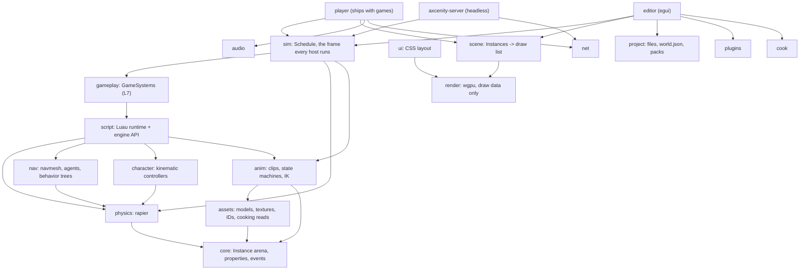

# Engine gap analysis and next-stage roadmap (2026-11)

Phases 1, 2 and 4 of Paul's "Feature Expansion, Competitive Analysis & Toolbox Integration" brief (2026-11-11): what Axcenity has against Unity, Unreal and Roblox Studio, where each system stands, and a prioritized plan. Phase 3 (the Axcenity Toolbox) is assessed in its own document by the Toolbox thread; section 5 holds the engine side and the slot its recommendation goes into.

Nothing here is implemented yet. Recommendation IDs are **G1–G16** (G for gap); they map to the existing IDs where one exists (C* from the [comparison doc](https://claude.ai/artifact/Avjn49acgsh72rxsZARD4D), L*/M* from [engine-modernization-report.md](engine-modernization-report.md), V* from [usability/design-system.md](usability/design-system.md)).

**Basis.** main at `2c030e2` (PR #88, 11 Nov 2026): source, `docs/`, the comparison doc and XB10k results (PR #80), the modernization report, the usability and design-system audits, `docs/rendering/performance.md`, and project memory. Peer facts are the vendors' claims as gathered for the comparison doc; no new peer engine was run. Every Axcenity claim names the file or doc it comes from.

## 1. Summary

Axcenity is far more complete than a feature list suggests. Of the 85 feature rows in section 3, **61 need nothing** (category A): the editor, rendering, animation, UI, networking and tooling already have what the brief lists, usually with tests and measurements behind them. The comparison doc also undersold a few things that already exist: runtime IK (`IKControl`, Phase 79), a script debugger with call stack and locals (v2 Phase 4), asset references by ID (#78) and the finished L7 move.

The gaps that matter are few, and most are about **how work is put together**, not missing rendering features:

1. **Scripts can't live inside objects.** Every Script is a file that becomes a child of ServerScriptService (`docs/project/world.md`, "Scripts"), and prefabs leave scripts and UI out (`project::write_prefab`). So a door can't carry its own door script, a prefab can't carry behavior, and a Toolbox model can't arrive working. Unity's components and Roblox's scripted Models both rest on this. **G2**, the most important finding.
2. **Asset providers are wired into the editor.** ambientCG is a 916-line dialog inside the `editor` crate with its own HTTP and zip code (`editor/src/ambient_cg.rs`); Poly Haven isn't in the engine at all. The Toolbox becomes the one provider layer (**G1**, with the Toolbox thread).
3. **Moving parts stutter above 60 fps.** Physics steps at a fixed 60 Hz and nothing interpolates between steps (`docs/architecture/physics.md`). **G3**.
4. **The built-in code editor has no completion or diagnostics.** Autocomplete exists only through VS Code and luau-lsp (`editor/src/autocomplete.rs`). Roblox Studio's biggest scripting advantage. **G4** (C3).

Priority 2 is a short list of real capability gaps: debugger stepping, a memory breakdown, audio occlusion and roll-off curves, upscaling, UI prefabs, and the already-planned L6, M9 and C9 work. Priority 4 records what was considered and deliberately left out (dynamic GI, ray tracing, Team Create, an AI assistant, Parallel Luau, internet hosting and others), each with the trigger that would bring it back.

**No system needs complete replacement** (category E) except the ambientCG HTTP client itself, which the brief asks to move behind the Toolbox; its dialog's features are kept.

**Decisions needed from Paul** (section 7): how scripts inside objects are stored (G2), whether interpolation is on by default (G3), how diagnostics are computed (G4), and the Toolbox architecture (G1, from the Toolbox thread).

## 2. How the engine is built (Phase 2)

### 2.1 Layers

28 crates, about 446k lines of Rust (editor 177k, render 34k, script 46k). The full ownership table is [../architecture/crates.md](../architecture/crates.md); the shape:

Rules the code enforces: `render` never sees Instances; `player` never depends on `editor`, `egui`, `blocks`, `plugins` or `cook` (`scripts/check-platform.sh`); one scripting runtime, which blocks and graphs translate into.

### 2.2 Frame and hosts

One data-driven schedule (`sim/src/steps.rs`, M1) runs in the player, editor Play, the dedicated server and the test runner, with a golden-order test. Physics runs fixed 60 Hz steps from an accumulator (`physics/src/lib.rs` `step`, up to 10 a frame). The draw list is retained and invalidated by revisions (M4).

### 2.3 Engine and editor

There is no engine/editor boundary to cross: the editor links the engine crates and runs Play as an in-process `Session` with its own `Sim`, physics and audio (`docs/architecture/play-mode.md`). Edits go through `EditorApp::change` into the undo `History`. This keeps Play instant and makes engine crashes in Play recoverable (`play::guard`), at the cost of one large `editor` crate: 177k lines, and `EditorApp` has 118 fields. L6 (split the editor) is the planned answer.

### 2.4 Assets

`assets::Assets` loads models (glTF, GLB, FBX), textures, skies, sounds and fonts from the project; M5 made loading async with tickets; L2 added cooking (BC7/BC5 `.axtex`, cooked `.axmodel`, offline LODs) and stable `ax://` IDs in sidecars, accepted wherever a path is. Built games ship cooked files in an `.axgame` pack (M9).

### 2.5 Extension points

- **Lua editor plugins** (`plugins` crate, `docs/editor/plugins.md`): toolbars, dock widgets made of UI Instances, selection, undo waypoints, settings, project files with a permission, viewport mouse.
- **GameSystems** (`script/src/system.rs`, L7): how engine features add services, methods, fields and frame steps without growing `ScriptRuntime`.
- **No native extension ABI**: Rust changes mean an engine build. Kept that way (section 6).

### 2.6 Public interfaces

The Luau API (Roblox-shaped, documented in `script/src/definitions/docs.rs`, written to `definitions/axcenity.d.luau` for luau-lsp and to the editor's API Reference page); the file formats (`world.json`, `*.prefab.json`, `.axpkg`, `.axgame`, sidecars), each versioned; and the CLI flags of the player, server, test runner and editor (`--build-game`, `--bench`).

### 2.7 Structural observations

- `script` depends on `physics`, `nav`, `character`, `procedural`, `mesh_edit` and `save` (`crates/script/Cargo.toml`). After L7 that is the API surface, not game logic; nothing measured makes it a problem, so no change is proposed.
- Provider code (HTTP, zip) lives in the editor crate (G1).
- rayon's global pool oversubscribes Paul's 32-thread desktop; physics now has its own pool (#86). Capping the global pool is the physics thread's open follow-up, not repeated here.
- Property storage (L1) was measured as not the bottleneck (about 9% of S10k instructions). Unchanged.

## 3. Feature-by-feature analysis (Phase 1)

Each row answers the brief's six questions in short: what the reference engines do and the problem it solves; what Axcenity has and how good it is; and whether doing more would help. **Cat.** is the brief's category: A existing, B enhancement, C usability redesign, D refactor, E replacement, F new. A row with a G ID has a full entry in section 4.

### 3.1 Editor and development experience

| Feature | Reference engines | Axcenity today | Cat. | Verdict |
|---|---|---|---|---|
| Scene hierarchy | Unity Hierarchy, Unreal Outliner, Roblox Explorer: tree, search, drag to reparent | Explorer with drag, rename, tags, arrow keys (V6), row cache: 10k rows 75 → 0.15 ms (V7); Ctrl+K search over objects (#76) | A | Done |
| Inspector | Unity Inspector, Unreal Details, Roblox Properties: typed fields, search, multi-edit | Properties with descriptions, filter, reset, changed marks (U*, V9), multi-select editing (V5), live editing in Play with Keep (`play/kept.rs`) | A | Done |
| Scene and game views | Unity splits Scene and Game views; Unreal and Roblox play in the level viewport | One viewport for editing and Play, as Roblox; debug view modes, culling view, LOD legend | A | Roblox's model fits the audience |
| Gizmos and transforms | Move/rotate/scale handles, local/world, pivots, snapping | Studio's five tools plus F3X axes and pivot modes, surface, collision and snap-point snapping, join surfaces, view cube (`docs/editor/transforms.md`) | A | Ahead of Studio |
| Undo and history | Unity Undo, Unreal transactions, Roblox ChangeHistoryService | Every edit undoable, named steps, Undo History jump list, per-script undo for blocks and graphs, plugin waypoints; version history and checkpoints | A | Done |
| Prefabs | Unity prefabs with overrides, variants, nesting; Roblox Packages | Linked copies, bold overrides with revert and apply, variants, nested prefabs (Phase 49) | A / **G2, G5** | Mechanism done, but **scripts and UI are left out** of prefabs |
| Asset import | Unity/Unreal importers with settings; Godot `.import` | Import dialog, glTF/GLB/FBX, cooked BC7/BC5, cooked models, LODs, stable IDs (L2) | A | Done |
| Project organization | Folders, labels, references, move-safe GUIDs | Assets panel with categories, model folders as packages, Find References, rename-safe IDs, global assets library, `.axpkg` | A | Toolbox collections extend it (G1) |
| Editor extensibility | Unity editor scripting, Unreal modules, Roblox plugins | Lua plugins: toolbars, dock widgets, selection, undo, settings, files, mouse | B, **G10** | Missing custom property editors, viewport drawing and importer hooks; add on demand |
| Code editing in the editor | Roblox Script Editor: autocomplete, type checking; Godot's built-in editor | egui `TextEdit`, hand-written highlighter, Find in Scripts, error links; completion only in VS Code | B, **G4** | P1 |
| Script debugger | Breakpoints, stepping, watches, call stack | Breakpoints, pause, call stack with locals, Continue (`script/src/debugger.rs`); no stepping | B, **G6** | P2 |
| Simulate without a player | Roblox "Run" (F8); Unity Play without a player object | Not found: Play always spawns the player when the game has one | F, **G14** | P3 |
| Live collaboration | Roblox Team Create, Unreal Multi-User | None; git-friendly text files and local version history | F | P4: needs a server and accounts |
| AI assistant | Roblox Assistant, Unity AI, Unreal AI Assistant | None | F | P4 (section 6) |
| Editor build speed | n/a (binary editors) | 5–6 s incremental rebuilds of a 177k-line crate | D, **G11** (L6) | P2, after M12 |

### 3.2 Rendering and graphics

Renderer performance work (#83, #88, vegetation phases 1–6, L4, M4) is not revisited. These rows look at features.

| Feature | Reference engines | Axcenity today | Cat. | Verdict |
|---|---|---|---|---|
| Materials and PBR | Shader graphs (Unity, Godot), Substrate (Unreal 5.7) | PBR presets, material files, surface shaders, material graphs, toon/ramp/rim/outline models | A | Done |
| Lights and shadows | Clustered forward, cascades, MegaLights (beta) | Tiled forward to 1,024 lights, point/spot/rect shadows, 4 cascades to 4096², contact shadows | A | Many-shadowed-lights tech is P4 |
| Global illumination | Lumen, SDFGI/VoxelGI, APV, lightmaps | Baked light probe volumes (no lightmap UVs needed), stale-bake warnings, optional real-time probe GI (off by default) | A | Dynamic GI is P4 |
| Reflections | Reflection probes, SSR, Lumen reflections | Baked reflection probes with blend distance; SSR on water | A | General SSR P4 |
| Post-processing | Volumes, bloom, grading, DoF, TAA, upscalers | Bloom, tone mapping, LUT grading, DoF, motion blur, TAA, graphics volumes; render scale but **no upscaler** | B, **G9** (C5) | P2 |
| Particles | Niagara, VFX Graph, GPUParticles | CPU and GPU particles (100k in 0.23 ms), weather, wind | A | Node-based VFX authoring P4 |
| Environment | Sky atmosphere, volumetric clouds, fog, water | Hillaire atmosphere, time of day, clouds, weather, volumetric fog, sun shafts, water | A | Done |
| Terrain and foliage | Unity Terrain, Unreal Landscape + PCG | Sculpt, erosion, paint, painted foliage with LOD, cull distance and `SHADOW_REACH` | A | Vegetation thread follow-ups only |
| LOD | Auto LOD, Nanite, HLOD | Offline LODs by screen size with dithered fades and hysteresis, LOD inspector and report | A | Per-category thresholds and leaf-card LOD are vegetation follow-ups (`performance.md`, "Limitations") |
| Occlusion culling | Hi-Z / GPU occlusion | Deliberately not built: measured to save at most 1.9 ms in a best-case scene and cost more elsewhere (`performance.md`, Phase 15) | A | Revisit on the stated trigger |
| GPU-driven drawing | Nanite, GPU Resident Drawer | CPU-planned instancing | D (L5) | P4: after M12, when a big-world scene needs it |
| Skinning | GPU skinning | GPU skinning (graphics Phase 14) | A | Done |
| Ray tracing | Unreal, HDRP | None | F | P4, policy |

### 3.3 Physics and world simulation

| Feature | Reference engines | Axcenity today | Cat. | Verdict |
|---|---|---|---|---|
| Rigid bodies | PhysX, Chaos, Jolt | rapier, assemblies from welds, materials, velocities, impulses, own thread pool | A | Step speed is the physics thread's |
| Render interpolation | Unity `Rigidbody.interpolation`, Godot physics interpolation, Unreal async physics smoothing | None: above 60 fps parts move in 60 Hz steps | B, **G3** (C2) | P1 |
| Collision management | Layers and masks | 32 collision groups with editor window, CanCollide sensors, CanTouch, Touched/TouchEnded | A | Done |
| Character controllers | CharacterController, CharacterMovementComponent, Humanoid | Kinematic third/first-person controllers, Humanoids, server movement check | A | Done |
| Joints | Hinge, ball, prismatic, spring, rope | Seven constraint types with motors, limits, breaking; ragdolls | A | Done |
| Vehicles | Chaos Vehicles, WheelCollider | Ray-cast vehicle controller, VehicleSeat, wheels | A | Done |
| Spatial queries | Raycast, shapecast, overlap | `raycast`, `shapecast`, `parts_in_box/radius/part` with filters | A | Done |
| Physics debugging | Collider, contact and sleep views (PhysX Visual Debugger, Chaos Visual Debugger) | Collider wireframes, ray lines, Size boxes; no contacts, sleeping or center of mass | B, **G15** | P3 |
| Simulation testing | Play-mode tests, automation | Game tests (`*.spec.lua`, Tests panel, `axcenity-test`, JUnit) | A | Done |

### 3.4 Animation

| Feature | Reference engines | Axcenity today | Cat. | Verdict |
|---|---|---|---|---|
| Authoring | Unity Animation window, Sequencer, Roblox Animation Editor | Animation panel with Record, property and bone tracks, posing, sequencer for cutscenes | A | Done (usability pass AN1–AN8) |
| State machines and controllers | Mecanim, Animation Blueprints | State machines with Any State, conditions, exit times, priorities; layers with masks | A | Done |
| Blending | Blend trees, blend spaces | 1D blend trees and 2D Delaunay blend spaces with matched pass lengths | A | Done |
| Inverse kinematics | Control Rig, Animation Rigging, Roblox IKControl | `IKControl` Position/Rotation/Transform/LookAt with pole and smoothing, foot placement (Phase 79) | A | Comparison doc said "behind"; it isn't |
| Retargeting | Unreal IK Retargeter, Humanoid Avatars | Mixamo-named template only; clips bind by bone name | F, **G16** | P3 |
| Procedural | Physical animation, Control Rig | IK, LookAt, ragdolls with get-up blending, root motion | A | Active ragdolls P4 |
| Events | Animation events, notifies | Clip events, `AnimationEvent`, `KeyframeReached`, markers | A | Done |

### 3.5 Audio

| Feature | Reference engines | Axcenity today | Cat. | Verdict |
|---|---|---|---|---|
| Spatial audio | 3D panning, attenuation | Kira spatial tracks, listener at the camera | A | Done |
| Attenuation curves | Roblox `RollOffMode` (Inverse, Linear, tapered), Unity custom curves | Linear only, from `RollOffMinDistance` to `RollOffMaxDistance` | B, **G8** | P2 (small) |
| Environmental effects | Reverb zones, snapshots | ReverbZones with seven presets and fades; per-Sound and per-group effects | A | Done |
| Mixing and routing | Mixer groups, MetaSounds, SoundGroups | SoundGroups as nested buses, eight effect types, meters, Mixer panel, auto-generated settings UI | A | Done |
| Occlusion | Steam Audio, Wwise obstruction, Unreal occlusion | None: walls don't muffle sounds | F, **G8** | P2 (small) |
| Doppler | Unity, Unreal | None | F | P4 |
| Debugging | Wwise profiler, audio visualizers | Spatial-sound markers overlay, meters, Profiler audio section | A | Done |

### 3.6 Scripting and programming

| Feature | Reference engines | Axcenity today | Cat. | Verdict |
|---|---|---|---|---|
| Luau integration | Roblox Luau with native code | Luau, `safeenv` sandbox, `--!native` (3.1× / 6.2× on the numeric bench), watchdog | A | Native `vector` on hold by policy |
| Scripts attached to objects | Unity components; Roblox scripts in Models | **Not possible**: scripts live only in three services | B/D, **G2** | P1 |
| Debugging | Breakpoints, stepping, watches | See 3.1 | B, **G6** | P2 |
| Runtime inspection | Live Explorer/Properties in Play | Live Explorer and Properties, Keep changes, Lua console with completion, F9 developer console in games | A | Done |
| Events | Signals, BindableEvents | Events, BindableEvent/Function, Remote*, CollectionService tag signals | A | Done |
| Component communication | Messages, interfaces | Attributes, tags, Bindables, ModuleScripts, GameSystems | A | Done |
| API documentation | Generated references | Generated API Reference page and luau-lsp definitions from one source; wiki in progress | A | Docs site is C8 (wiki thread) |
| Libraries | TweenService, PathfindingService, packages | Tween, pathfinding, data tables, saves, dialogue/quests, abilities, tools | A | Done |
| Script parallelism | Parallel Luau, jobs | None | F | P4: scripts are 0.74 ms of XB10k |

### 3.7 UI and interface development

| Feature | Reference engines | Axcenity today | Cat. | Verdict |
|---|---|---|---|---|
| Authoring | UMG, UI Toolkit, Roblox UI editor | UI Designer (rulers, anchors, states, bevel, slice, text toolbar), UI Event Graphs | A | Done (UD1–UD10) |
| Layout | Flex, grids | CSS subset with flexbox via `taffy`, M14 layout cache (500 elements 3.6 ms) | A | Done |
| Responsive scaling | Canvas Scaler, UIScale | UDim2 scale, `aspect-ratio`, `ScreenInsets`, `TextScaled`, player text scale | A | Done |
| Anchoring | Anchors, constraints | Anchors in UDim2 with anchor diamonds | A | Done |
| UI animation | Tweens, transitions | CSS transitions, TweenService, Animator clips on UI, reduced-motion setting | A | Done |
| Input | Input System, Enhanced Input, ContextActionService | UserInputService, ContextActionService, rebinding saved as settings, gamepad focus navigation | A | Done |
| Reusable components | Prefabs (Unity UI), packages | No UI prefabs (`write_prefab` leaves UI out); copy and paste only | B, **G5** | P2, after G2 |

### 3.8 Multiplayer and networking

| Feature | Reference engines | Axcenity today | Cat. | Verdict |
|---|---|---|---|---|
| Testing | Play with several clients, network emulation | Play with several clients, emulated latency/jitter/loss | A | Done |
| Client/server | Server-authoritative | Every game is server + clients; listen and dedicated servers | A | Done |
| Replication | Replication graphs, StreamingEnabled | Quantized motion within a budget, streaming by radius, network ownership | A | Done |
| Remote communication | RPCs, RemoteEvents | RemoteEvent and RemoteFunction with Roblox shapes | A | Done |
| Server simulation | Dedicated servers | `axcenity-server` headless | A | Done |
| Network debugging | Network profiler | Profiler Network section, round trips, bytes per frame | A | Done |
| Sessions | Lobbies, matchmaking, teleport | LAN discovery, passwords, max players, kicks; no hosting by policy | A | Hosting P4 (M11) |
| Scale | Large lobbies | Measured to 8 loopback players | B, **G13** (C9) | P2 |

### 3.9 Development and debugging tools

| Feature | Reference engines | Axcenity today | Cat. | Verdict |
|---|---|---|---|---|
| CPU profiling | Unity Profiler, Unreal Insights | Profiler panel per frame step, Tracy, `--bench` harness and `axcenity-bench-check` baselines | A | Done |
| Memory profiling | Memory Profiler, Memory Insights | Process memory, both Lua heaps, texture budget, render buffer bytes; no breakdown by kind | B, **G7** | P2 |
| GPU diagnostics | GPU timings, RenderDoc | Per-pass GPU timers, cascade times, overdraw numbers, debug views, LOD inspector | A | Done |
| Scene inspection | Live hierarchy | See 3.6 | A | Done |
| Logging | Console, log files | Output with error links, Console tab error count, F9 console, player log files and crash message | A | Done |
| Build and packaging | Build settings, installers | Build Game, `.axgame` v2, installers for three OSes, `check-packages.py`; games still ship source textures beside cooked ones | B, **G12** (C4/M9) | P2 |
| Automated tests | Test runners | Game tests plus 3,184 engine tests; CI off by policy | A | Done |

### 3.10 Other categories from the comparison

| Feature | Axcenity today | Cat. | Verdict |
|---|---|---|---|
| Asset marketplace / discovery | ambientCG textures only, inside the editor | E/F, **G1** | P1, with the Toolbox |
| Learning material | 67 examples, Learn page, API Reference, wiki in progress | A | C8 belongs to the wiki thread |
| Platforms | Windows, Linux, macOS | A | Mobile, web, consoles deferred by policy |

## 4. Recommendations (Phase 4)

Each entry gives the brief's Phase 4 fields and the Phase 2 questions (where it lives, who depends on it, whether the architecture supports it, added complexity, compatibility, testing). Effort: S days, M 1–3 weeks, L a month or more.

### Priority 1: foundations

#### G1. Toolbox foundation: one provider layer for asset discovery

- **Now**: `editor/src/ambient_cg.rs` (916 lines) calls ambientCG's API with `ureq`, downloads zips, extracts them into `assets/textures/<id>/` and writes a `.texture.json` with `provider` and source URL (`assets/src/texture_set.rs`). Previews, paging and resolution choice are in the same file. Poly Haven has no engine code. Two more client sets exist outside the engine: the Toolbox's (Django: ambientCG, Poly Haven, Openverse) and the "3D Models" Blender pipeline's (Python: ambientCG, Poly Haven, Kenney, plus Freesound downloads and a shared asset record).
- **Inspiration**: Roblox Toolbox (search, insert, attribution in one panel); Unity Asset Store window; Fab in Unreal.
- **Limitation**: each provider would be another editor file with its own HTTP, cache and metadata; nothing is shared with the Toolbox or the asset pipeline.
- **Proposal**: the Toolbox thread's architecture decides where providers run (section 5). The engine side, whatever that decision: an editor-only crate (like `cook`) that owns the provider interface the editor calls (search, metadata, preview, download), moves `ureq` and `zip` out of `editor`, and lands every download through the existing import paths (texture sets, the Import dialog for models, `assets/sky` for HDRIs, `assets/audio`), with the provider, license and attribution kept in the asset's sidecar. The ambientCG dialog's behavior (exact package or none, zip-slip checks, preview pool, staging then replace) is kept and becomes the first provider's tests.
- **Category**: E for the HTTP client, D for the dialog, F for the Toolbox panel.
- **Depends on**: the Toolbox thread's proposal and Paul's sign-off on it; G2 for models that carry scripts.
- **Who depends on it**: Assets panel (`asset_browser.rs`), texture sets (materials in `app/material_files.rs`, terrain layers in `app/terrain/layers.rs`), Import dialog, sky picker, Sound.
- **Fits the architecture**: yes; the cook crate is the precedent for an editor-only crate the player never links (`check-platform.sh` gains the new crate).
- **Compatibility**: existing `.texture.json` files keep loading; the sidecar gains optional fields.
- **Complexity**: M for the engine side.
- **Risks**: provider rate limits and API changes; licensing must be shown before download.
- **Tests**: the dialog's current tests move to the provider; a fake provider for UI tests; downloads produce the same files as today; the player still has no HTTP or zip dependency.

#### G2. Scripts inside objects

- **Now**: `scripts/**/*.server.lua` become Scripts in ServerScriptService, `*.client.lua` LocalScripts in StarterPlayerScripts, `*.module.lua` ModuleScripts in ReplicatedStorage (`docs/project/world.md`). `world.json` may not contain scripts, and `write_prefab` leaves them out (`project/src/world_file.rs`). The runtime already runs scripts elsewhere: UI Event Graphs compile to a LocalScript under a ScreenGui, and cloned scripts start (`fire_changes`). The world-file doc already notes "putting a script inside a part can be added later as a world-file reference without breaking this layout".
- **Inspiration**: Roblox (a Model carries its scripts; `script.Parent` is the object; Toolbox models arrive working); Unity (behaviors are components on the GameObject and travel with prefabs).
- **Limitation**: reusable interactive objects need a central script plus tags. Prefabs, `.axpkg` packages and Toolbox models can't carry behavior.
- **Proposal**: a Script, LocalScript or ModuleScript may sit under any Instance. `world.json` and prefab files hold a reference node (class, name, `Source`: a project path to the `.lua` or `.blocks.json` file, or its `ax://` ID); the code stays a file, so git and the code editor keep working. Prefab copies share the file (one door script, many doors), as Unity shares a script asset. Insert Script on a part creates `scripts/<Model>/<Name>.server.lua` and the reference. Run rules follow Roblox: server Scripts run wherever they are in the Workspace; LocalScripts run only where they already do plus inside ScreenGuis and the character. Existing projects don't change.
- **Category**: B (feature) with D (world-file format).
- **Depends on**: Paul's choice of storage (section 7).
- **Who depends on it**: `project` (load/save, prefabs, packages, `asset_refs`), `script` (start order), `editor` (Explorer insert, script tabs, Find in Scripts, rename, live reload, Asset Check), `testing`, `player`, `server`, `net` (replicas never run server Scripts).
- **Fits the architecture**: yes; the runtime side exists, the work is the format and the editor.
- **Compatibility**: older projects load unchanged; a project using references bumps the project format so an older editor refuses it instead of dropping scripts.
- **Complexity**: M–L (2–4 weeks).
- **Risks**: start order (proposal: the three services first, as now, then the Workspace in tree order); scripts from the Toolbox run code from the internet, so an inserted model lists its scripts and asks before keeping them; streaming must not start a script inside a model that hasn't streamed in.
- **Tests**: world and prefab round trips; a prefab copy's script runs per copy with its own `script.Parent`; package export brings script files; rename and Find in Scripts follow references; live reload in Play; same start order in player, server, test runner and editor Play (golden test); replicas don't run server Scripts.

#### G3. Physics render interpolation (C2)

- **Now**: `Physics::step` runs 0 to 10 fixed steps a frame and writes poses to the world after the last (`physics/src/lib.rs`). At 144 or 240 fps most frames run no step, so falling and spinning parts move in visible 60 Hz jumps. Characters are kinematic and move every frame, so the player sees smooth characters next to stepping props. Replicas already smooth parts on clients (`net`).
- **Inspiration**: Unity's per-body interpolation, Godot 4.3+ physics interpolation, Unreal's async-physics smoothing.
- **Proposal**: physics keeps each moved body's pose before and after the last step (it already gathers `motions_before_step` for fractures) and the fraction of a step left over. The draw list draws moved parts at the blended pose; the world, scripts, touches and the network keep the stepped values, so game logic and results don't change. Teleports (a script setting `Position`) snap, as now. A Workspace property turns it off.
- **Category**: B.
- **Depends on**: nothing; coordinate with the physics thread (same crate).
- **Who depends on it**: `scene` draw list (M4's retained items: blended parts are re-planned while moving, as moving parts already are), player and editor Play hosts, the camera when it follows an unanchored part. Server and test runner untouched (they don't draw).
- **Fits the architecture**: yes; it's render-only data passed beside the world, like poses for skinning.
- **Compatibility**: no file or API change; results identical.
- **Complexity**: S–M (1 week).
- **Risks**: double smoothing on network replicas (skip parts the network already smooths); welded assemblies must blend as one.
- **Tests**: a falling part drawn at 240 fps sits between its step poses; scripts read stepped values; teleports don't blend; the golden frame order is unchanged; XB10k and S10k benches don't move beyond noise.

#### G4. Script completion and diagnostics in the editor (C3)

- **Now**: code tabs are egui `TextEdit` with `lua_syntax.rs` highlighting. The Lua console already completes Instance paths, properties, globals and built-ins (`editor/src/console.rs` `complete`). The API's types live in `script/src/definitions/tables.rs`. Type checking needs VS Code and luau-lsp (`autocomplete.rs` sets that up).
- **Inspiration**: Roblox Studio's Script Editor (autocomplete, the new type solver, inline errors).
- **Proposal**: stage 1, completion in code tabs from the console's completer and the definitions tables (members of a typed value, `game:GetService` names, Instance paths, Enum items), with a popup and signature hint; no new dependency. Stage 2, diagnostics underlined in the tab and listed in Output: either run luau-lsp (already the project's language server) as a child process, or compile Luau's analysis library. Paul picks (section 7).
- **Category**: B.
- **Depends on**: M12's egui 0.36 (the text widget changes); do stage 1 after M12 merges.
- **Who depends on it**: script tabs, block editor Lua view, plugins' Lua.
- **Fits the architecture**: stage 1 reuses existing pieces; stage 2 adds a process or a C++ library.
- **Compatibility**: none affected.
- **Complexity**: stage 1 M (2 weeks), stage 2 M.
- **Risks**: typing latency in large scripts (complete only on demand and on `.`/`:`); luau-lsp version drift (pin it with `luau0-src`).
- **Tests**: completion lists for representative positions; no frame over a budget while typing in a 5,000-line script; diagnostics match luau-lsp's on a sample project.

### Priority 2: major enhancements

| ID | Item | Now → proposal | Cat. | Depends on | Effort | Benefit | Risk | Tests |
|---|---|---|---|---|---|---|---|---|
| G5 | UI prefabs | `write_prefab` leaves UI out → ScreenGuis and UI elements save as prefabs with their LocalScripts (after G2) | B | G2 | S–M | Reusable menus, HUD widgets, Toolbox UI kits | Low | UI prefab round trip; overrides on UI properties |
| G6 | Debugger stepping and watches | Breakpoint, locals, Continue → Step Over/Into/Out on the existing Luau step hook (`script/src/debugger.rs`), watch expressions, pause on error | B | none | M | Real debugging without print | Medium: the only `unsafe` code is there | Step tests across coroutines, `task.wait`, pcall and module calls |
| G7 | Memory breakdown | Process memory, Lua heaps, texture budget → Profiler Memory tab and F9 page: textures, meshes, GPU buffers, Instances by class, audio, physics colliders, asset caches | B | none | S–M | Find what fills memory in big projects | Low | Totals match known scenes (S10k, Farmhouse) |
| G8 | Audio occlusion and roll-off | Linear roll-off, no occlusion → `RollOffMode` (Inverse, Linear, InverseTapered as Roblox) and occlusion from a physics ray per spatial Sound, throttled, applied as volume and low-pass | B/F | none | S–M | Sounds behave like Roblox users expect; walls muffle | Low: ray cost bounded per frame | Roll-off values; a wall between listener and Sound lowers it; cost on hello-mixer |
| G9 | Upscaling (C5) | Render scale with linear resampling in the composite pass (plus an optional `SharpenEffect`) → FSR 1-class spatial upscale and sharpen (MIT shader) when render scale < 1, then upscale inside TAA's resolve | B | M12 | M | Big GPU savings at 1440p and up (the dry patch is GPU-bound at 11.3 ms) | Medium: ghosting in stage 2 | Pixel references per preset; GPU time at 0.67 and 0.5 scale |
| G11 | Split the editor (L6) | 177k-line crate, 118-field `EditorApp` → sub-crates behind an `EditorContext`, one panel family per PR | D | after M12 | L | Faster rebuilds, enforced boundaries | Medium | Existing editor tests; rebuild time before and after |
| G12 | Cooked-only games (C4, M9) | Games ship source textures beside cooked ones → ship cooked only, read the pack in place | B | none | S–M | About half the size | Low | `check-packages.py`; built games run |
| G13 | 16–32 client LAN test (C9) | 8 loopback players measured → a real LAN run with server and bandwidth numbers | B | Paul's machines | S | Proves the multiplayer claim | Low | Bench lines per client count |

### Priority 3: quality of life

| ID | Item | Proposal | Cat. | Effort |
|---|---|---|---|---|
| G10 | Plugin API additions (C7) | Viewport drawing (lines, boxes, handles), custom property rows, importer hooks; each added when a real plugin or Toolbox provider needs it | B | M |
| G14 | Run without a player | Roblox-style Run: Play with physics and Scripts but no character, camera stays the fly camera | F | S |
| G15 | Physics debug views | Contacts, sleeping bodies, centers of mass and assemblies in the Overlays menu | B | S |
| G16 | Humanoid retargeting | A bone map plus rest-pose correction so clips play across rigs other than Mixamo's | F | M |

The vegetation thread's open LOD items (per-category thresholds, leaf-card LOD) and the physics thread's global-pool cap are theirs and not repeated.

### Priority 4: future, with triggers

| Item | Why not now | Bring it back when |
|---|---|---|
| GPU-driven drawing (L5) | M12 first; no big-world scene needs it yet | A large open-world benchmark is CPU-bound in drawing |
| Occlusion culling | Measured: at most 1.9 ms in its best case | An interior or city scene measures mostly hidden items |
| Dynamic GI (Lumen/SDFGI class) | Baked probes and optional real-time probe GI cover current games | Day/night games need moving indirect light at High |
| Hardware ray tracing, general SSR | Policy and cost | After L5 |
| Live collaboration | Needs accounts and a server | Internet hosting is on the roadmap |
| AI assistant in the editor | Needs a service, keys and a privacy decision | Paul wants it; the plugin API (G10) would host it |
| Parallel Luau | Scripts are 0.74 ms of XB10k | Scripts dominate a measured frame |
| Doppler, active ragdolls, motion matching, VFX graph | Little value for current games | A game needs one |
| USD, Alembic, `.blend` import | The Blender pipeline exports GLB already | A user workflow needs it |
| Internet hosting and security (M11), mobile, web, consoles, CI (M10), ECS, native extension ABI | Development policy | Next milestone review |

## 5. Toolbox integration (Phase 3, engine side)

The Toolbox assessment, the architecture choice (embedded, companion service, remote, hybrid) and the provider design come from the thread "Assess Toolbox and plan engine integration". This section is what the engine needs from that design, so the two documents meet; the recommendation will be linked here when it lands.

**Engine-side requirements**

- The editor stays usable offline: search needs the network, but everything downloaded works offline in the editor and the player, as ambientCG textures do today.
- The player never links provider code (same rule as `cook`).
- Downloads land through existing systems, not a parallel asset store:

| Asset type | Lands as | Existing system |
|---|---|---|
| Textures and materials | `assets/textures/<id>/` + `.texture.json`, optional `.material.json` | Texture sets, material editor, terrain layers, cooking (BC7/BC5) |
| HDRIs | `assets/sky/` (`.hdr`, `.exr`) | Lighting `SkyImage` picker, probes |
| Models | Import dialog → `assets/models/<name>/`, cooked `.axmodel`, LODs | L2 pipeline, Model Studio, prefab placing |
| Audio | `assets/audio/` (WAV, FLAC, OGG, MP3) | Sound, SoundGroups |

- Every downloaded file gets its `ax://` ID sidecar (L2) and records provider, source URL, author, license and attribution text there, so Asset Check and Build Game can list attributions.
- The Assets panel stays the one place assets are browsed; the Toolbox is a panel beside it whose results drop into the viewport and Assets panel by the same drag-and-drop (`DropTarget`) as tiles.
- Favorites, collections, history and download records live in the editor's data folder (beside Global Assets), not in projects.
- Models with scripts need G2 before they arrive working.

## 6. What stays as it is

Most of what the brief asks to examine is category A. In particular, keep: the Instance tree without an ECS; the one-viewport Roblox workflow; the CSS UI system; Lua plugins rather than a native ABI; baked probe lighting; the decision not to build occlusion culling; and the development policy's deferrals.

## 7. Decisions for Paul

1. **G2 storage**: scripts inside objects as references to files (recommended: keeps git, the code editor and blocks working) or as source inside `world.json`.
2. **G3 default**: interpolation on by default with a Workspace switch (recommended) or off by default.
3. **G4 stage 2**: diagnostics from luau-lsp run as a child process (recommended: already the project's language server, nothing to compile) or from Luau's analysis library compiled in.
4. **G1**: the Toolbox architecture from the Toolbox thread.

## 8. Proposed order

1. Now, independent of other threads: G3 (interpolation), G2 design note and then implementation, G7, G8.
2. After the Toolbox decision: G1, then G5.
3. After M12 merges: G4, G9, G11.
4. When the PC is free: G13.

Each item is one PR from main with tests first, docs updated in the topic file it changes, and benches before and after where it touches a frame step.

## Corrections to the comparison doc

- "Behind on runtime IK": runtime IK exists (`IKControl`, `anim/src/ik_control.rs`, Phase 79). Retargeting is the real gap.
- "References in worlds still name paths": references by `ax://` ID landed in #78.
- "L7 parts 1–3": L7 is complete (#85).
- The script debugger (breakpoints, call stack, locals) wasn't listed.
