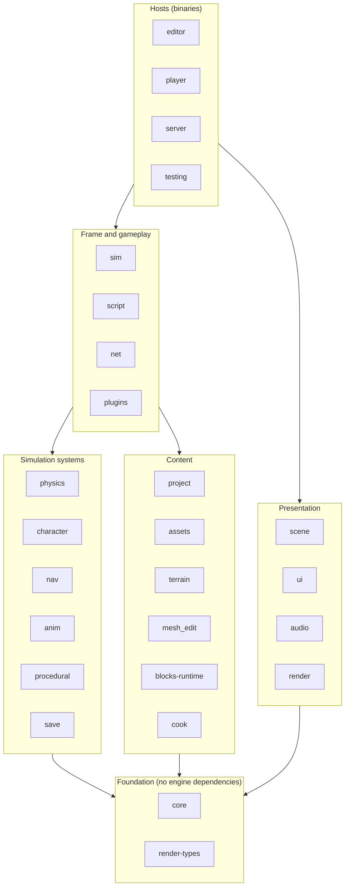
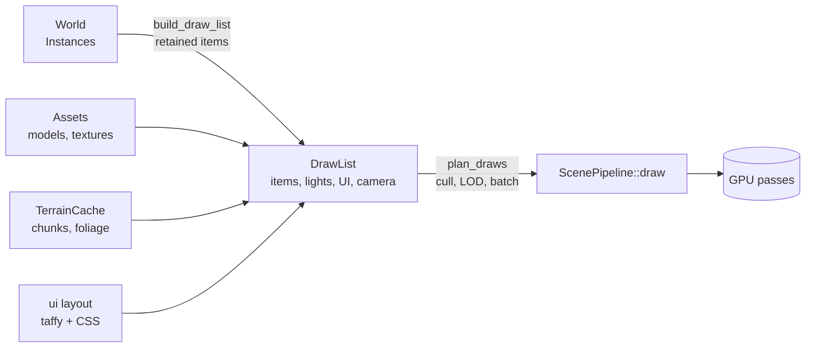
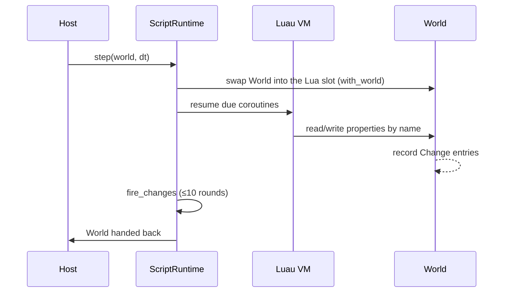

# Architecture overview

How Axcenity is layered, the rules that keep the layers apart, and how data moves between them. The crate-by-crate graph is [System dependencies](System-Dependencies.md); the frame is [Execution lifecycle](Execution-Lifecycle.md).

## Layers

This is a reading aid, not a rule; the rules are the crate edges in [System dependencies](System-Dependencies.md). The point it makes: the foundation knows nothing about the rest, simulation never reaches up into presentation, and only hosts tie presentation to simulation.

## The invariants

These come from the root `CLAUDE.md` and `docs/architecture/crates.md`, and each has an ADR.

| Rule | Why | Enforced by | ADR |
|---|---|---|---|
| `player` never depends on `editor`, `egui`, `blocks`, `plugins` or `cook` | Shipped games stay small and carry no editor code | `scripts/check-platform.*` ("The player has no editor code") | [ADR-0001](Architecture-Decisions/ADR-0001-Layered-Crate-Workspace.md) |
| `render` never sees Instances, scripts or the editor | One renderer for player and editor; GPU code testable on plain data | Crate dependencies (`render` depends only on `render-types`) | [ADR-0003](Architecture-Decisions/ADR-0003-Renderer-Consumes-Only-Draw-Data.md) |
| Instances live in a generational arena; no `Rc<RefCell>` tree | Cheap deep copies (Play, undo), IDs valid across the network, no borrow tangles | Code review; `World` owns everything | [ADR-0002](Architecture-Decisions/ADR-0002-Instance-Tree-In-A-Generational-Arena.md) |
| One scripting runtime; blocks and graphs translate to Lua | One behavior, one debugger, one sandbox | `blocks-runtime` emits Lua; `project` translates at load | [ADR-0004](Architecture-Decisions/ADR-0004-Luau-As-The-Only-Script-Runtime.md) |
| One frame order for every host | Editor Play behaves like the shipped game | `sim::STANDARD` and golden order tests | [ADR-0006](Architecture-Decisions/ADR-0006-One-Shared-Frame-Schedule.md) |
| The server links no window, GPU or audio | Starts on a Linux box with no display | `cargo tree -p axcenity-server -i wgpu` empty; `crates/server/tests/headless.rs` | [ADR-0001](Architecture-Decisions/ADR-0001-Layered-Crate-Workspace.md) |
| No dependency cycles; shared types go to `core` | Keeps the graph a DAG | Cargo | [ADR-0001](Architecture-Decisions/ADR-0001-Layered-Crate-Workspace.md) |
| Runtime file access goes through `assets` (saves excepted) | Portability; a game can't read outside its folder (`safe_path`) | `assets::safe_path` | [Platform support](Platform-Support.md) |
| Dependencies pinned in the workspace, Apache-2.0-compatible | Deliberate upgrades, clean licensing | Root `Cargo.toml`, `cargo hakari` | [Add a dependency](../Guides/Recipes/Add-a-Dependency.md) |
| Roblox-familiar names, never Roblox branding | Familiar to creators, legally clean | Review | [Scripting](../Engine-Systems/Scripting.md) |

## The main data flows

### World to pixels

`scene` owns the translation (`crates/scene/src/draw_list.rs`) and keeps each Instance's items between frames, rebuilding only what changed by `Instance::revision` (M4). See [Scene bridge](../Engine-Systems/Scene-Bridge.md) and [Rendering](../Engine-Systems/Rendering.md).

### Scripts to the world and back

Scripts never hold pointers into the World: a Lua Instance is an `InstanceId` in userdata, and every access goes through `World`. Changes are logged and fired deferred, after the script pauses ([ADR-0005](Architecture-Decisions/ADR-0005-Deferred-Change-Events.md)).

### Simulation to the network

The server runs the same `Sim`; `net::Network` diffs the World against what each player has (`Replicator`), sends reliable changes in postcard, and sends part motion quantized on the unreliable channel within each player's budget. A joined device is a replica World with the server's IDs. See [Networking](../Engine-Systems/Networking.md).

### Content to runtime

Project files load through `project` (deterministic JSON, migrations); assets through `assets` on worker threads; the editor cooks textures and models ahead into `.axcenity/imported/`, which `assets` prefers when current. See [Asset pipeline overview](../Asset-Pipeline/Pipeline-Overview.md).

## What makes it different from a generic engine

- **Roblox-style object model** rather than ECS or scene graph plus components. Behavior lives in scripts and in services inside `script`, not in components on objects.
- **Two Lua VMs per game** (server and client sides) even in single-player, which is a listen server; RemoteEvents cross between them the same way as over the network.
- **Text-first project format** with versioned migrations that keep a copy of the previous files.
- **The editor is a host**: every gameplay feature must work in Play exactly as in the player, which is why the frame order is data.

## Known structural weaknesses

From the modernization audit; see [Technical debt](../Roadmap/Technical-Debt.md).

- `editor` is one 168k-line crate with a 100+-field `EditorApp` (L6 plans sub-crates).
- `script` hosts most gameplay systems (health, tools, humanoids, quests, dialogue, saves, sequences); L7 plans a `gameplay` crate.
- Properties are a string-keyed `BTreeMap` per Instance; L1 (typed slots) was measured on 2026-11-10 at about 9% of an S10k frame and parked.
