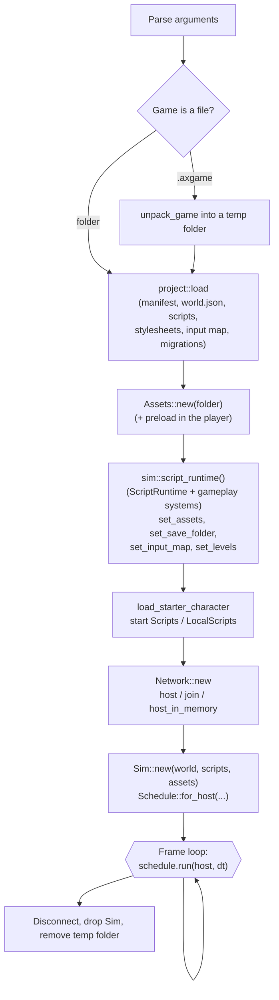
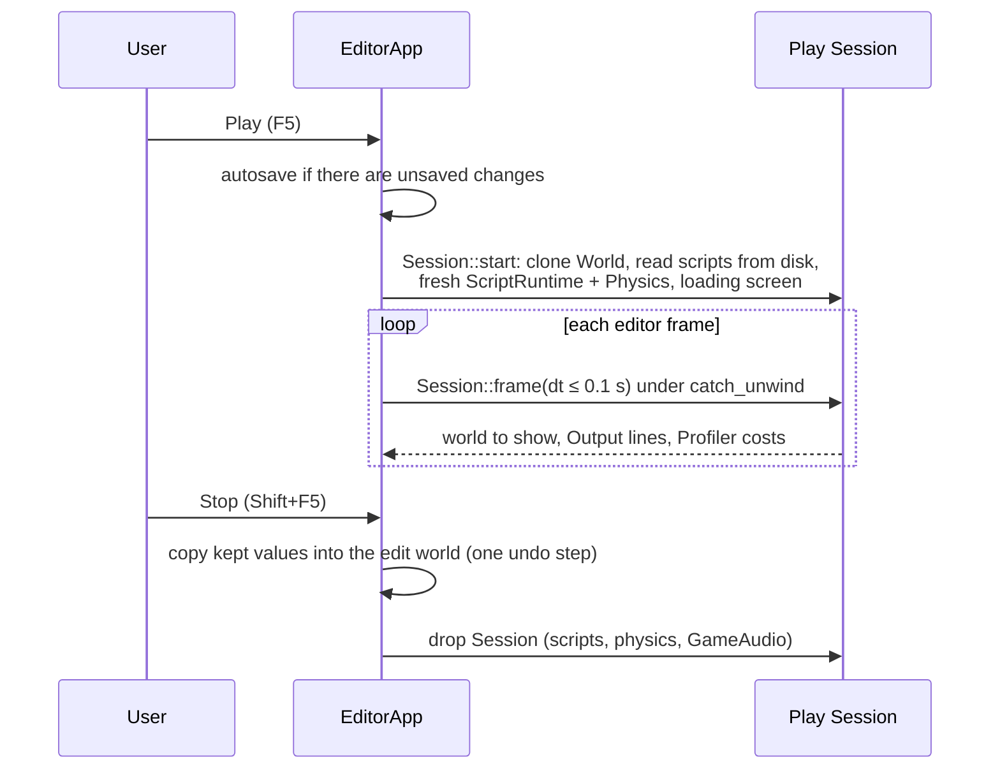
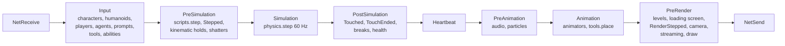

# Execution lifecycle

How each host starts, runs frames and stops. The frame itself is one table for every host; see [Frame schedule](../Engine-Systems/Frame-Schedule.md) for the step list and `docs/architecture/frame-loop.md` for why each step sits where it does.

## The common shape

`Sim` (`crates/sim/src/lib.rs`) bundles what every host simulates: the `World`, `ScriptRuntime`, `Physics`, `Controllers` (characters), `Agents` (navigation), `Animators` and `Assets`. `Sim::new` also shares one navigation mesh between agents and Humanoids (M13). What differs per host (input, sound, network, drawing, printing) goes through the `HostIo` trait (`crates/sim/src/host.rs`).

## Player (`axcenity-player`)

From `crates/player/src/main.rs`, `main`:

1. Install the logger and panic hook (`logs.rs`); parse `--host`, `--join`, `--password`, `--watch`, `--dev`, `--bench` (`watch.rs`).
2. Find the game: a folder argument, a `.axgame` file, or `game.axgame` next to the executable. Packed games unpack to a temporary folder (`PackedProjectFolder`, removed on drop). Version 2 packs restore modified times and unpack on several threads (M9).
3. `project::load`. A project from an older format is migrated; the player logs where the previous files were kept.
4. Start the game's log in the player's data folder (`save::game_folder`), decide whether the F9 console is allowed, report project problems, parse stylesheets.
5. Start the project's loading screen (`LoadingGui`) or the Axcenity splash.
6. `Assets::new`, then **`preload::Preload::start`** (I11): a thread reads the Workspace's models and textures while the window and GPU start.
7. Build the runtime with `axcenity_sim::script_runtime()` (the `ScriptRuntime` with every gameplay system, [Gameplay systems](../Engine-Systems/Gameplay-Systems.md)) and configure it (assets, save folder, user ID, saved graphics settings), pose Animators once, load the starter character, hand the levels over, **start scripts**.
8. Host or join if asked.
9. Create the winit event loop (`ControlFlow::Poll`) and `App`; each redraw calls `App::frame`, which runs the `PLAYER` schedule and renders.
10. On exit, disconnect from the network; report a loop error through the error path.

The loading screen holds until the preload is done; the first frame then uploads what it needs. Startup is measured as "launch to first frame" and "launch to assets in" ([Benchmarking](../Performance/Benchmarking.md)).

## Dedicated server (`axcenity-server`)

`crates/server/src/main.rs`: same load path, then `ScriptRuntime::set_dedicated` (no local player), start only `Script`s (LocalScripts are sent to clients), host on `--port` (or in memory with `--bench-clients n`), and loop: each frame runs the `SERVER` schedule with the real elapsed time capped at 0.1 s, or a fixed 1/60 s under `--bench`. It links no window, GPU or audio ([System dependencies](System-Dependencies.md#what-each-host-links)).

## Test runner (`axcenity-test`)

`crates/testing`: `Runner` lists `tests/**/*.spec.lua` and runs each `it` in a fresh headless `TestGame` (`crates/testing/src/game.rs`) at a fixed 1/60 s, through the `TEST` schedule, with no audio or drawing. `--bench <frames>` runs the start level as a benchmark host; `--make-s10k <folder>` writes the S10k scene. See [Testing strategy](../Development/Testing-Strategy.md).

## Editor (`axcenity-editor`)

`crates/editor/src/main.rs`:

- `--cook <folder>` cooks a project's textures and models and exits (1 on failure). `--build-game …` builds a game from the command line. Debug builds take `--resume <handoff>` after an engine rebuild (`relaunch.rs`).
- Otherwise `eframe::run_native` with the wgpu renderer. The device asks for `TIMESTAMP_QUERY` (Profiler) and `TEXTURE_COMPRESSION_BC` (cooked textures) where the adapter has them. The app installs the theme, loads settings, global assets and plugin data, starts **background cooking**, and opens the project on a background thread so the window shows at once.
- Each egui frame: `EditorApp` lays out panels, the viewport draws through `TextureRenderer` on eframe's device, and during Play `Session::frame` runs the `EDITOR_PLAY` schedule.

### Play and Stop

A panic in `Session::start` or `Session::frame` throws the session away and reports "The engine crashed during Play" in Output. Several clients (1–8) run as several `Session`s over the in-memory loopback (`play/multi.rs`). Details: `docs/architecture/play-mode.md`.

## The frame, briefly

Change events (`Changed`, `ChildAdded`, …) fire before and after every step that runs scripts, so physics' writes fire at the start of the post-simulation stage ([ADR-0005](Architecture-Decisions/ADR-0005-Deferred-Change-Events.md)). Time is game time: hosts pass the frame's seconds, capped at 0.1 s.

## Shutdown

| Host | On exit |
|---|---|
| Player | `Network::disconnect`; `Saves` flushes per-player data on drop; the temporary unpacked folder is deleted |
| Server | Same; `Unpacked` removes its temp folder on drop |
| Editor Play | Stop drops the `Session`: scripts, physics, the Play `GameAudio` (silencing its sounds) |
| Editor | eframe persists layout and settings; background threads (cooking, watcher) stop with the process |

## Related

[Frame schedule](../Engine-Systems/Frame-Schedule.md) · [Threading model](Threading-Model.md) · [Editor architecture](../Editor/Editor-Architecture.md) · [Networking](../Engine-Systems/Networking.md)
