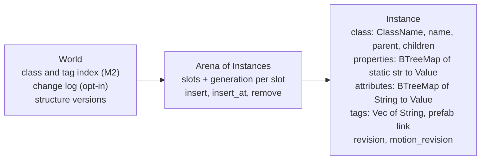

# Memory architecture

Axcenity has no custom allocator or memory manager. Memory is plain Rust ownership: one owned `World`, `Arc` handles for shared immutable asset data, and caches that free what hasn't been used recently. This page says who owns what and how each kind of memory is bounded.

## The World

- **Generational IDs.** An `InstanceId` is an index plus a generation (`core/src/arena.rs`). A destroyed slot's generation goes up, so a stale ID resolves to `None`, never to a different Instance. Every lookup returns `Option`/`Result`.
- **Replica IDs.** A joined device keeps the server's Instances at their own IDs (`Arena::insert_at`) and numbers its own from 2³¹ (`InstanceId::is_local`).
- **Deep copies are cheap and safe.** `World` derives `Clone`; with no pointers, a clone is a full copy where every ID stays valid. Editor Play and undo snapshots rely on this.
- **Properties** are a `BTreeMap<&'static str, Value>` per Instance (`core/src/world.rs`). The audit estimated about 28 entries and ~2 KB of heap per Part (**Unverified**, an inference). Typed per-class slots (L1) would shrink that; a Callgrind run of whole S10k frames on 2026-11-10 put name lookups at about 9% of the frame (**Measured**, PR #59), so L1 is parked.
- **Indexes and versions.** The class and tag index (M2) lists Instances by class and tag in ID order; `structure_version` and per-service versions let readers skip unchanged subtrees; `revision` and `motion_revision` per Instance let caches rebuild only what changed.
- **Hashing.** Long-lived maps keyed by engine IDs use `rustc_hash::FxHashMap`; maps keyed by strings from players, files or the network keep std's SipHash (I9; `docs/architecture/data-model.md`).

## Assets (CPU side)

| Cache | Owner | Bounded by |
|---|---|---|
| Models, textures, materials, sounds, fonts, data tables | `Assets` (`Arc<Mutex<Shared>>`, one per project; the lock is held only to look up and store, M5) | Kept for the project's life; `Assets::forget` drops a changed file; a reload keeps the last good version until the new one is in |
| Shared embedded textures | `EMBEDDED_IMAGES` in `assets/src/model.rs`; cooked in-place copies shared through `shared_cooked` (PR #65) | Held **weakly**, per project: freed when no model uses them |
| Cooked images | `Image` with BC7/BC5 levels | Decoded RGBA pixels only if something on the CPU asks (`Image::rgba`) |

## Scene and render caches

| Cache | Owner | Bounded by |
|---|---|---|
| Retained draw items per Instance (M4) | `scene/src/retained.rs` in `TerrainCache` | Rebuilt by revision and dependencies; removed with the Instance |
| MeshPart meshes, file materials, skins (I8) | `scene/src/mesh_cache.rs` | Rebuilt when `Assets` hands back a reloaded model |
| Terrain chunk meshes and weight textures | `TerrainCache` | Same key, new version per edit |
| GPU meshes, textures, bind groups, surface-shader pipelines | `render` | **Freed after 600 frames and 10 s undrawn** (`docs/rendering/models.md`) |
| GPU textures over budget | `render/src/renderer/texture_budget.rs` | The graphics settings' texture memory budget: the least recently drawn textures drop their largest mips (BC7 down to its 4×4 level at most) |
| Frame targets (MSAA, SSAO, shadows, probes, temporal history, depth of field) | `FrameTargets` | **Exist only while a setting uses them** (graphics plan decision; [ADR-0013](Architecture-Decisions/ADR-0013-Look-Versus-Cost-Settings.md)) |

Measured GPU sizes: one 4096² texture with mips is 85 MiB as RGBA8 and 21 MiB as cooked BC7 ([Optimization log](../Performance/Optimization-Log.md#l2-cooked-textures)).

## Scripts

- Each Luau VM has its own heap; the editor Profiler shows both heaps.
- **No memory limit per script** (`docs/scripting/sandbox.md`, "Not covered"): a script can allocate until the process runs out. Listed in [Known limitations](../Roadmap/Known-Limitations.md).
- Compiled bytecode is cached per thread by source (M6 chunk cache); finished handler coroutines are reset and reused (M6).

## How to reason about a memory change

1. Who owns it, and for how long? Prefer an owner that already exists (the `Assets` cache, `TerrainCache`, the renderer's caches) to a new global.
2. What frees it? Every cache above has an eviction rule; a new one needs one too.
3. Is it per Instance? Multiply by 10,000 (S10k) before deciding it's small.
4. Measure: the editor Profiler's **Memory** tab (G7) breaks memory down by kind (Lua, Instances, Models, Textures, Sky and probes, Sounds, Physics) and by Instance class; it charts the total over the last minute, keeps each kind's peak and change since Play started, and compares the game with the project's optional memory budget (`memory_budget` in the manifest; editor-only, a warning in Output, nothing enforced); `RenderStats` shows GPU bytes by kind ([Profiling](../Performance/Profiling.md)).
