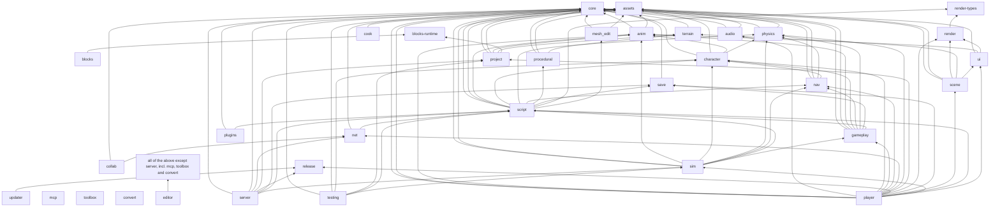

# System dependencies

Which engine crate depends on which, read from each crate's `Cargo.toml` `[dependencies]` on 2026-11-10 (dev-dependencies left out). The rules of what *may* depend on what are in `docs/architecture/crates.md`; this page draws what *does*.

## The crate graph

`release`, `mcp`, `toolbox` and `convert` have no engine dependencies; `mcp`, `toolbox` and `convert` are editor-only (they bring `tokio`, `rusqlite` and `openusd`). `script → mesh_edit` is optional (the default `csg` feature, for `UnionAsync`). Every crate also depends on `workspace-hack` (generated by cargo-hakari; no code).

## What each host links

| Host | Links GPU (wgpu) | Links audio (kira, cpal) | Links window (winit) | Links egui |
|---|:-:|:-:|:-:|:-:|
| `editor` | yes | yes | yes | yes |
| `player` | yes | yes | yes | no |
| `server` | **no** | **no** | **no** | no |
| `testing` (`axcenity-test`) | no | no | no | no |

The server's "no" column is roadmap M8 (PR #13): `script` takes its render data from `render-types` and its sound actions from `core::sound`, and `.config/hakari.toml` leaves `winit` out of the workspace hack. Check with `cargo tree -p axcenity-server -e normal -i wgpu` (also `kira`, `winit`); each must print nothing.

## Forbidden edges

| Edge | Reason | Checked by |
|---|---|---|
| `player → editor / egui / blocks / plugins / cook / convert / mcp / toolbox` | Shipped games carry no editor code; `cook` links Intel's prebuilt ISPC kernels; `convert` brings `openusd` ([ADR-0027](Architecture-Decisions/ADR-0027-Convert-New-Model-Formats-To-glTF-On-Import.md)); `mcp` brings tokio | `scripts/check-platform.*` |
| `render → core` (or anything with Instances, scripts, winit) | [ADR-0003](Architecture-Decisions/ADR-0003-Renderer-Consumes-Only-Draw-Data.md) | Crate manifest |
| `script → render / audio` | The server links `script` | M8; `cargo tree` |
| `physics → character / nav`, `character → nav` | Queries flow one way: nav and characters ask physics | Crate manifests |
| `sim → render / wgpu / egui / winit / kira / cpal` | The server links `sim` | `crates/sim/CLAUDE.md`; `cargo tree -p axcenity-sim -e normal` |
| `mesh_edit → render / physics` | Pure CPU geometry, reusable by script, editor and tests | `crates/mesh_edit/CLAUDE.md` |
| `terrain` → anything but `core` | Algorithms only; `project` does files, `scene` draws, `physics` collides | `crates/terrain/CLAUDE.md` |
| `blocks-runtime` → any engine crate | Must stay safe for the player | `crates/blocks-runtime/CLAUDE.md` |
| `save` → anything but `core`; never the project folder | Saves live in the player's data folder | `crates/save/CLAUDE.md` |
| Any cycle | Move the shared type into `core` | Cargo |

## Where `docs/architecture/crates.md` and the manifests differ

Found in this audit and fixed in the same change that added the wiki ([Documentation history](../Changelog/Documentation-History.md#open-documentation-gaps)): `crates.md` had no row for **`sim`**, the `player` and `editor` rows didn't list it, and `testing`'s row named `anim`, `nav` and `physics`, which it now reaches through `sim`.

## Third-party libraries

The full list with versions, licenses and the crates that use them is [Dependencies](../Reference/Dependencies.md). The couplings that matter:

- **wgpu, winit, eframe/egui, egui_dock, egui-phosphor and glyphon move together**, because the editor viewport renders on eframe's wgpu device. M12 (PR #104) moved them to wgpu 30, egui 0.36, egui_dock 0.21, glyphon 0.12.
- **rapier3d is patched** from `vendor/rapier3d` (PR #121): upgrading rapier means re-applying the patch (`vendor/README.md`).
- **`mlua` 0.12 and `luau0-src = "=0.22.0"` move together**: newer Luau writes bytecode version 13, which mlua-sys 0.13 can't read. `crates/script/src/luau_pin_tests.rs` fails if they drift.
- **renet and renet_netcode 2 move together.**

## Related

- [Architecture overview](Architecture-Overview.md) · [Repository structure](Repository-Structure.md) · [Add a dependency](../Guides/Recipes/Add-a-Dependency.md)
- [ADR-0001: Layered crate workspace](Architecture-Decisions/ADR-0001-Layered-Crate-Workspace.md)
