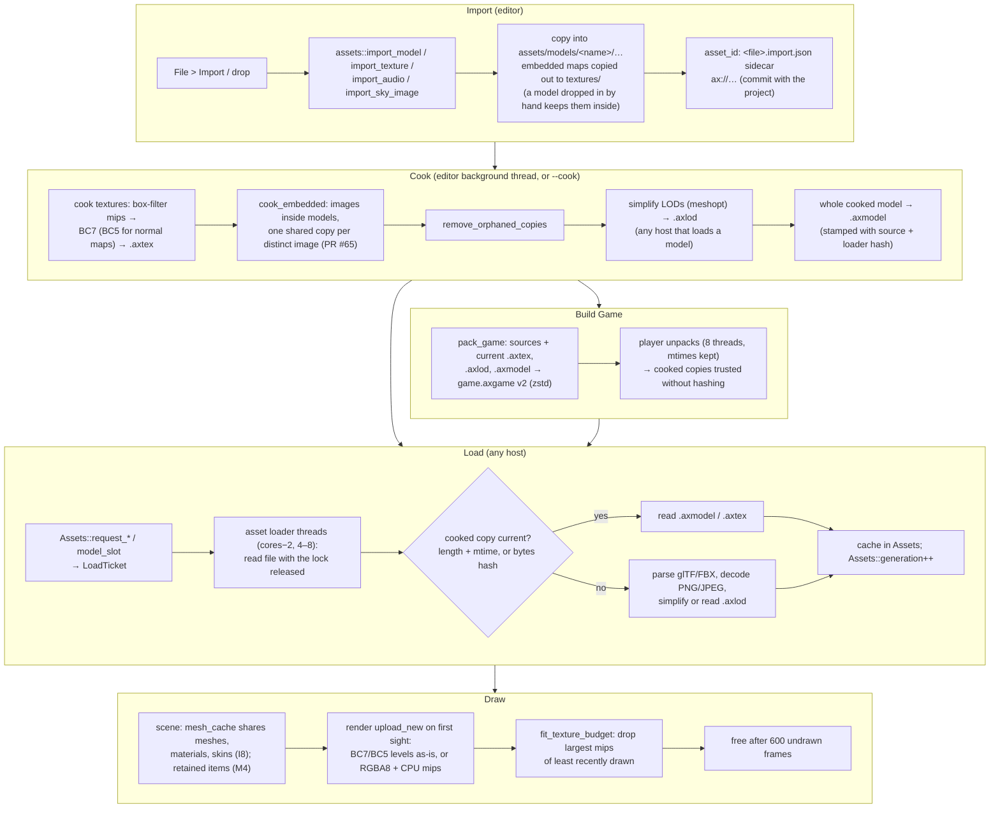

# Asset pipeline overview

> [!summary]
> Assets are **plain files inside the project folder**, named by project path. The editor **imports** them (copying a model, its buffers and textures, embedded maps copied out to files), gives each a **stable ID** in a sidecar, and **cooks** them in the background into `.axcenity/imported/` (BC7/BC5 textures with offline mips, simplified LODs, whole cooked models). At runtime `assets` **loads** off its lock on worker threads, preferring a cooked copy when it's current; `scene` hands meshes and textures to `render`, which **uploads** them on first sight (no mips to make for cooked textures), fits them to a **texture budget**, and frees what isn't drawn for 600 frames. **Build Game** packs the sources plus the current cooked copies. **Implemented** (roadmap L2 complete; since PR #78 a reference may name the asset ID `ax://…` as well as the path, and `Assets::resolve` turns an ID into its path before loading, so a moved file keeps its references). Online assets come in through the [Toolbox](../Editor/Toolbox.md).

This was built in about two days: M5 (loading off the lock), I11 (player preload), then L2 in eight parts (PRs #45, #47, #49, #50, #51, #53, #55, #57).

## The lifecycle

## Rules that hold it together

| Rule | Where |
|---|---|
| An `ax://` ID and its path share one load and one cache entry (`assets/src/references.rs`) | `assets` |
| Every game file read goes through `assets`, inside the project (`safe_path` refuses absolute paths, drives, schemes, `..`) | `assets` |
| Never read or decode under the `Assets` lock; one read per file however many threads ask (`LoadTicket`) | `assets/src/loading.rs` (M5) |
| A model not loaded yet draws **nothing** (no placeholder); a reloading one keeps its last version; only a missing or bad file is the grey box | `scene` (M5 follow-up) |
| Physics uses `model_blocking`: a part needs its real collision shape | `physics` |
| A stale cooked copy is never used: matched by length and mtime, or by content hash when only the time differs | `assets/src/cooked.rs` |
| Cooked models are stamped with the source file and `AXCENITY_ASSETS_SOURCE_HASH` (hash of the `assets` crate's source and the lockfile), so changing the importer invalidates them | `assets/build.rs`, `model/cooked_model.rs` |
| Cooking is editor-only; the player never links `cook` (`intel_tex_2`) | [ADR-0008](../Architecture/Architecture-Decisions/ADR-0008-Desktop-Texture-Cooking.md) |
| Cooked mips must match the renderer's own (2×2 box average) | `cook`, `render/src/renderer/gpu.rs` |
| Loading never panics on a bad file: `gltf`/`ufbx` panics become `ModelError::Damaged`, each failure reported once | `assets` |

## Performance

All **Measured**; see the [Optimization log](../Performance/Optimization-Log.md) for method and hardware.

| Stage | Before → after |
|---|---|
| Player first frame (I11 preload), hello-roads | 2,069–5,431 → 341–398 ms |
| Arid Dry Patch launch to assets in (M5 off-lock) | 5,056 → 3,204 ms |
| 4096² texture upload on first frame (L2 BC7) | 55–61 → 0.9–1.1 ms; GPU 85 → 21 MiB |
| CityPropsCollection.fbx load (L2 cooked model) | 143 → 1.7–1.9 ms |
| Simplifying LODs with the cache | 68 → 6 ms |

**Resolved issue (Measured):** Abandoned Farmhouse's player startup regressed after M5 (first frame about 1.05 s at `300bbb5`, about 4.4 s at `39dd258`) because its `.glb` files embed every 4K map. PR #65 cooks embedded images in place: cooked first frame 2,926 → 1,869 ms, launch to assets in 7,224 → 3,330 ms, GPU textures 947 → 311 MB (Windows, pinned, medians of 3). PRs #67 and #69 then decoded terrain layer maps on the loading workers and built the layer arrays in parallel: first frame **212 ms**, assets in 1,579 ms (baselines at `15965da`). See [Known bottlenecks](../Performance/Known-Bottlenecks.md#abandoned-farmhouse-startup-regression).

## Related pages

- [Importers](Importers.md): what glTF and FBX loading reads and how textures find their roles
- [Cooking](Cooking.md): the cooked file formats and when cooking runs
- [Supported formats](Supported-Formats.md): every file type and what reads it
- [Memory architecture](../Architecture/Memory-Architecture.md): cache ownership and eviction
