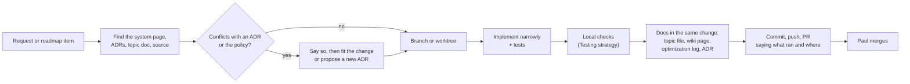

# Contribution workflow

How a change goes from idea to `main`. Agents follow the same flow; the rules for them are in the repository's `AGENTS.md`.

## The development policy

Paul set these on 2026-11-10 (`docs/development-policy.md`; [ADR-0011](../Architecture/Architecture-Decisions/ADR-0011-Desktop-First-Local-Verification.md)):

1. Avoid introducing infrastructure before it is needed.
2. Prefer reliable, maintainable implementations over premature optimization.
3. Don't sacrifice core functionality for hypothetical future platforms.
4. Keep architectural extension points where reasonably inexpensive.
5. Require local tests for significant engine changes.
6. Avoid expanding features when existing implementations have unresolved correctness issues.
7. Revisit deferred capabilities at appropriate architectural milestones.

## The flow

- **Plans**: a roadmap phase is one heading in `plans/axcenity-engine-unified.md`; the `implement` skill resolves it with `.claude/skills/implement/scripts/plan.py`. Tick a criterion only when a passing test or an inspected screenshot proves it.
- **Branches**: one branch per item (`m4-retained-draw-list`, `l2-cooked-textures`); several agents often work in parallel on separate worktrees under `Documents/Axcenity Engine Worktrees/`, so keep changes to your own files.
- **Commits**: short title in the repo's style ("Cooked BC7 textures (roadmap L2, part 1)"), a body when useful, the attribution line the session asks for. After a finished `implement` phase, commit and push automatically (owner's standing preference).
- **Pull requests**: what changed, why, what was measured (before/after with machine and method), and exactly which checks ran on which OS. Nothing runs on GitHub for a pull request. A user-visible change adds an entry to `releases/unreleased/` ([Release process](Release-Process.md)).
- **Pushing**: if a push says "Repository not found", the active `gh` account is probably not `MrBearson321`; tell Paul rather than switching accounts.
- **Docs**: when behavior changes, update the topic file (`docs/README.md` maps them) and the wiki page if architecture, decisions, performance or limitations changed ([Wiki guide](../Getting-Started/Wiki-Guide.md#keeping-it-true)). The `organize` skill tidies docs and code after a stretch of work.
- **Benchmarks**: commit `benchmarks/baselines.json` with the change that moved it, and say why.

## Repository skills

| Skill | Use |
|---|---|
| `implement` | Build a feature or roadmap phase end to end: context, code, tests, tick criteria, commit, push |
| `organize` | Sync docs and steering files with the code, then remove dead code and split oversized files without behavior changes |
| `research` | Investigate a question against primary sources in the background; write findings to a Markdown file |
