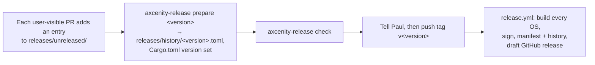

# Release process

> [!summary]
> Release system Phases 3 and 4 (PRs #98, #105, #113; 2026-11-11). **One version source**: `[workspace.package] version` in the root `Cargo.toml` (SemVer with `-alpha.N`, `-beta.N`, `-rc.N`; the channel follows from it). The light **`release`** crate (used by editor, player and server) knows the version and channel, the build's provenance (`--version`), and the release history in `releases/`; the `axcenity-release` CLI checks, prepares and queries it. **GitHub Actions runs only for release tags**: the workflow builds, signs (minisign manifest; macOS apps signed) and publishes a **draft** release ([ADR-0018](../Architecture/Architecture-Decisions/ADR-0018-Actions-For-Release-Tags-Only.md)). **Implemented**, with Phases 5–7 (PRs #118, #124, #129): the editor's **Version Explorer** (Help > Version Explorer; built from `releases/` at compile time, works offline), update checks and Copy diagnostics; the **`updater`** crate and `axcenity-updater` binary (resumable download with size and SHA-256 checks, safe unpacking, staged install, swap by rename, verify the new editor's `--version --json`, roll back on failure; Windows setup and Linux `.tar.gz` installs only); and **project format 5**, which records the engine a project was created and saved with and asks before upgrading an older project, putting it back if the upgrade fails.

## The flow

- **Tell Paul before pushing a tag**: the version, the platforms and roughly how long it takes (Actions minutes are spent only on purpose).
- Published files include per-OS packages, an update zip/tarball for the self-updating installs, `axcenity-release.json` (+ `.minisig`) and `axcenity-history.json`.
- History so far: `v0.1.0-alpha.3` (2026-10-21) is the only published release; the next is `0.2.0-alpha.1`.

## Commands

| Task | Command |
|---|---|
| Check `releases/` against `Cargo.toml` | `cargo run -p axcenity-release -- check` |
| Start a release record | `cargo run -p axcenity-release -- prepare 0.2.0-alpha.1` |
| Query history | `cargo run -p axcenity-release -- query compare 0.1.0-alpha.3 unreleased` |
| Package checks without CI | `python3 scripts/check-packages.py` |

## Related documentation

`docs/project/releases.md`, `releases/README.md`, `docs/research/release-system/`; [Contribution workflow](Contribution-Workflow.md)
