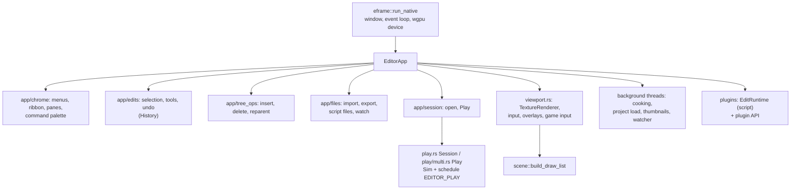

# Editor architecture

> [!summary]
> `axcenity-editor` is an **eframe/egui 0.32** app (168k lines, one crate) with **egui_dock** panels that can float as real OS windows. `EditorApp` holds the editor state; `app.rs` runs each frame and its children (`app/*.rs`) hold one responsibility each. The **viewport** draws through `render::TextureRenderer` on eframe's own wgpu device. **Play** runs the game in-process on a deep copy of the edit world through the shared frame schedule. Lua **plugins** extend the ribbon and dock. Specialized tabs (Model Studio, Animation, UI Designer, Material, Sequencer, graphs, Terrain Studio) are on [Specialized editors](Specialized-Editors.md). **Implemented**; splitting into sub-crates is planned (L6).

## Architecture

- **State**: `EditorApp` (the audit counted 109 fields) is split by behavior across `app/*.rs` files; big modules are a parent file plus a same-named folder (`docs/architecture/crates.md`, "Where the big files split").
- **Edits** route through `EditorApp::change` (or `change_many`) so undo and history stay consistent; asset files through `History::record_asset`, world-and-files steps through `History::record_world_and_files`.
- **Design system** (the `editor-kit` crate, re-exported at the editor's crate root so `crate::theme` paths are unchanged): colors from `theme::palette(ctx)` tokens, controls from `widgets.rs`, layouts that fit a 260-point column from `responsive.rs` (`toolbar`, `form`, `split`). See the design-system audit `docs/research/usability/design-system.md` (DS1–DS27, V1–V26); its Phase 1 (finished tokens: graph canvases read `theme::Canvas`, three radius tokens, one overlay palette `theme::overlay`, one changed-from-default mark) landed in PR #66.

## Play mode

Play (F5) autosaves if needed, clones the World (every `InstanceId` stays valid), reads scripts from disk, and creates a fresh `ScriptRuntime` and `Physics`; each editor frame `Session::frame` runs the `EDITOR_PLAY` schedule under `catch_unwind` with the real elapsed time (≤ 0.1 s). Properties edits during Play change the game world (no undo); **Keep** pins copy chosen values back at Stop as one undo step. Breakpoints pause the session. Several clients (1–8) are separate `Session`s over the in-memory loopback with an emulated network. **Run** (F8, roadmap G14) is the same with one `Session` marked as a server with no player (`ScriptRuntime::set_dedicated`, as `axcenity-server`): Scripts and physics run, no character spawns, LocalScripts don't start, and the fly camera stays the view. Full behavior: `docs/architecture/play-mode.md`; lifecycle diagram: [Execution lifecycle](../Architecture/Execution-Lifecycle.md#play-and-stop).

## Plugins

Lua plugins (`plugins` crate, Phase 54): `plugin.json` manifests found in plugin folders, project-only file access, and an API (`plugin`, toolbars, dock widgets, `Selection`, `ChangeHistoryService`, mouse, settings, retained viewport drawing and drag handles in `draw.rs`, Properties rows in `rows.rs`, importers and Assets panel items in `assets.rs`; `plugin.ApiVersion` is 2) run in `script`'s long-lived `EditRuntime` against the edit world. Creators scaffold, pack and share plugins as `.axcenity-plugin` zips (`plugins::bundle`); the Plugins panel and Toolbox **Packs ▸ Import plugin…** install them. Undo, the ribbon and dock tabs are the editor's (`app/plugins.rs`). Keep `definitions/axcenity-plugin.d.luau` in step with `api.rs` (a test checks). The player must never depend on `plugins`.

## Recent additions (2026-11-11)

- **Universal search** (Ctrl+K; `command_palette.rs`, `app/search.rs`): one fuzzy-ranked list over commands, tools, scripts, assets, levels, objects and settings, each provider re-listed only when its stamp changes; the command palette (Ctrl+Shift+P) and Quick Open (Ctrl+P) are views of it.
- **Cohesion pass CP2** (ADR-0024): one categorical palette for the whole editor (`theme::Hue`, the block categories' colours) that tints the ribbon's group captions; one toolbar menu button (`widgets::menu_button`, same height as `widgets::button`) and one menu-item shape with an icon column (`theme::menu_item`, Settings > Appearance > Menu icons: Left or Centered); ribbon captions on one baseline; the Console's command line and completions bounded; the Blocks bar hint truncates. The Scene tab can close: a **Welcome** tab (`Pane::Welcome`, `app/welcome.rs`) holds the documents' place while no document is open (`Layout::keep_a_document`). The start screen's reading glass is only on Learn, Documentation and API Reference, and those pages scroll inside it.
- **Cohesion pass CP3** (ADR-0024): one open action for the Explorer (`app/open.rs`, `explorer::opens_with`): a double-click opens a script's tab (shown again if open), UI in the UI Designer, an Animation's clip or an Animator's state machine in the Animation tab, and frames a part or Model in the viewport (`Viewport::frame`). Scripts inside objects switch Code ↔ Blocks like Rename or Move… (`project::plan_switch`, one undo step for the file and every copy's `SourceFile`), and their block files open in a Blocks tab.
- **Cohesion pass CP4** (ADR-0024): `axcenity_blocks::catalogue` describes every block and reporter (an exhaustive `match`, so a new one must be described to build) and turns each graph `NodeSpec` into the same `NodeInfo`; the kit's `widgets::info_card`, drawn through `node_graph::node_card`, is the one tooltip of the Blocks palette, the block Graph view's nodes and menu, and the UI Event Graph, Behavior Tree and Dialogue editors.
- **Cohesion pass CP5** (ADR-0024): the **Object Viewer** (`editor-tools/src/object_viewer.rs`, `Pane::ObjectViewer`) draws a copied subject in a `World` of its own through `preview::Canvas`, so the scene and undo never see it; orbit, pan, zoom, frame, lighting presets, floor and sky; it redraws only when its view, size, subject or loading textures change (otherwise `Canvas::show_last`). Opened by **View** in the Explorer's and Assets' menus (`app/open.rs`); boxed in `EditorApp`, since two worlds inline overflowed a test thread's stack.
- **Design system Phases 2–5**: errors stay until seen; one way to open and close windows and dialogs; Explorer and Console draw only what's visible; Properties edits every selected item; Explorer arrow keys; a **shortcut table** (`shortcuts.rs`, every shortcut one `Action` with a context); layout presets; Increase contrast.
- **Script completion** (G4 stage 1; `crates/editor/src/script_completion.rs`, `crates/editor/src/scripts/assist.rs`): code tabs list members after `.`/`:` and names on Ctrl+Space, and show an engine call's signature after `(`/`,`. It reads `axcenity_script::api_reference()` (the luau-lsp definitions' tables) and follows chains and locals' declarations against the edit world; no type checking. Stage 2 (`crates/editor/src/luau_check.rs`, `crates/editor/src/app/luau_checks.rs`) runs `luau-lsp analyze` as a child process on a background thread when a tab's code goes quiet, and underlines errors and lints; luau-lsp is found, not shipped (`AXCENITY_LUAU_LSP`, the PATH, or VS Code's Luau extension).
- **Go to Definition** (G4's gap, competitive roadmap item 4; `script_completion::definition_at`): F12 or Ctrl+click in a code tab. The same `Resolver` that types chains for completion finds the Instance a chain names (opened through `EditorApp::open_instance`, the Explorer's double-click path) or the API entry of a member (Help > Learn's API page); a local's declaration is found by line, nearest before the cursor. The tab hands anything outside itself to the editor through `ScriptTabs::take_definition`.
- **Scripts inside objects** editor support (Insert Script into a selected object creates `objects/<name>/Script.server.lua`).
- [MCP server](MCP-Server.md) and [Toolbox](Toolbox.md).
- **UI prefabs** (G5): Save prefab and Export Package take ScreenGuis and UI elements with their `SourceFile` LocalScripts.
- **Version Explorer** and the updater ([Release process](../Development/Release-Process.md)); **Profiler › Memory** (G7).
- **egui 0.36** since M12: wheel deltas summed per frame (`wheel.rs`); tests run frames through `theme::run`.

## Integration and tooling

| Feature | Where |
|---|---|
| Profiler panel (Game and Graphics tabs) | `profiler.rs`, fed by `Session::cost` and `TextureRenderer::stats` |
| Background cooking of textures and models | `cooking.rs` ([Cooking](../Asset-Pipeline/Cooking.md)) |
| Asset Check and fixes | `asset_check.rs`, `app/asset_fixes.rs` over `project::check_assets`, `plan_fix`; duplicate files (R12) `project::find_duplicates`, Merge `project::plan_merge` |
| Engine rebuild and relaunch (debug, source tree, `engine-dev` feature; engine hot-patching removed in Phase 89) | `rebuild.rs`, `relaunch.rs`, `app/engine.rs` |
| Build Game, `--build-game`, `--cook` | `build_game.rs`, `cooking.rs` |
| Build profiles (R13: menu, picked profile, report in Output) | `app/files/export.rs`, `app/chrome/menus.rs` (`build_profile_menu`), `app/native_menu.rs` |
| Visual-debug overlays, debug views (`debug-views` feature of `render`) | `viewport/overlays.rs`, `viewport/view_mode.rs` |
| Steady frames on VRR displays | `EditorApp::keep_frames_steady` ([Hardware notes](../Performance/Hardware-Notes.md)) |

## Performance

- **Measured** (audit, `docs/research/usability/design-system.md` A9): costs of the editor UI itself were measured there; open items include drawing only visible Explorer rows (V7) and a bounded Console log (V8).
- Incremental rebuild of the editor binary about 5–6 s; cold build about 6 min on a laptop (`docs/development.md`). L6 targets about 2 s.

## Testing

956 tests. Drawing tests use `theme::test_context()` and save PNGs to `AXCENITY_SNAPSHOTS` for inspection; `bench_project_play` (`AXCENITY_BENCH_PROJECT`, `AXCENITY_BENCH_FRAMES`) benchmarks Play.

## Limitations

- One giant crate (now ~168k lines; about 50k more are in its sub-crates); `EditorApp` has ~118 fields. G11 (L6) splits it one step at a time: first the shared UI base into `editor-kit` (4.8k), then one panel family per crate: the Toolbox tab (`editor-toolbox`, 4k), Graphics Benchmark (`editor-benchmark`, 3k), the Model Studio (`editor-model-studio`, 13k), the generic node-graph editor (`editor-node-graph`, 2.6k) and the UI Designer with its style panel and UI handles (`editor-ui-designer`, 13.5k). What those panels share with the editor moved under them into `editor-tools` (9k): gizmo, snapping, the shortcut table, Animation's posing and preview, and small types and rules (`Edit`, `Field`, the Assets panel's tiles, the Instance-tree rules). Each keeps its old path in the editor through a re-export, so moves stay pure.
- egui repaints the whole editor every Play frame; panics while *drawing* the Play world aren't caught yet.
- Editor Play can't host or join a real network game (loopback only).

## Development guidance

- Don't hardcode chrome colours; route color buttons through `color_palette::edit_srgb`; every new menu item or ribbon button needs a `Command` (a test checks the palette can run them all).
- Don't call egui `Context`/`Response` methods inside an `input` closure.
- Keep eframe, egui and render on compatible wgpu majors.

## Related documentation

`crates/editor/CLAUDE.md` (file map), `docs/editor/*.md`, `docs/architecture/play-mode.md`; [Specialized editors](Specialized-Editors.md)
