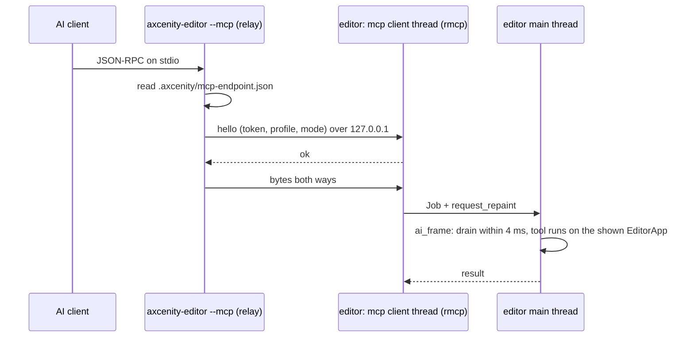

# MCP server for AI clients

> [!summary]
> `axcenity-editor --mcp <project>` serves a project to AI clients (Claude Code, Cursor, Codex, local models) over the **Model Context Protocol** on stdin/stdout: **in the open editor window** when it takes AI connections (Settings ▸ AI connections; the process then only relays), otherwise by opening the project **without a window** (PRs #102–#133 and step 3.4; 2026-11-11). The protocol half is the engine-free **`mcp`** crate (`rmcp` on its own thread, tool specs with flat JSON schemas, argument checks, one `ToolError` shape, safety modes and confirm tokens); the **tools are the editor's** (`editor/src/app/mcp.rs` and `app/mcp/`), handed to the thread that owns `EditorApp` as `Job`s, so they use the same code paths as the panels. **Editor only**: the player and server never link it (it brings `tokio`). **Implemented.**

This is *distinct from this wiki's agent instructions*: the repository's `AGENTS.md` and this wiki tell agents working on the **engine's source** how to behave ([Wiki guide](../Getting-Started/Wiki-Guide.md)); the MCP server lets agents work on a **game project** through the editor.

## Shape

```mermaid
sequenceDiagram
  participant C as AI client
  participant M as mcp crate (rmcp thread)
  participant E as EditorApp thread
  C->>M: tools/call (stdio)
  M->>M: check args against ToolSpec, mode, confirm token
  M->>E: Job
  E->>E: tool in app/mcp/ (same code as panels; undoable edits)
  E-->>M: result or ToolError
  M-->>C: compact text result
```

- **Profiles** (`lite`, `standard`, `full`) choose which tools are listed; **modes** (`read`, `edit`, `full`) choose what they may do; destructive calls need a confirm token bound to that one call.
- Tools include reading the project, undoable object edits, `script_read`/`script_write`, `project_check`, `batch`, `object_duplicate`, `material_edit`, `env_set`, `game_run`, with a log and a checkpoint. Object edits stay in memory until `project_save`.
- Both MCP protocol eras are served (the `initialize` handshake and the stateless 2026-07-28 one), with two prompts and resources that mirror read tools.
- `history changes` answers "what changed since I last looked", split into the client's own changes and everyone else's (`changes.rs`). `--mcp --check` prints a health report and every client's config line; the user guide is `docs/mcp/README.md`.

## In the open editor (step 3.4)



- With the setting off, or no editor listening, `--mcp` runs headless and writes `.axcenity/mcp-headless.lock`; the editor warns on opening such a project, and a headless server refuses writes while an editor listens, so two copies never overwrite each other.
- `render_stats` (full profile) reads the viewport's last frame (`EditorApp::last_drawn`) and the Profiler's Play readout; without the window it says to connect to the editor.
- Every live client is a session of its own over one shared change log. Writes are refused while the editor plays. A long call (`game_run`) holds the window: there are no job handles yet.

## Development guidance

- Keep schemas flat (no `oneOf`/`$ref`), summaries one sentence, errors that say what to do next.
- New tools go in `editor/src/app/mcp/` (one file each) and go through `EditorApp` paths so undo and history stay consistent.
- `scripts/check-platform.sh` checks the player doesn't link it.

## Related documentation

`docs/editor/mcp.md` (running it, connecting clients, the tool list), `docs/research/mcp/` (design, client compatibility, capability map, tool inventory); [Editor architecture](Editor-Architecture.md)
