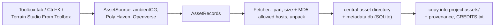

# Toolbox (online asset sources)

> [!summary]
> Roadmap **G1** (PRs #90, #92, #96, #107): the editor's one way to find and fetch assets online. The **`toolbox`** crate defines `AssetSource` and the shared `AssetRecord`, with **ambientCG** (v3 API), **Poly Haven** and **Openverse** sources; verified downloads (size, MD5, `.part` files, unpacking) into a **central asset directory** recorded in a SQLite `metadata.db` (`rusqlite`, versioned schema, also read from Python); a library (favourites, collections, recents); provenance (`.axcenity/asset-sources.json`, `CREDITS.txt`); Toolbox packs; the Blender library migration; the `axcenity-toolbox` CLI and a Python package with Blender providers. The editor's **Toolbox tab** (`editor-toolbox`'s `lib.rs`) replaced the Assets panel's old ambientCG "Get texture". **Editor only.** **Implemented.**

## Searching

Textures and skies search **All sources** by default: `search` in `editor-toolbox`'s `lib.rs` asks each source on its own thread (`std::thread::scope`), interleaves their pages, and reports a source that fails while others answered (`Found::failed`) instead of failing the search. Results are deduplicated by `provider:id` only; assets from two sources are never merged. The Sounds tab carries a licence notice (`SOUND_LICENCE_NOTICE`) above Openverse's results; each card keeps its own licence.

## Dragging a card into the scene

A result card's picture is a drag handle when Get would work (competitive roadmap item 3, G1's gap): `editor-toolbox` sets a `CardDrag` payload; the editor's frame (`app.rs`, beside Assets-panel drops) hands one let go over the viewport to `EditorApp::drop_toolbox_card`, which calls `ToolboxPanel::get_dropped` with `Target::Drop(Spot)`. The Get runs as usual on its thread; `installed_action` gives the drop to the texture set or sound it installed, and `app/toolbox.rs` places it through `drop_asset`, the same path as a tile. A sky or model uses the drop up (the sky asks, the model opens the Import dialog), so it never places a later Get.

## Where its assets show

The Assets panel groups a project's assets by where they came from (`asset_browser/origin.rs`): each Toolbox source gets a section, read from the project's `.axcenity/asset-sources.json` (`Snapshot::source_of`), beside Built-in, Made in Axcenity, Imported and Global assets. A model's folder takes its model's origin, and a material made from a texture set is listed under that set.

The **Downloaded / Imported Assets** tab (`asset_inventory.rs`) lists the library's downloads (`Database::downloads_of`), this project's installs and the snapshot together with the project's imported files, one row per asset (`provider:id`, or the path for an imported file), grouped by type. **Remove download** deletes a variant's folder and `forget_download`s it; the `assets` row stays, per the crate's rule.

**Packs ▸ Import plugin…** installs a creator-shared `.axcenity-plugin` (from `plugins::bundle`) into the project's `plugins/` or the user's `Plugins` folder, then opens the Plugins panel. Asset packs stay separate; there is no hosted plugin catalogue.

## Flow

## Rules (from `crates/toolbox/CLAUDE.md`)

- `player`, `server`, `sim` and `testing` never depend on it.
- Unit tests never touch the network (`http::Fixture`) or the real directory; `tests/live.rs` is run by hand after changing a source.
- `SourceError` messages are safe to show; every request sends `http::USER_AGENT`; never offer `.blend` files; check every download URL with `SourceInfo::allows_download_from`.
- Change the DB schema only through a new version in `db.rs`; never delete `assets` rows.

## Related documentation

`docs/research/asset-sources/` (assessment, architecture options, provider interface, experience); [Asset pipeline overview](../Asset-Pipeline/Pipeline-Overview.md); [Dependencies](../Reference/Dependencies.md)
