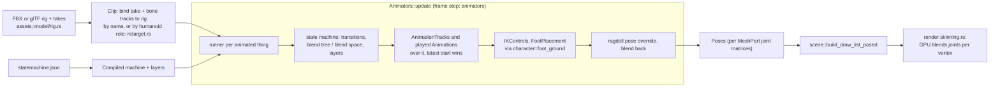

# Animation

> [!summary]
> `anim` plays **one clip type** (`*.anim.json`: property tracks, bone keys, an optional linked take from an FBX or glTF file) through **Animators** running **state machines** (`*.statemachine.json`) with transitions, 1D blend trees, 2D blend spaces (Delaunay), layers with masks, root motion and events; then **AnimationTracks** over them, **runtime IK** (`IKControl`, foot placement), and **ragdolls** blending in and out. Posing is on the CPU; skinning is on the **GPU** (graphics Phase 14). Cutscene **sequences** share `SequenceRun::apply` between the editor preview and the Sequence Instance. **Implemented.**

## Execution flow

- Live state (`AnimatorState`, `AnimationTrackState`, `PropertyAnimationState`) is in the World, not saved properties.
- Property tracks animate Parts, Model pivots and UI elements; reduced motion (a game UI setting) holds GUI animations.
- A take for another humanoid skeleton (Mixamo on an Unreal mannequin, Blender, Biped …) is **retargeted** (G16, `retarget.rs`): bones are matched to 52 humanoid roles (22 body, 30 finger; AP1) by a fitting **rig definition** (`assets/rigs/*.rig.json`, reusable bone maps found by fit, `Assets::rig_definitions`) or by name, the body's facing and up are measured in both rest poses, and each mapped bone's world turn from its rest is carried over; the hips' travel is scaled by leg length. Name binding still wins whenever any humanoid bone binds by name. `check_rig`/`check_pair` report missing or misplaced roles, swapped sides, rest pose (T/A) and finger coverage before binding. A clip's link can name a **retarget profile** (`*.retarget.json`, AP2): match rest poses (T-pose takes on A-pose models, on by default), hips Scaled/Unscaled/InPlace, plant feet and match hands with two-bone IK, finger strength, per-role weight and offset.
- Debugging (AP6): `Model::pose` also keeps each bone's posed origin (`Posed::bones`), which the viewport's **Skeletons** overlay draws (rest skeletons from `Rig::skeleton` while editing); `Animators::inspect` is a read-only snapshot of one runner (state, fade, layers, tracks over it, parameters, the last 8 things it fired, root motion) for the editor's Debug > Animator Inspector.
- `Posed::primitive` skins on the CPU only on request (tests, tools, the Model Studio's pose test), per LOD level.
- **Followers** (default humanoid HD4, `Animators::follow`): a skinned MeshPart inside a posed one with no runner of its own takes its pose by bone name and is placed by its skeleton (`place_follower` writes its Size, Position and Orientation when they differ), so modular parts on one skeleton wear as one character from one Animator; a part swaps by `MeshId`. A follower's blend shapes stay at rest.

## Dependencies

`anim`: `core`, `assets`. Easing curves are shared with TweenService (`anim::ease`) and UI transitions.

## Performance

**Measured** (graphics Phase 14, RX 9070 XT): GPU skinning cut 20 walking characters' CPU draw time from 4.85 to 0.38 ms and mesh memory from 13 to 2.3 MB (149 batches → 22); vertex-heavy scenes pay ~5% for wider instances. CPU posing of 20 simple characters is 0.05 ms. S10k's 20 animated characters cost 0.12 ms in Animation (9950X3D).

## Testing

`crates/anim/src/tests.rs` (canonical example files round-trip), `layer_tests.rs`, `retarget_tests.rs`, `animators/inspect_tests.rs`; player `skinning_tests.rs`, `ragdoll_tests.rs`, `cutscene_tests.rs`; editor animation tests (the Animation tab).

## Limitations

- Format 1 clip files still read (converted).
- No motion matching: proposal only (`docs/research/motion-matching.md`, MM1–MM6; inertialization and a controller trajectory first, the database when there's a licensed dataset).
- Ragdolls can overshoot joint limits on hard landings (see [Physics](Physics.md)).
- No GPU posing (state machines and IK run on the CPU each frame).
- Blend shapes (morph targets) are imported (F1) and drawn morphed on the GPU (F2, before skinning, in every raster pass), but hardware ray tracing sees the unmorphed mesh. Faces are driven by a `FaceControls` (F3: 48 standard controls through a face profile, eye and jaw bones turned after IK) and F4's layers (expressions with priorities and asymmetry, overrides, masks, automatic blinks, gaze at the camera, a target or a point, idle darts), and clips and Sequences key face controls (F4b), F5's lip sync (timed visemes through a viseme map, made from phoneme timings or a recording with the Console's `lipsync`), and the Character Studio tab edits faces (F6: profile, controls, shape mapping, expressions, a lip-sync timeline; its preview plays visemes without the sound), faces cost less far off or out of view (F7a facial LOD by `LodDistance`; a whole face still allocates small vectors each frame), but a line keeps time with its Sound only by the game's clock while the Sound plays (a Sound has no play position in the World), and in multiplayer a face's expressions, overrides, layers and lip sync go as targets at the face's `ReplicationRate` (F7b), so devices blend between sends and a lip sync can be up to 0.1 s off the server's. Plan: `docs/research/facial-animation.md` (F4–F7, [ADR-0028](../Architecture/Architecture-Decisions/ADR-0028-Facial-Animation-Morph-Targets-On-GPU-And-FaceControls.md)).
- Retargeting has rig definitions, fingers (AP1) and profiles (AP2: rest-pose matching, hips travel, planted feet and hand IK, per-role weight and offset). Twist isn't matched between rest poses (only bone directions), and planted feet come from the take's foot travel, not from detected contacts. Bone maps and profiles are edited in the Animation tab's Retargeting section (AP3). Keyed clips have Cleanup tools (AP4, `anim/src/cleanup.rs`): mirror (by the humanoid map and side words, baked a frame apart), smooth, reduce keys, fix the loop seam, re-time a range; they work on keys only, so a linked clip is converted first. The Sequencer's transport adds play backwards, loop, an In/Out play range and edit-point stepping (AP5, `transport::PlayMode`; preview only, never saved). Plan: `docs/research/animation-production.md` (AP6-AP7).

## Development guidance

- Read files through `Assets`; skeletal poses from `Model::pose`.
- Keep example animation files canonical (`to_json` round-trips them).
- The Model Studio's Pose test must skin exactly as `assets::Posed` does.

## Related documentation

`docs/rendering/animation.md`, `docs/scripting/api-animation.md`, `docs/project/animation-files.md`, `docs/project/sequences.md`; [Specialized editors](../Editor/Specialized-Editors.md#animation-tab-and-sequencer)
