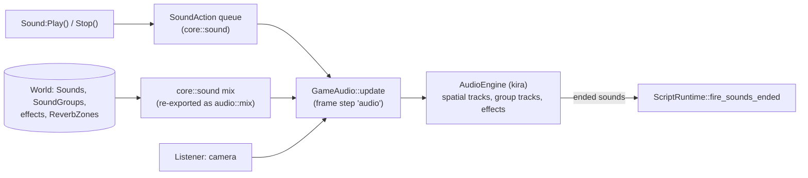

# Audio

> [!summary]
> `audio` plays project sounds through **kira 0.12**. Scripts never touch it: they queue `SoundAction`s (declared in `core::sound`, so `script` and the server don't link kira), and each host's `GameAudio` applies them after script steps, syncs every Sound's properties each frame, spatializes emitters against the camera as listener, routes through **SoundGroup buses with effects and ReverbZones** (Phase 52), and reports sounds that ended so scripts get `Ended`. The output opens lazily on the first play. **Implemented.**

## Architecture

- **Spatial**: a Sound with `Spatial` on is an emitter at its nearest ancestor `Part`, `MeshPart` or `Terrain`, else `Sound.Position`; stereo panning and attenuation from `RollOffMinDistance` to `RollOffMaxDistance`.
- **Buses**: group tracks are rebuilt when their shape changes; Sounds move over. The editor's Mixer can mute and solo (`GameAudio::set_monitor`) without changing the world.
- **Ownership**: the player owns one `GameAudio` for its lifetime; editor Play owns its own and drops it on Stop, silencing its sounds. The Properties panel previews a Sound with a short-lived engine.

## Roll-off and occlusion (G8, PR #128)

`Sound.RollOffMode` (`Inverse`, `Linear`, `LinearSquare`, `InverseTapered`; curve in `core/src/sound/spatial.rs`): the audio engine sets each spatial track's volume itself every frame, gliding over 60 ms. `SoundService.Occlusion`: `sim::Occlusion` casts rays from the listener to playing spatial Sounds in earshot, counting anchored solid parts and Terrain in between (up to 3), at most 8 Sounds and 6 rays each per frame, and hands the result to `GameAudio::set_walls`. The dedicated server skips it.

## Dependencies

`core`, `assets` (sound files via `Assets::read_file`), `kira`, `mint`. Never reads project files directly.

## Performance

**Measured** (9950X3D, S10k with 50 looping sounds): Audio step 0.032 ms in editor Play. Kira mixes on its own thread, not counted in frame time.

## Testing

`crates/audio/src/render_tests.rs` hears the output through a capture backend (`AudioEngine` is generic over the backend). 18 tests.

## Limitations

- No HRTF; stereo panning only. Occlusion is ray-counted walls, not a sound-propagation model.
- A file that can't be played is reported once, not every frame.

## Related documentation

`docs/scripting/api-sound.md`, `docs/architecture/play-mode.md` (Audio, Mixer); [Frame schedule](Frame-Schedule.md)
