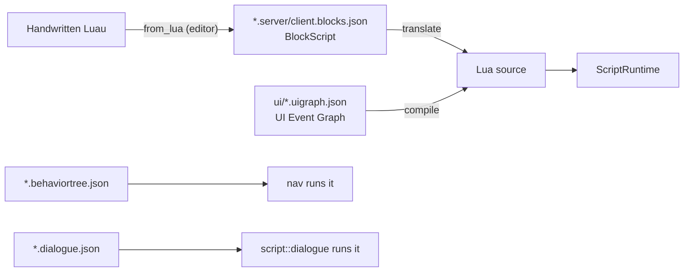

# Blocks and graphs

> [!summary]
> Every visual authoring format **compiles to Lua** and runs in the one `ScriptRuntime`: Scratch-style block scripts, their Blueprint-style Graph view, UI Event Graphs, and the node sets behavior trees and dialogues use. The runtime half (`blocks-runtime`) is what games load; the editor half (`blocks`) adds `from_lua`, which turns any Luau back into blocks. **Implemented.**

## Architecture

- **One-way at runtime.** `project::load` translates block scripts and UI graphs; the player never sees blocks ([ADR-0004](../Architecture/Architecture-Decisions/ADR-0004-Luau-As-The-Only-Script-Runtime.md)). The Lua is never saved; the JSON is the source.
- **Blocks ↔ Graph** are two views of one `BlockScript` (`graph.shown` remembers which). Code ↔ Blocks replaces the file.
- **`from_lua`** (editor only) parses Luau (`crates/blocks/src/lua.rs`), picks the friendliest block for each statement, and checks each choice writes the same tokens (`lua::same_code`). What no block can write stays word for word in a grey Lua block, so nothing is lost.
- `Translation::block_lines` maps each block to its first Lua line, so a runtime error highlights its block.
- **Material graphs are not here**: they compile to WGSL in the editor (`editor/src/material_graph.rs`), never to Lua ([Rendering](Rendering.md#architecture)).

## Source code

| Where | What |
|---|---|
| `crates/blocks-runtime/src/lib.rs`, `translate.rs`, `translate/luau.rs` | `BlockScript`, Lua output |
| `crates/blocks-runtime/src/node_graph.rs` | Generic graph data and edits |
| `crates/blocks-runtime/src/ui_graph.rs` | UI Event Graph nodes (`UI_NODES`) and compiler |
| `crates/blocks-runtime/src/behavior_tree.rs`, `dialogue.rs` | Node sets for behavior trees and dialogues |
| `crates/blocks/src/lib.rs`, `lua.rs` | `from_lua`, the Luau reader |
| `crates/project/src/ui_graphs.rs` | Compiles each graph to a LocalScript `EventGraph` under its ScreenGui at load |
| `crates/editor/src/block_editor.rs`, `block_editor/graph.rs`, `node_graph.rs` | The editors |

## Testing

`crates/blocks/src/luau_tests.rs` holds acceptance scripts and sweeps every `.lua` in the repo through `from_lua`; `tests.rs` runs translated scripts in the real runtime with an exhaustive match over block kinds. `cargo nextest run -p axcenity-blocks -p axcenity-blocks-runtime`.

## Limitations

- "Every block must correspond to a real Lua API" (no block-only features), so a new script API needs a matching block to be reachable from blocks.
- `BEHAVIOR_NODE_KINDS` in `nav` must match `blocks::behavior_tree::BEHAVIOR_NODES` (an editor test compares them).
- Phase 91 ("One graph canvas") plans to merge the graph canvases; not started.

## Development guidance

- `blocks-runtime` must not depend on any engine crate (it ships in the player).
- A new block kind: a row in `tests.rs`'s exhaustive match and in `docs/scripting/blocks.md`.

## Related documentation

`docs/scripting/blocks.md`, `graphs.md`, `ui-graphs.md`; [Scripting](Scripting.md); [Specialized editors](../Editor/Specialized-Editors.md)
