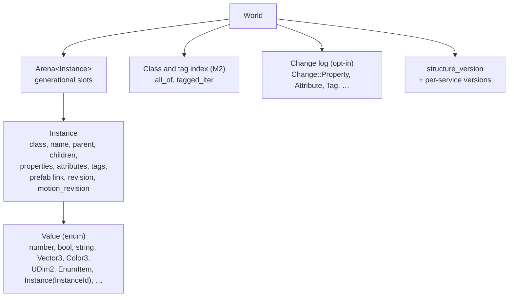

# Core and data model

> [!summary]
> `core` owns the **Instance tree**: every object in a game is an `Instance` in one `World`, stored in a generational arena and referenced by `InstanceId`. It also owns typed property values, change records, the class and tag index, and the plain data shared by many crates (input map, sound actions, terrain data, splines, streaming partitions). It depends on no other engine crate. **Implemented.**

This is Axcenity's entity system and scene manager. There is no ECS ([ADR-0002](../Architecture/Architecture-Decisions/ADR-0002-Instance-Tree-In-A-Generational-Arena.md)).

## Architecture

- `game` is the root (DataModel); services such as `Workspace`, `ReplicatedStorage`, `Players`, `Lighting`, `StarterPlayer` are its children. `World::service` finds them.
- `ClassName` is an enum; `core/src/class.rs` declares each class's properties, defaults and enums. Property defaults also drive serialization and the network (a replica is sent only non-default values).
- Properties are a `BTreeMap<&'static str, Value>` per Instance, attributes a sorted `BTreeMap<String, Value>`, tags a `Vec<String>` in insertion order.

## Source code

| Where | What |
|---|---|
| `crates/core/src/world.rs` and `world/` | `World`, `Instance`, create/destroy/reparent, properties, attributes, tags, change recording, `descendants_iter`, `copy_from`, `duplicate` |
| `crates/core/src/arena.rs` | `Arena<T>`, `Id { index, generation }`, `insert_at` for replicas |
| `crates/core/src/class.rs`, `enums.rs`, `value.rs` | Class schema, enums, `Value` |
| `crates/core/src/index.rs` | Class and tag index; `World::check_index` cross-checks it in debug game tests |
| `crates/core/src/prefab.rs`, `prefab/` | Placed prefab copies (`PrefabLink`), overrides, `sync` |
| `crates/core/src/streaming.rs` | `Partition`, `Unit`: what loads together (Phase 80) |
| `crates/core/src/input.rs`, `sound.rs`, `ability.rs`, `dialogue.rs`, `tool.rs`, `csg.rs`, `spline.rs`, `terrain.rs`, `strings.rs`, `ui_settings.rs` | Plain data shared by several crates, kept here to avoid cycles |
| `crates/core/src/bench.rs` | `Laps`, `StageSamples`, `BenchRun`: shared benchmark plumbing |

## Execution flow

- **Mutation goes through `World`** so links, indexes, revisions and change records stay consistent: `create`, `set_parent`, `destroy`, `set_property`, `set_attribute`, `add_tag`, `remove_tag`.
- Each change bumps the Instance's `revision` (and `motion_revision` for `Position`, `Orientation` and velocities, the `MOTION_PROPERTIES`), and a reparent bumps `structure_version` and the version of the service it happened in.
- With recording on, each change becomes a numbered `Change`; `ScriptRuntime::fire_changes` turns them into `Changed`, `ChildAdded`, … events ([Scripting](Scripting.md#execution-flow)).
- **Reading many Instances**: `descendants_iter` walks a subtree without allocating (I9); `all_of(class)`, `all_where`, `tagged_iter(tag)` go straight to the index (M2) in ID order; `in_tree_order` sorts a list into tree order when order matters.

## Dependencies

None engine-internal. Third-party: `serde`, `glam`, `rustc-hash`.

## Integration

Every other crate reads and writes the World. Readers that cache derived data key it by `revision` (scene's retained draw items, physics sync, replication) or by per-service `structure_version` (physics, streaming).

## Performance

- **Measured** (M2, 9950X3D, S10k): replacing per-frame walks with the index took the test runner's frame from 6.68 to 5.91 ms (about 12%). Each walk cost tens of microseconds on 10,000 parts; the gain came from their number ([Optimization log](../Performance/Optimization-Log.md#m2-class-and-tag-index)).
- **Measured** (PR #59, Callgrind, S10k): string-keyed property lookups are about 9% of a frame's instructions; typed slots (L1) parked.
- **Measured** (M3): `World::set_property` costs about 0.8 µs per write in physics write-back (string keys plus the change log).

## Configuration

None at runtime. Debug game tests run `World::check_index` every 60 frames.

## Testing

`cargo nextest run -p axcenity-core`; index consistency is also exercised by every game test in debug builds.

## Limitations

- Index order is ID order, not tree order; use `in_tree_order` or `all_below` where order shows.
- A property can hold an `InstanceId` that goes stale; every lookup must handle `None`.
- Per-Instance heap cost is high for a 10k-part world (~2 KB per Part, **Unverified** estimate).

## Development guidance

- Never cache a reference to an Instance as anything but an `InstanceId`.
- Add shared plain types here when two crates need them, rather than creating a dependency between those crates.
- Use `FxHashMap` for engine-keyed maps, SipHash for strings from outside; never depend on hash-map iteration order.
- A new class or property: update `class.rs`, then project parsing and writing ([Change a file format](../Guides/Recipes/Change-a-File-Format.md)), the Lua definitions ([Add a script API](../Guides/Recipes/Add-a-Script-API.md)), and raise `net::PROTOCOL_VERSION` if a default changed.

## Related documentation

- Topic docs: `docs/architecture/data-model.md`; crate rules: `crates/core/CLAUDE.md`
- [ADR-0002](../Architecture/Architecture-Decisions/ADR-0002-Instance-Tree-In-A-Generational-Arena.md), [ADR-0005](../Architecture/Architecture-Decisions/ADR-0005-Deferred-Change-Events.md)
- [Memory architecture](../Architecture/Memory-Architecture.md)
