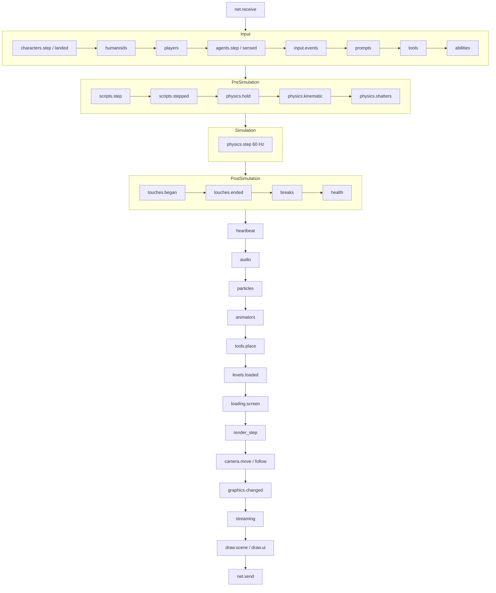

# Frame schedule

> [!summary]
> `sim` makes the frame **data**: `STANDARD` in `crates/sim/src/steps.rs` is one ordered table of named steps, each tagged with its stage (Roblox RunService stage names) and the hosts that run it. The player, editor Play, the dedicated server and the test runner all run it through their own `HostIo`. Golden tests fix each host's order, so moving a step is a deliberate, visible change. **Implemented** (roadmap M1, PRs #15, #16, #20, #24).

## Why it exists

Before M1, four hosts copied the frame order by hand and had already drifted: editor Play ran the render step before Animators, audio sat elsewhere, and particles and streaming advanced inside viewport drawing. Something that worked in Play could behave differently in a shipped game ([ADR-0006](../Architecture/Architecture-Decisions/ADR-0006-One-Shared-Frame-Schedule.md)).

## Architecture

| Type | Role |
|---|---|
| `Sim` | The simulation state: `World`, `ScriptRuntime`, `Physics`, `Controllers`, `Agents`, `Animators`, `Assets` |
| `Step { name, stage, hosts, run, lap }` | One frame step: a plain function over `FrameCtx` |
| `Stage` | `NetReceive`, `Input`, `PreSimulation`, `Simulation`, `PostSimulation`, `Heartbeat`, `PreAnimation`, `Animation`, `PreRender`, `NetSend` |
| `Hosts` | Bit set: `PLAYER`, `EDITOR_PLAY`, `SERVER`, `TEST`; `GAME`, `NETWORKED`, `ALL` |
| `Schedule::for_host(h)` | The steps host `h` runs, in order |
| `HostIo` | What differs per host: `net_receive`, `character_motion`, `frame_input`, `flush_output`, sound, drawing, `prepare_physics`, `owns_physics` |
| `DRIFT` | Steps a host deliberately runs elsewhere, with the reason (today one: the server runs `physics.shatters` before `physics.hold`) |
| `golden.rs` | Writes each host's order; a change fails the test and prints the new order |

## The steps

The full table with which host runs each step is maintained in `docs/architecture/frame-loop.md` (a test checks that table against the schedule). In outline:

## Integration

- **Player**: `App::frame` runs `Schedule::for_host(PLAYER)` then renders (`crates/player/src/main.rs`).
- **Editor Play**: `Session::frame` (`crates/editor/src/play.rs`) runs `EDITOR_PLAY` without drawing; the viewport draws.
- **Server**: `Schedule::for_host(SERVER)` in `crates/server/src/main.rs`.
- **Test runner**: `TestGame::frame` (`crates/testing/src/game.rs`) at a fixed 1/60 s.
- Every step is timed (`lap`) and named in a profiler span; bench step names (`LAPS`) stay as `docs/benchmarks.md` lists them.

## Performance

- **Measured** (9950X3D, seven pinned alternating rounds): M1 made editor Play faster, not slower: frame median 5.99 → 5.09 ms, Physics 3.34 → 2.29 ms, worst frame 13.8–17.2 → 5.9–6.9 ms on S10k (`docs/benchmarks.md`, "Editor Play and M1").

## Testing

`cargo nextest run -p axcenity-sim` runs the golden order tests and `the_frame_loop_doc_lists_the_schedule`.

## Limitations

- Single-threaded by design today; L4 (parallel stages) and Phase 93 (a multithreaded frame) are open ([Threading model](../Architecture/Threading-Model.md#planned)).
- Steps call into `script` and, since L7, into `gameplay` (`gameplay::step_humanoids`, `step_tools`, `step_abilities`, `step_health`, `place_tools`); `sim::script_runtime()` builds the runtime with every gameplay system ([Gameplay systems](Gameplay-Systems.md)).
- Since G3 the draw step places moving parts between physics steps (`Sim::blends`, `Physics::blend_alpha`).

## Development guidance

- Add a step to `STANDARD` at the player's position; mark the hosts. If a host must differ, add a `DRIFT` entry with the reason. Update `docs/architecture/frame-loop.md` (the test prints the new table). See [Add a frame step](../Guides/Recipes/Add-a-Frame-Step.md).
- `sim` must not depend on `render`, `wgpu`, `egui`, `winit`, `kira` or `cpal` (the server links it).

## Related documentation

- `docs/architecture/frame-loop.md`, `crates/sim/CLAUDE.md`
- [Execution lifecycle](../Architecture/Execution-Lifecycle.md), [ADR-0006](../Architecture/Architecture-Decisions/ADR-0006-One-Shared-Frame-Schedule.md)
