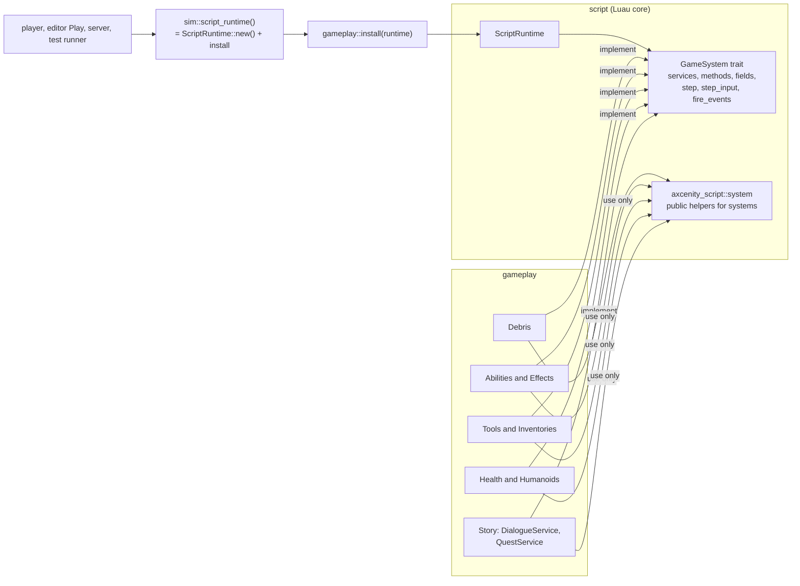

# Gameplay systems

> [!summary]
> Roadmap **L7** (PRs #68, #72, #77, #82, #85, 2026-11-11) moved gameplay systems out of `script` into the **`gameplay`** crate, so `ScriptRuntime` shrinks toward the Luau core (interpreter, sandbox, scheduler, Instances, events). Each system implements **`script::GameSystem`** (`crates/script/src/system.rs`): the services it adds, Instance methods, read-only and kept properties, a per-frame step, input and prompt hooks, event firing and network activation requests. **Implemented**: Debris, Abilities and Effects, Tools and Inventories, Health and Humanoids, and Story (dialogues and quests). **Players stays in `script`** by Paul's decision (it's part of the multiplayer core), which ends L7 ([ADR-0019](../Architecture/Architecture-Decisions/ADR-0019-Gameplay-Systems-Through-GameSystem.md)).

## Architecture

- **Every host** builds its runtime with `axcenity_sim::script_runtime()`. A bare `ScriptRuntime::new()` (script's own tests, the edit-time Console, plugins' `EditRuntime`) has no gameplay systems.
- Hosts call the systems' frame functions from the shared schedule: `gameplay::step_humanoids`, `fire_landed`, `step_tools`, `step_abilities` (frame step 1), `step_health` (step 4, server), `place_tools` (after Animators); UI reads `ability_bar`, `player_inventory`, `dialogue_view`, `quest_tracker`.
- Event order is preserved: Abilities then Health fire **first** (before the engine's Players and levels events), Tools fire after.
- **Definitions**: the luau-lsp file still describes every service; `system::DESCRIBED_SYSTEM_*` lists what systems add, and `gameplay`'s `system_tests` check them against the installed systems.

## Development guidance

- A system uses only `script`'s public API (`axcenity_script::system`, the runtime methods documented "for game systems", `LuaInstance`, `lent_world`). If it needs more, make that one thing public on purpose.
- Systems step and hook in the order `install` adds them.
- A new gameplay feature goes in `gameplay` as a `GameSystem`, not into `script`.

## Testing

`crates/gameplay/src/*_tests.rs` (Debris, abilities, health, humanoids, tools, dialogue, system lists); `net/src/ability_tests.rs`; editor dialogue tests.

## Related documentation

`docs/architecture/game-systems.md` (the full trait and what each system hooks); [Scripting](Scripting.md); [Frame schedule](Frame-Schedule.md)
