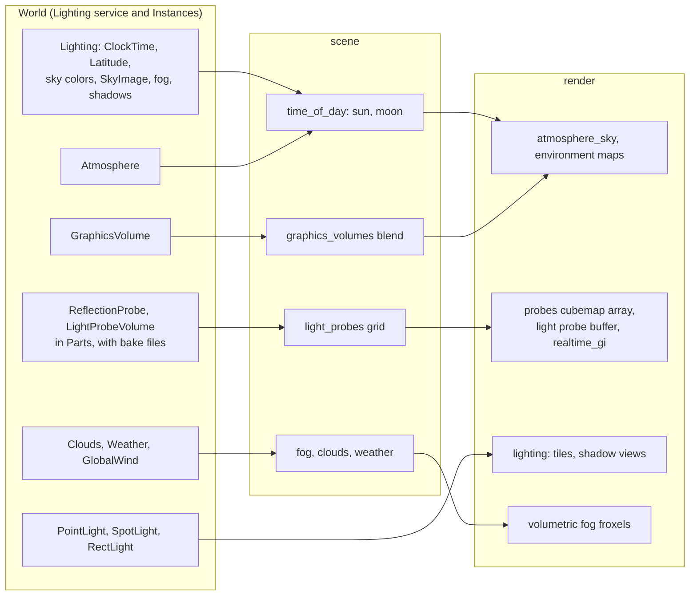

# Lighting and atmosphere

> [!summary]
> How a world is lit: the sun and moon placed by **time of day**, a gradient sky or a physically based **Atmosphere** (Hillaire 2020 scattering, worked out on the CPU) or a sky image, **environment maps** baked only when the sky changes, baked **reflection probes** and **light probe volumes** (indirect light without lightmap UVs), optional **real-time GI** that re-traces a few probes a frame, tiled **point/spot/rect lights** with optional shadows, **fog** (distance, height, volumetric froxels with sun shafts), **clouds**, **weather** and **graphics volumes** that blend a place's look around the camera. **Implemented**; real-time GI is opt-in (off at every preset).

All of it follows the "look vs cost" split ([ADR-0013](../Architecture/Architecture-Decisions/ADR-0013-Look-Versus-Cost-Settings.md)): the creator's Lighting Instances say what the world looks like; the machine's settings cap what it costs. Defaults reproduce the old fixed sun and sky exactly.

## Architecture

## Key facts per feature

| Feature | How | Cost control |
|---|---|---|
| Sun shadows | Cascades (High: three 2048² layers), texel-snapped spheres, casters 500 studs toward the sun; PCSS soft shadows (16+16 Poisson samples); fade over the last 20% | Shadow quality Off→Ultra; far cascades alternate frames past 12,000 casters |
| Spot / point shadows | Per-light maps; `near` offset so a lamp doesn't shade its own beam | Count and size by shadow quality |
| Contact shadows | Screen-space, need the prepass depth | High and Ultra |
| Environment | Sky baked into a cubemap only when it changes; GGX-filtered mips; spherical harmonics on the CPU | Reflection quality Low (analytic, no maps) → Ultra (256²) |
| Default sky | New Baseplate and Empty projects get a CC0 Poly Haven HDRI (`project/src/default_sky.rs`, 2K `.hdr`, 5.4 MB) as `SkyImage`, with `ClockTime` and latitude set to its sun | A project file like any sky; exported with the game |
| Reflection probes | Editor bakes a cubemap at a part's middle; used inside its box with `BlendDistance` | Left out at Low |
| Light probe volumes | Grid of probes in a part's box (`Spacing`, max 16 a side); diffuse indirect light | Bake fingerprint warns when stale; the editor's Light Probes overlay (R18.1) shows each probe's baked light and each volume's bake state; probes baked inside a solid are invalid and left out of the blend (R18.2); the sky's share of each probe's light is baked apart and scaled by the sky drawn now, so a dimming or tinted sky relights volumes without tracing (R18.3); Bake Probes runs about 30 ms a frame (`editor/src/app/probe_bake.rs`, one `LightProbeBaker` for every volume) with a progress window and Cancel, so a big bake no longer freezes the editor; Fill with Probes (R18.4) sizes a volume to the selection within 512 probes |
| Real-time GI | Re-traces the preset's tier of probes each frame with a kept `ProbeCamera` (R18.4 `RealtimeGiTier`: Low 1 at 8² faces, Medium 2 at 8², High 2 at 16², Ultra 4 at 16²) | `realtime_gi` setting, off by default |
| Volumetric fog | Froxel grid in compute, sun shafts | Setting |

## Integration

`scene` reads the Lighting service and its Instances into `DrawList` fields (`sky`, `sun`, `fog`, `clouds`, `weather`, `wind`, `lights`, probe data); `render` draws them. Bakes are editor actions (`editor/src/app/probes.rs`) writing files under `assets/probes`, packed into built games.

## Performance

- **Measured** (3f2fc05, 1440p Ultra forest): soft sun visibility through leaves takes 4 filtered samples instead of a second 32-sample soft shadow (0.6 ms saved). Far cascades on alternate frames when casters exceed 12,000 (they held 11.3 of 14.3 M shadow triangles).
- **Measured** (rendering baseline): shadows are the largest GPU pass in heavy scenes (43–52% before culling).
- Owner's projects note "Ultra and real-time GI are still heavy at 1440p" (project memory; see [Hardware notes](../Performance/Hardware-Notes.md)).

## Testing

`render/src/renderer/tests/environment_maps.rs`, `reflection_probes.rs`, `light_probe_volumes.rs`; `render/src/atmosphere.rs` unit tests; `scene/src/time_of_day.rs`; `player/src/time_of_day_tests.rs` (GPU). `hello-graphics` must stay within its references at every preset.

## Limitations

- Lights are tiled in 2D, not clustered; depth-heavy scenes may need clusters (`docs/rendering/lights.md`).
- Rect lights light from a representative point, not a true area integral.
- Bakes go stale when the world changes; the editor flags them but doesn't rebake automatically.
- Real-time GI draws six faces of the whole scene per probe. With hardware ray tracing (planned RT2, `docs/research/hardware-ray-tracing.md`) rays would update the same light probe volumes instead.
- Probes inside solid parts and the ground are left out since R18.2, but a wall thinner than the gap between probes can still leak (probe visibility is a later stage), Since R18.3 a sky that dims or changes color relights volumes baked since, but a sun that moves (its direct light's bounce) still needs real-time or ray traced GI, and bakes from before keep the sky as baked. R18.4 added Fill with Probes and real-time GI tiers; `bench_light_probes` measures bake, volume and tier costs (PC numbers pending). What's left of R18 (`docs/research/global-illumination.md`) is probe visibility, only if leaks remain, and RT2.

## Related documentation

`docs/rendering/sky.md`, `lights.md`, `shadows.md`, `fog.md`, `clouds.md`, `weather.md`, `wind.md`, `volumes.md`, `water.md`; [Rendering](Rendering.md)
