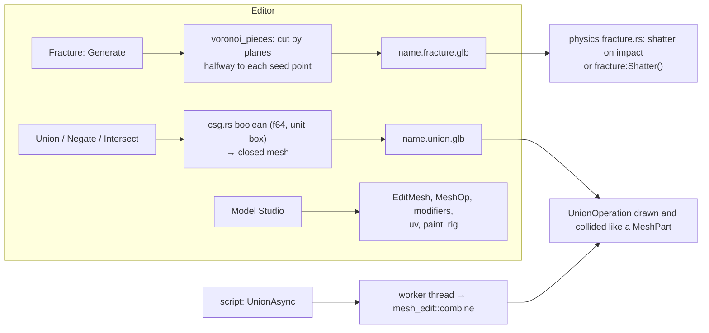

# Mesh editing and CSG

> [!summary]
> `mesh_edit` is the engine's CPU geometry library (22.7k lines): **plane cuts** that close their holes (ear clipping, flat-face refill), **Voronoi fracture** pieces, **BSP booleans** for solid modeling (Union, Negate, Intersect, Separate → `UnionOperation`), and everything the **Model Studio** edits (half-edge `EditMesh`, modeling operations, modifiers, UV unwrapping with its own LSCM solver, texture painting, sculpting with a BVH, baking onto a Make Low Poly copy, rigging and weights; Phase 90 removed sculpting, retopology and baking, and R15 brought sculpting and baking back, leaving retopology by hand to Blender). It writes `.glb`. Runtime users: `physics` (shattering Fractures' pre-generated pieces) and `script` (`UnionAsync` on a worker, default `csg` feature). **Implemented.**

## Flows

## Development guidance

- Deterministic: same mesh, count, seed and pattern give the same pieces; built-in PRNG (SplitMix64), never `rand`; never iterate a `HashMap` into output. (Ball and cylinder pieces may differ in the last bits across platforms because of `sin`/`cos`.)
- Every modeling operation keeps the mesh manifold (`check_manifold`); boolean results are closed so they combine again.
- Depends on `core` and `assets` only, never `render` or `physics`.
- Baking normals must use the tangent frames `assets::tangents` gives the saved `.glb`; Pose test skinning must match `assets::Posed`.

## Related documentation

`docs/architecture/fracture.md`, `solid-modeling.md`, `docs/editor/model-studio.md`; [Specialized editors](../Editor/Specialized-Editors.md#model-studio); [Physics](Physics.md)
