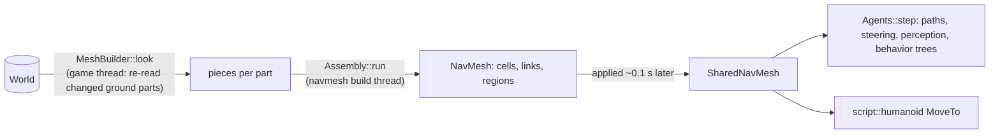

# Navigation and AI

> [!summary]
> `nav` builds **one navigation mesh per game** from the ground colliders physics would simulate (anchored parts, welded-to-anchored parts, terrain, colliding foliage), finds paths across it, steps `NavigationAgent`s with local avoidance, gives them sight and hearing of the player character, and runs `.behaviortree.json` behavior trees. The mesh is a grid of column cells (default 1 stud) with slope, headroom and step rules matching the character controllers. Agents and Humanoids' `MoveTo` share it (`SharedNavMesh`), and rebuilds are assembled on a `navmesh build` worker (M13). **Implemented.**

## Architecture

- Building **reads** the world and never writes. Unanchored parts are not ground (I7), so moving crates don't trigger rebuilds; agents walk through where they lie.
- Refresh: after 0.5 s of game time since a look that found a change, re-read changed parts; if the mesh must change, a worker assembles it while agents walk on the old one.

## Integration

Frame steps `agents.step` and `agents.sensed` (Input stage); hosts fire `PlayerSensed`. Agents write only their own body and `Destination`, `Status`, `SeesPlayer`, `HearsPlayer`.

## Dependencies

`core`, `assets`, `physics` (`part_solids`), `character` (to leave character bodies out). `physics` and `character` must never depend on `nav`.

## Performance

**Measured** (details: [Optimization log](../Performance/Optimization-Log.md)):

| Change | Result |
|---|---|
| I7 anchored ground only, incremental `MeshBuilder` (cloud, S10k) | Agents median 4.2–4.6 → 0.36–0.38 ms; worst 120–137 → 26–29 ms (test runner) |
| M13 build on a worker, one shared mesh | Agents worst 25–36 → 4.0–5.6 ms; mean 0.89–1.07 → 0.33–0.38 ms |
| Reference | A 512-stud terrain at 1-stud cells builds in about 50 ms; S10k from scratch about 110 ms (cloud) |
| What's left | The worst frame is `MeshBuilder::look` re-reading 100 turning spinners (2.9–3.9 ms); Callgrind put the navmesh refresh at 19% of S10k frame instructions (PR #59) |

## Testing

`src/tests.rs` (mesh), `shared_tests.rs` (worker, sharing), `agent_tests.rs`, `perception_tests.rs`, `behavior_tests.rs`.

## Development guidance

- Keep `part_key` (`SHAPE_PROPERTIES`) in step with `physics::part_solids`, or meshes won't rebuild after a change.
- `BEHAVIOR_NODE_KINDS` must match `blocks::behavior_tree::BEHAVIOR_NODES`.

## Related documentation

`docs/architecture/navigation.md`; [Characters](Characters.md), [Physics](Physics.md), [Blocks and graphs](Blocks-and-Graphs.md)
