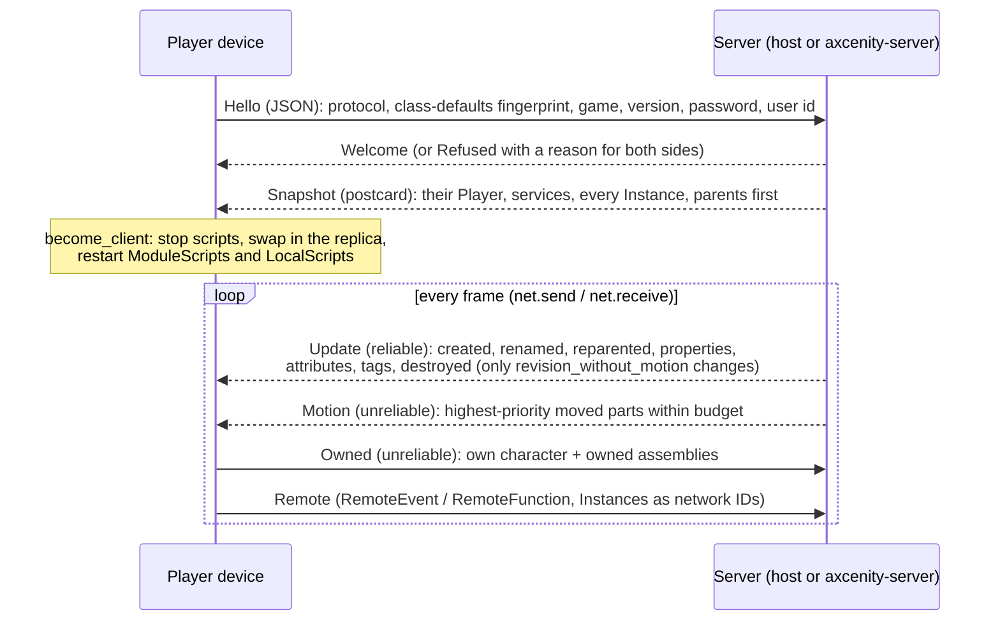

# Networking

> [!summary]
> Server-authoritative multiplayer over **renet 2** (reliable-ordered and unreliable channels) on UDP via **renet_netcode**, or an in-memory loopback with the same interface. A joined device keeps a **replica World** at the server's Instance IDs and runs only LocalScripts; the server diffs the world against what each player has and sends reliable updates in **postcard** (M7), and part **motion** quantized, prioritized and budgeted on the unreliable channel, smoothed 0.1 s behind on the device. Players move their own characters and owned assemblies with no delay; the server checks them. Single-player and editor Play are a **listen server**. **Partial**: local, LAN and a local dedicated server are the scope; netcode runs **unsecured**, and internet hosting and secure connect tokens (M11) are deferred. Server raycasts can be **lag compensated**, and any device can record **replays** and kill cams (Phase 81).

## Architecture

- **IDs**: replica Instances keep the server's IDs; device-local ones are numbered from 2³¹ (`InstanceId::is_local`). ServerScriptService and ServerStorage never leave the server.
- **Reconnecting** (multiplayer readiness MP2): a device joined over UDP that loses its connection (`SessionEvent::Lost`) keeps its world and rejoins for 60 s (1, 2, 4, then every 8 s) before `ConnectionFailed`; its Hello carries the random rejoin key the last `Welcome` gave, so a server still holding the stale connection drops it and lets the player back in even when full, with the same name. Hosts restart physics and characters when `Network::follows` changes.
- **Validation** (MP3a): per-player token buckets (`net::limits`) for bytes, remote calls, chat, console, stream requests and packets; unreadable, server-only and too-deep (over 32 tables, `MAX_TABLE_DEPTH`) messages dropped; each drop flags the player (once a second per reason), fires `Players.PlayerFlagged` and 5 flags in a minute kick (`--kick-flags`). MP3b (`net::movement`): a character's move may not pass through or end inside an anchored solid part or Terrain, nor stay off the ground higher than a jump's arc allows; owned parts may not go faster than 400 studs a second; refused moves are corrected and spend strikes (40, back at 4 a second), and a device out of strikes is flagged once a second.
- **Handshake** checks protocol (`PROTOCOL_VERSION`, 10 since M7, 12 since Phase 81, 14 since MP2's rejoin keys), class-defaults fingerprint, game name, version, password, `MaxPlayers` (8); `Hello`/`Refused` stay JSON forever so a newer engine can say why it refuses.
- **Ownership** (Phase 66): `CharacterCheck` limits how far a character may move per packet (walk/run speed + 15%, jump height, never more than 30 studs across or up, falls aside; under 1/64 stud is the wire's rounding and free); owned assemblies are held still on the server and placed where the owner says.
- **Lag compensation** (Phase 81, `script/src/lag.rs`): the host's send records a second of poses for parts that moved (`LagHistory`, by `motion_revision`) and each remote player's rewind (round trip + 0.1 s smoothing, at most 1 s). `workspace:Raycast` with `RaycastParams.CompensateFor`, or in a `LagCompensated` Tool's RemoteEvent handler before it waits, tests moving parts where the shooter saw them (`physics::raycast_rewound`); their own character stays where it is. Shape casts and overlaps aren't compensated.
- **Replays** (Phase 81, `net/src/replay.rs`): `ReplayService` queues requests; `Network::send` feeds a `Recorder` (its own `Replicator` plus exact poses of parts whose `motion_revision` moved; a snapshot keyframe every 10 s). A `.replay` is `AXREPLAY` + format version + postcard. `Playback` rebuilds from the keyframe before a moment in `empty_replica` with the game's Terrains, then applies frames, so playback is pure data and the same every time ([ADR-0010](../Architecture/Architecture-Decisions/ADR-0010-Listen-Server-Replicas-And-Network-IDs.md) replicas, no re-simulation). `BufferSeconds` + `PlayBuffer(player)` is a kill cam drawn by the player's `replay_view.rs` instead of the live world; `axcenity-player --replay` watches a file.
- **Streaming**: with `StreamingEnabled`, each player gets only their share ([World streaming](World-Streaming.md)).
- **Data layers** (R16.4): what a switched-off layer parks inside its `DataLayer` is server-only (`World::is_server_only`), so a player's device sees those parts destroyed and made again at the same IDs as the server switches the layer; the `DataLayer`s and their `Active` replicate, so `LayerChanged` fires on both sides (`docs/editor/layers.md`).

## Integration

`Network::receive` is the first frame step and `Network::send` the last ([Frame schedule](Frame-Schedule.md)). `script`'s `NetworkService` only queues `NetworkRequest`s; the host answers them. Editor Play with several clients runs extra `Session`s joined over the loopback with emulated latency, jitter and loss.

## Dependencies

`net`: `core`, `script`, `renet`, `renet_netcode`, `postcard`, `serde_json` (handshake). `server`: `assets`, `core`, `net`, `project`, `save`, `script`, `sim`; never a window, GPU or audio.

## Performance

**Measured** (M7, cloud container, S10k with 8 loopback players): snapshot 14.4 MB JSON → 1.02 MB postcard (players can now join S10k at all: the 5 MiB reliable channel dropped them); network send 45.2 → 5.06 ms; server frame 57.4 → 14.9 ms; 10,324 → 5,464 bytes per frame. 92% of the old send was `MotionSender::frame` re-reading 10,000 parts by name per player; it now re-reads a part only when its `motion_revision` moved. See [Optimization log](../Performance/Optimization-Log.md#m7-replication-wire).

## Configuration

Ports 47800 (game) and 47801 (LAN discovery). `--host [port]`, `--join addr:port`, `--password`; server `--port`, `--max-players n`, `--stats seconds`, `--bench-clients n`; `axcenity-bots <game> --join addr:port --count n` (MP1), `--churn s` and `--flood silent|junk|spam|deep` (MP2, MP3), `--cheat speed|noclip|fly` (MP3b); server `--kick-flags n` (MP3). Hosts log with `net::LOG_FILTER` (`warn,renetcode=off`; renetcode logs every unreadable packet). `AXCENITY_NET_JSON=1` makes a sending end use JSON instead of postcard, for debugging.

## Testing

`cargo nextest run -p axcenity-net` (55 tests; `lag_tests` proves a compensated shot hits a moving target an uncompensated one misses; `replay_tests` a two-minute match that replays exactly and a 5 s kill cam); `crates/server/tests/headless.rs` runs the real binary; editor `play/tests.rs` multi-client tests; LAN between two computers by hand: `cargo test -p axcenity-net -- --ignored --nocapture a_game_hosted_on_another_computer`. **Scale** (multiplayer readiness MP1): `axcenity-bots` are headless players over real UDP, one process per machine; `scripts/net-scale.py run|join|report` drives server and bots and writes a report; `crates/server/tests/bots.rs` joins 12 bots in two processes. **Operations** (MP2): `crates/server/tests/operations.rs` kills and restarts a server (bots rejoin, saves kept), churns bots (no Instance or Lua leak), and floods it with silent, junk and spamming connections; `net` `rejoin_tests`. Plan for the rest (secure connections, NAT and relay, validation, operational tests, prediction): `docs/research/multiplayer-readiness.md`.

## Limitations

- **Unsecured netcode**: no encryption or connect tokens; fine for direct-address and LAN play only ([ADR-0010](../Architecture/Architecture-Decisions/ADR-0010-Listen-Server-Replicas-And-Network-IDs.md), development policy).
- A connection that sends junk at renet's full rate costs other players some packets for the ~3 s until it's kicked; silent connections can hold the spare slots for 10 s until MP4's connect tokens.
- No relay or matchmaking. Replays don't record animation poses, sounds, particles or screen GUIs, and the timeline isn't clickable. Lag compensation covers `workspace:Raycast` only, and a part's pose between two recorded frames is interpolated linearly.
- A RemoteEvent message with no handler is dropped (Roblox queues it).

## Development guidance

- Never block: sockets are non-blocking; every wait counts in frame time.
- Raise `REPLAY_VERSION` when `Replay` changes; a replay also carries `PROTOCOL_VERSION` and is refused across protocols.
- Raise `PROTOCOL_VERSION` when a message or a class default changes (creates carry only non-default properties).
- postcard: no skipped fields or `#[serde(tag)]` in wire types.
- Nothing in ServerScriptService or ServerStorage goes to a player; a player's message belongs to the connection's Player whatever it says.

## Related documentation

`docs/architecture/networking.md`, `docs/architecture/streaming.md`; [World streaming](World-Streaming.md); [ADR-0010](../Architecture/Architecture-Decisions/ADR-0010-Listen-Server-Replicas-And-Network-IDs.md)
