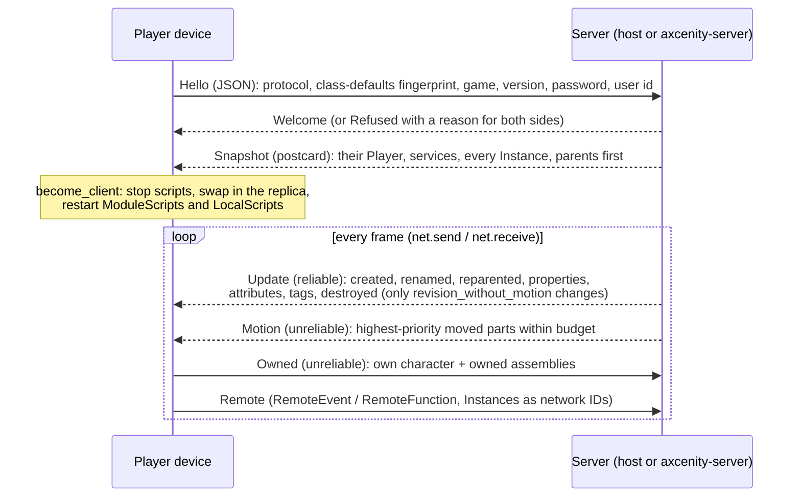

# Networking

> [!summary]
> Server-authoritative multiplayer over **renet 2** (reliable-ordered and unreliable channels) on UDP via **renet_netcode**, or an in-memory loopback with the same interface. A joined device keeps a **replica World** at the server's Instance IDs and runs only LocalScripts; the server diffs the world against what each player has and sends reliable updates in **postcard** (M7), and part **motion** quantized, prioritized and budgeted on the unreliable channel, smoothed 0.1 s behind on the device. Players move their own characters and owned assemblies with no delay; the server checks them. Single-player and editor Play are a **listen server**. **Partial**: local, LAN and a local dedicated server are the scope; netcode runs **unsecured**, and internet hosting, secure connect tokens (M11) and replays (Phase 81b) are deferred or planned. Server raycasts can be **lag compensated** (Phase 81).

## Architecture

- **IDs**: replica Instances keep the server's IDs; device-local ones are numbered from 2³¹ (`InstanceId::is_local`). ServerScriptService and ServerStorage never leave the server.
- **Handshake** checks protocol (`PROTOCOL_VERSION`, 10 since M7, 12 since Phase 81), class-defaults fingerprint, game name, version, password, `MaxPlayers` (8); `Hello`/`Refused` stay JSON forever so a newer engine can say why it refuses.
- **Ownership** (Phase 66): `CharacterCheck` limits how far a character may move per packet (walk/run speed + 15%, jump height, never more than 30 studs); owned assemblies are held still on the server and placed where the owner says.
- **Lag compensation** (Phase 81, `script/src/lag.rs`): the host's send records a second of poses for parts that moved (`LagHistory`, by `motion_revision`) and each remote player's rewind (round trip + 0.1 s smoothing, at most 1 s). `workspace:Raycast` with `RaycastParams.CompensateFor`, or in a `LagCompensated` Tool's RemoteEvent handler before it waits, tests moving parts where the shooter saw them (`physics::raycast_rewound`); their own character stays where it is. Shape casts and overlaps aren't compensated.
- **Streaming**: with `StreamingEnabled`, each player gets only their share ([World streaming](World-Streaming.md)).

## Integration

`Network::receive` is the first frame step and `Network::send` the last ([Frame schedule](Frame-Schedule.md)). `script`'s `NetworkService` only queues `NetworkRequest`s; the host answers them. Editor Play with several clients runs extra `Session`s joined over the loopback with emulated latency, jitter and loss.

## Dependencies

`net`: `core`, `script`, `renet`, `renet_netcode`, `postcard`, `serde_json` (handshake). `server`: `assets`, `core`, `net`, `project`, `save`, `script`, `sim`; never a window, GPU or audio.

## Performance

**Measured** (M7, cloud container, S10k with 8 loopback players): snapshot 14.4 MB JSON → 1.02 MB postcard (players can now join S10k at all: the 5 MiB reliable channel dropped them); network send 45.2 → 5.06 ms; server frame 57.4 → 14.9 ms; 10,324 → 5,464 bytes per frame. 92% of the old send was `MotionSender::frame` re-reading 10,000 parts by name per player; it now re-reads a part only when its `motion_revision` moved. See [Optimization log](../Performance/Optimization-Log.md#m7-replication-wire).

## Configuration

Ports 47800 (game) and 47801 (LAN discovery). `--host [port]`, `--join addr:port`, `--password`; server `--port`, `--bench-clients n`. `AXCENITY_NET_JSON=1` makes a sending end use JSON instead of postcard, for debugging.

## Testing

`cargo nextest run -p axcenity-net` (51 tests; `lag_tests` proves a compensated shot hits a moving target an uncompensated one misses); `crates/server/tests/headless.rs` runs the real binary; editor `play/tests.rs` multi-client tests; LAN between two computers by hand: `cargo test -p axcenity-net -- --ignored --nocapture a_game_hosted_on_another_computer`.

## Limitations

- **Unsecured netcode**: no encryption or connect tokens; fine for direct-address and LAN play only ([ADR-0010](../Architecture/Architecture-Decisions/ADR-0010-Listen-Server-Replicas-And-Network-IDs.md), development policy).
- No relay or matchmaking; no replays yet (Phase 81b). Lag compensation covers `workspace:Raycast` only, and a part's pose between two recorded frames is interpolated linearly.
- A RemoteEvent message with no handler is dropped (Roblox queues it).

## Development guidance

- Never block: sockets are non-blocking; every wait counts in frame time.
- Raise `PROTOCOL_VERSION` when a message or a class default changes (creates carry only non-default properties).
- postcard: no skipped fields or `#[serde(tag)]` in wire types.
- Nothing in ServerScriptService or ServerStorage goes to a player; a player's message belongs to the connection's Player whatever it says.

## Related documentation

`docs/architecture/networking.md`, `docs/architecture/streaming.md`; [World streaming](World-Streaming.md); [ADR-0010](../Architecture/Architecture-Decisions/ADR-0010-Listen-Server-Replicas-And-Network-IDs.md)
