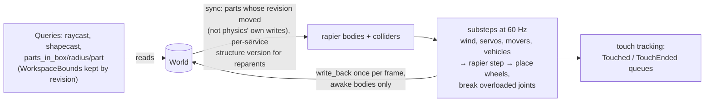

# Physics

> [!summary]
> `physics` simulates the World's unanchored parts with **rapier3d 0.36** (feature `parallel`, on physics' **own rayon pool of at most 12 threads**) at a **fixed 60 Hz** (accumulator, at most 10 steps a frame), and hosts **draw moving parts between steps** (interpolation, G3). Welded parts are one rapier body (assemblies); joints, movers, ray-cast vehicles, ragdolls, breaking joints and shattering Fractures sit on top. It finds script changes by comparing each part with what it last read or wrote, and writes poses and velocities back once per frame. Spatial queries (`raycast`, `shapecast`, `parts_in_*`) never step or write. **Implemented.**

## Architecture

- **Layers** (cohesion pass CW6.1): backend (rapier, inside the crate) → engine-facing API (`physics::api` and the crate root, `core` types only; a test keeps rapier out of `api.rs`) → simulation (`Physics::step`) → editor properties (`core` class defaults, Properties' Physics group) → Lua (`script/src/physical.rs`). No backend trait: a second backend isn't planned. Details: `docs/architecture/physics.md`, "Layers".
- **Drag** (CW6.2, `drag.rs`): per-part `LinearDrag`, `AngularDrag` (0.5 default, the old global spin slowing) and `RollingFriction` (extra spin drag only in steps with an active contact) on the assembly's root; scripts get `ApplyForce`/`ApplyTorque(…, seconds?)` and `AssemblyLinearMomentum`.
- **Bodies**: anchored → fixed collider; unanchored → dynamic body. An assembly (WeldConstraint union-find) is one body at its root part with offset colliders; it's rebuilt, not edited in place, when its parts or poses change.
- **Shapes**: built-ins; MeshParts by `CollisionFidelity` (R15.2): Default is the model's own `_COL` collision pieces when it has any (`shapes::own_pieces`), else the convex hull of their model (kept by model and size, `shapes::hull`); already-convex small models as their own triangles; UnionOperations by `CollisionFidelity`; terrain heightfields; colliding foliage.
- **Touches**: a pair with a solver contact after a step, newly, is queued; it ends after 3 steps apart. Resting contacts at the start aren't reported. Two anchored parts never touch.
- **Characters are not bodies** ([ADR-0007](../Architecture/Architecture-Decisions/ADR-0007-Fixed-Step-Physics-And-Kinematic-Characters.md)): the host holds their parts kinematic before each step.
- **Determinism**: body order is deterministic (`BTreeMap`), the step is fixed; cross-machine determinism is not a goal ([ADR-0014](../Architecture/Architecture-Decisions/ADR-0014-Determinism-Not-Required.md)).

## Execution flow

Frame steps (from [Frame schedule](Frame-Schedule.md)): `physics.hold` (network-owned bodies), `physics.kinematic` (characters and agents), `physics.shatters` (scripts' `Shatter` calls), `physics.step` → `Physics::step` = `sync` → N × `substep` → `write_back` (each a profiler span), then `touches.began`, `touches.ended`, `breaks`.

## Dependencies

`core`, `assets` (MeshPart hulls). `mesh_edit` only in tests. **Never** `character` or `nav` (they query physics).

## Performance

**Measured** (details: [Optimization log](../Performance/Optimization-Log.md)):

| Change | Result |
|---|---|
| M3 sync overhaul + `parallel` (cloud, S10k) | Physics 11.32 → 8.87 ms (test runner), 9.91 → 8.15 (server); sync 1.6–1.7 → 0.7 ms; rapier's step −17% on 4 cores |
| MeshPart hulls kept by model and size (PR #21) | Biome patch Input 30.9 → 0.006 ms (the mouse ray built hulls of 2–3 M corners every frame) |
| L4 query bounds (PR #59) | S10k Characters 2.05 → 0.31 ms: rays no longer read every part's Position and Size by name |
| Step part 1 (#84): forces reset only on pushed bodies, sorted touch merge with a per-collider owner table (`owners.rs`), `set_known_property`, motion-only re-reads, `Changed` skip for unwatched Instances | S10k test runner Physics 6.12 → 4.73 ms, Heartbeat 1.10 → 0.54, frame 8.07 → 6.09 (container) |
| Own thread pool (#86, #93) | Desktop unpinned S10k Physics 2.71 → 2.19 ms, frame 3.37 → 2.81; rayon's global pool (32 threads) oversubscribed. Steps sharing the pool take turns (fixed a deadlock) |
| Drag properties (CP6, container, 7 alternating rounds, step medians) | 1k bodies 1.18 → 1.33 ms, 5k 5.10 → 5.37, 10k 10.56 → 10.99: within this container's ±20% swing; recheck on the PC |
| What's left on S10k | Mostly rapier itself; ~0.8 µs per `World::set_property` in write-back for ~1,100 moving parts; 58% of S10k frame instructions are physics (PR #59 Callgrind) |

`parallel` costs a little in tiny scenes (`hello-vehicle` 0.05–0.07 → 0.19 ms).

## Interpolation (G3)

Above 60 fps most frames run no step. Before a frame's last step, physics remembers each awake dynamic body's pose; `Physics::blends` then lists a `Blend` for every part that moved, worked out only when a host that draws asks (`physics/src/blend.rs`, PR #110). The draw list places those parts at `Physics::blend_alpha` between the two poses (`Sim::blends`); the World itself keeps the stepped values, so scripts and replication are unaffected.

## Solver settings

rapier keeps its defaults (4 iterations, a stabilization pass): fewer made stacks fall and chains stretch (measured in `docs/benchmarks.md`, "Physics step, part 3"). A touching pair keeps its contact points until it has moved 0.1 studs (`CONTACT_RECYCLE_DISTANCE`, PR #99), which keeps short stacks standing.

## Configuration

`AXCENITY_PHYSICS_THREADS` sets the pool size (results don't depend on it). `Workspace.Gravity` (196.2 studs/s²), `Workspace.GlobalWind`, collision groups (`collision-groups.json`, max 32), `PhysicalProperties` per part, `RAGDOLL_ITERATIONS`. Debug builds with `AXCENITY_PHYSICS_VERIFY` cross-check incremental sync against a full read (`sync.rs`).

## Testing

`cargo nextest run -p axcenity-physics` (128 tests: `sync_tests.rs`, `assembly_tests.rs`, `joint_tests.rs`, `break_tests.rs`, `fracture_tests.rs`, `vehicle_tests.rs`, `query_tests.rs`, `mover_tests.rs`); player tests for vehicles, ragdolls, destruction.

## Limitations

- Setting `Position` stops a part (Roblox keeps its speed) (decided in Phase 6).
- A MeshPart whose model has no `_COL` pieces collides as its convex hull by default: hollows are filled unless it's set to `PreciseConvexDecomposition` (decomposed when first needed, slow for big models) or the model gets pieces (R15.2).
- Ragdolls can push a joint past its limit for a few frames on a hard landing.
- Lag compensation (Phase 81) not built.
- One friction coefficient (no separate static friction); acceleration isn't a property (CP6).

## Development guidance

- Preserve deterministic body order and the fixed-step accumulator. Wake bodies after external state edits. Keep touch tracking in step with collider changes.
- Queries must not step or write back.
- Keep `nav`'s `part_key` (`SHAPE_PROPERTIES`) in step with what `physics::part_solids` reads.

## Related documentation

`docs/architecture/physics.md`, `fracture.md`, `solid-modeling.md`; [Characters](Characters.md), [Navigation and AI](Navigation-and-AI.md), [Mesh editing and CSG](Mesh-Editing-and-CSG.md)
