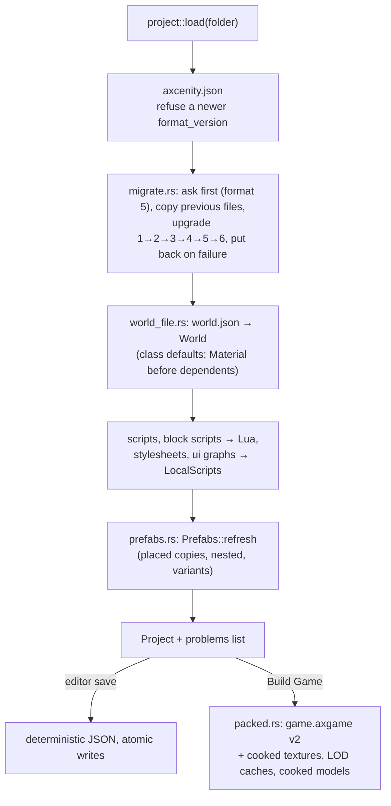

# Project and serialization

> [!summary]
> A project is a **folder of readable text files**: `axcenity.json` (manifest, `format_version` 5 since PR #129, with an `engine` block recording `created_with` and `saved_with`), `world.json` (the Workspace and services), `levels/*.world.json`, Lua scripts, block scripts, CSS, UI graphs, an input map, a string table, collision groups, and `assets/`. `project` loads and saves them deterministically, **upgrades older formats in place** after copying the previous files to `.axcenity/previous/<version>/`, keeps prefab copies in step, packs games (`.axgame` v2, zstd per entry), reads and writes asset packages (`.axpkg`), keeps version history, watches files (`notify` with a polling fallback), and checks assets without writing. One damaged file never blocks a load. **Implemented.**

## Architecture

- **Determinism**: serialization is stable so files diff cleanly; nothing may depend on hash-map order ([ADR-0016](../Architecture/Architecture-Decisions/ADR-0016-Text-Project-Format-With-Migrations.md)).
- **Scripts inside objects** (G2): a script node in `world.json`, a level or a prefab holds only its class, name and `SourceFile` (a project path, usually under `objects/`); files written that way bump world/level/prefab files to format `2`. Asset references, Asset Check, packages and Build Game know `SourceFile` (#114).
- **Branding** (cohesion pass CP8, `branding.rs`): the manifest's `branding` names the game's icon (square PNG) and banner (wide PNG or JPEG), checked from their headers only. The player's window uses the icon; Build Game writes `game.ico`, `game.icns` and `icon.png` from it (`editor/src/build_game/icons.rs`); `branding://icon` and `branding://banner` resolve in `Assets`. A bad picture falls back to Axcenity's with a note. Details: `docs/project/export.md`.
- **AutoRecover** (`recovery.rs`, editor `app/autorecover.rs`): every few minutes the editor writes unsaved work (the world, script tabs, block scripts) to `.axcenity/autorecover/`, built whole in a sibling folder with each file flushed and `recovery.json` last, then swapped in by renames, so a crash or power cut mid-write leaves the previous snapshot readable. A snapshot whose `recovery.json` nobody touched for 90 s is left behind and offered on open; `load_recovered` loads the project with the snapshot's world in place of `world.json`. Details: `docs/project/autorecover.md`.
- **Your own templates** (`user_templates.rs`, editor `app/save_template.rs`, `start/dialogs.rs`): File > Save as Template… zips the project's files (not `.axcenity/`, `.git/` or `collaborate.json`) with `axtemplate.json` into `<name>.axtemplate` in the editor's data folder; New Project's Your templates unpacks one into a new folder with the new name, refusing paths that climb out. Details: `docs/project/templates.md`.
- **Problems, not failures**: `load` fails only for a missing manifest, a newer format, or an upgrade that can't finish; everything else becomes `Project::problems` and is left out.
- **Why JSON** (decided early): every editor highlights it, a JSON Schema can later give autocomplete, non-Rust tools can read it; costs: no comments, verbose.

## Integration

All four hosts load through `project::load`. The editor adds save, version history (`versions.rs`: pins, checkpoints, restores), backups (`backup.rs`), Asset Check (`validate.rs`, `asset_fix.rs`: plans without writing; identical textures, models and sounds from `duplicates.rs`, R12), asset references, rename and merge (`asset_refs.rs`), and Build Game (`editor/src/build_game.rs` pairs `game.axgame` with a player executable per OS).

**Build profiles and reports** (R13, `build_profiles.rs`): Build Game builds with a profile (Release, Development, or the project's own in `build-profiles.json`) that sets the target, cooked-only, the zstd level, the Developer Console and whether Asset Check problems stop the build; `packed.rs::pack_game_reporting` returns what went in, and the build writes `build-report.json`/`.txt` beside the game (engine version, Git commit, settings, files by kind, largest files, problems). Release packs exactly as before. Details: `docs/project/export.md`.

## Performance

**Measured** (M9, cloud container): `.axgame` v2 compresses `world.json` about 50× (S10k 10 MB → 0.2 MB), cooked games 10–21% smaller, unpacking on up to 8 threads (hello-roads 210 → 166 ms). Opening S10k's 10 MB `world.json` took about 5.5 s in release and 30 s in debug (**Measured**, I1 baseline), nearly all in one quadratic step: each Instance looked up its prefab segment among all its siblings. Since C11 that lookup happens only inside prefab copies, and S10k loads in 0.19 s in release, 0.8 s in debug (**Measured**).

## Testing

162 tests, including example-project round trips, migrations from older fixtures, packed-game round trips and traversal refusals.

## Limitations

- There's no binary world format; reading S10k's 10 MB of JSON is about 35 ms of its 0.19 s load.
- A cooked game ships both the source texture and its cooked copy (about twice the size for texture-heavy games); see [Known bottlenecks](../Performance/Known-Bottlenecks.md).
- References name assets by path, not by asset ID.
- AutoRecover doesn't keep UI graphs, behavior trees, dialogues, data tables, materials, the string table or terrain sculpting yet; those come back as last saved.
- A Windows build's `.exe` keeps Axcenity's file icon (a PE resource), and the Linux desktop entry sets no `Icon` (only absolute paths or theme names work); both show the game's icon on the running window.

## Development guidance

- Keep serialization deterministic; report damaged files through `Project::problems`.
- Bump `FORMAT_VERSION` only with a migration that keeps a copy of the previous files; a new optional file doesn't bump it ([Change a file format](../Guides/Recipes/Change-a-File-Format.md)).
- When core properties or enums change, update parsing and writing and keep the example-project tests passing.
- `validate.rs`, `asset_fix.rs`, `asset_refs.rs` must not write the project.

## Related documentation

`docs/project-and-export.md` (map), `docs/project/layout.md`, `world.md`, `export.md`, `levels.md`, `packages.md`; [File formats](../Reference/File-Formats.md); [Asset pipeline overview](../Asset-Pipeline/Pipeline-Overview.md)
