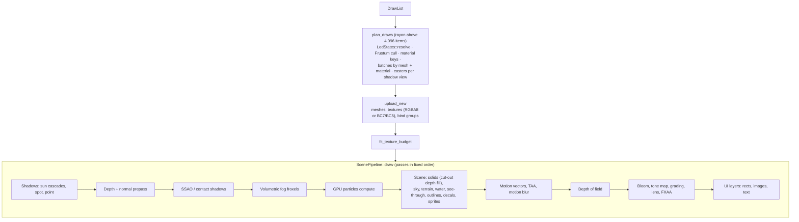

# Rendering

> [!summary]
> `render` draws a **`DrawList`** (items, materials, lights, sky, fog, decals, particles, UI, camera) with **wgpu 30** (M12, PR #104) and knows nothing about Instances ([ADR-0003](../Architecture/Architecture-Decisions/ADR-0003-Renderer-Consumes-Only-Draw-Data.md)). One private `ScenePipeline` serves both the player's `Renderer` (its own window surface) and the editor's `TextureRenderer` (a texture on eframe's device), so they draw identically. Forward PBR with a depth prepass, cascaded soft sun shadows, tiled point/spot/rect lights, LOD with cross-fades, frustum culling per view, GPU skinning, GPU particles, HDR post (bloom, tone mapping, grading, lens), TAA and motion blur. **Implemented.** No render graph ([ADR-0009](../Architecture/Architecture-Decisions/ADR-0009-No-Render-Graph-Yet.md)).

## Architecture

- **Conventions**: Y up, right-handed, sRGB colors 0–1 in the draw list (converted to linear), built-in shapes 1×1×1 at the origin (`transform = T × R × S(Size)`).
- **Materials**: base color, metalness, roughness, emissive, opacity, plus maps (normal, ORM channels, emission, opacity, specular), tiling, double-sided, shading model (Standard, Unlit, Toon), outline, translucency (leaves), water, and an optional WGSL **surface shader** (`surface_shaders.rs`, checked by naga, pipelines cached by code hash). `render::Material` is additive (`..Default::default()`).
- **Particle curves** (R17.1): an emitter's size, color and transparency curves (`NumberSequence`/`ColorSequence`) reach the draw list as one 32-entry `ParticleCurves` table that the CPU sprites and `particles.wgsl` both sample, so the two paths can't drift apart. `None` keeps the start and end blend. R17.2 adds spawn shapes (`render::SpawnShape::point`, mirrored by `spawn_point` in `particles.wgsl` from the same three randoms) and a speed table in the same `ParticleCurves`. See `docs/rendering/particles.md`.
- **Lights**: tiled on the CPU (32 px tiles, up to 64 lights per tile, 1,024 total), not clustered.
- **Settings**: the machine's `GraphicsSettings` (Low/Medium/High/Ultra plus overrides) are a ceiling on the world's Lighting requests; capabilities lower what the GPU can't do with a note ([ADR-0013](../Architecture/Architecture-Decisions/ADR-0013-Look-Versus-Cost-Settings.md)). Frame targets exist only while used.

## Source code

`crates/render/CLAUDE.md` names a file for every feature; the spine is:

| Where | What |
|---|---|
| `renderer.rs` | `Renderer`, `TextureRenderer`, `RenderStats` |
| `renderer/scene.rs` | `ScenePipeline`, `draw` (the frame), `schedule_cascades` |
| `renderer/types.rs` | GPU structs (`InstanceRaw`, `FrameUniform`, `MapsUniform`); must match `shader.wgsl` |
| `renderer/lighting.rs` | Uniforms, light tiles, shadow views, batches, `casters_in_views` |
| `renderer/culling.rs`, `lod.rs`, `parallel.rs` | Frustum culling, LOD with hysteresis and dithered cross-fade, rayon sharing |
| `renderer/gpu.rs`, `uploads.rs`, `texture_budget.rs` | Uploads (CPU mips for RGBA), background uploads, budget |
| `renderer/occlusion.rs`, `post.rs`, `temporal.rs`, `lens.rs`, `grading.rs` | Prepass and SSAO, post, TAA, depth of field, grading |
| `renderer/gpu_timer.rs` | Per-pass GPU time (`FramePass`) |
| `renderer/ray_ao.rs`, `ray_ao.wgsl` | Ray traced ambient occlusion (RT3): a half-size fragment pass blended into ambient occlusion's raw target before its blur |
| `renderer/ray_shadows.rs`, `ray_shadows.wgsl` | Ray traced sun shadows (RT1): a compute pass from the prepass into a per-pixel mask (frame binding 17) that `sun_visibility` prefers to the cascades within reach |
| `renderer/ray_tracing.rs`, `ray_hits.wgsl` | Hardware ray tracing: BLAS per mesh, TLAS of nearby items, Ray Hits view ([ADR-0025](../Architecture/Architecture-Decisions/ADR-0025-Optional-Ray-Tracing-Through-Ray-Queries.md)) |
| `*.wgsl` (24 files) | `shader.wgsl` (items), `lighting.wgsl`, `sky.wgsl`, `terrain.wgsl`, `water.wgsl`, `post.wgsl`, … |
| `crates/render-types/src/graphics.rs` | `GraphicsSettings`, `Capabilities`, `EffectiveGraphics`, `Camera` (no GPU code) |

## Execution flow

1. The host builds a `DrawList` ([Scene bridge](Scene-Bridge.md)) in the frame's `draw.scene` / `draw.ui` steps (player) or in the viewport (editor).
2. `Renderer::render` / `TextureRenderer::render` → `ScenePipeline::draw`: plan (cull, LOD, batch, shadow casters), upload what's new, fit the texture budget, record passes, submit.
3. Resources not drawn for 600 frames and 10 seconds are freed. GPU timings come back a frame or two later without the CPU waiting.

## Dependencies

`render-types`, `wgpu`, `glyphon` (text), `rayon`, `rustc-hash`, `bytemuck`, `glam`. Never `core`, Instances, scripts or winit.

## Performance

**Measured** highlights (details and machines in the [Optimization log](../Performance/Optimization-Log.md)):

| Work | Result |
|---|---|
| Frustum culling, LOD, foliage cull distance (graphics Phases 12–13) | Edge views stop drawing what's out of view; shadows were 43–52% of the GPU frame before |
| Threaded planning, per-thing work, cut-out depth fill, alternating far cascades (3f2fc05) | Painted forest at 1440p Ultra: CPU `ScenePipeline::draw` 39.6 → 9.5–10 ms; GPU 31 → 13.6–13.9 ms |
| Cooked BC7 textures (L2) | One 4096² map: first-frame upload 55–61 → 0.9–1.1 ms; GPU memory 85 → 21 MiB |
| Baseline (RX 9070 XT) | `bench_10000_parts` GPU frame 1.92 ms; 2,000 helmets 9.29 ms (154.5 M triangles before LOD) |

What's left (**Measured**, forest at Ultra): GPU-bound, 5.7 ms of shadow vertices and 7 ms of lighting at 3.7 M pixels; each shadow view copies 176-byte instances of which it reads 88 (slim shadow stream is part of L5).

## Measuring tools

Since rendering Phase 1 (PR #83): frame rate with 1% lows, CPU- or GPU-bound, per-pass and per-cascade GPU time, `OverdrawStats`, the LOD Inspector and `profile_project` (`docs/rendering/performance.md`, "Where the frame goes"). Planning runs on the renderer's own pool of at most 12 threads (PR #88).

## Configuration

`GraphicsSettings` (per machine: editor settings, player `graphics.json`; scripts via `UserGameSettings`): shadow quality and distance, post-processing, render scale (below 100% upscaled with an FSR 1-style EASU and RCAS pair, `upscale.wgsl`, or with TAA on by TAA itself at the output's size, then RCAS: G9 stage 2, `fs_taau`), texture quality and budget, anti-aliasing (Off, FXAA, MSAA 2×/4×, TAA), ambient occlusion, reflection quality, contact shadows, volumetric fog, real-time GI, decals, motion blur, the ray tracing distance, ray traced shadows and ambient occlusion. `docs/rendering/settings.md` has the preset table.

## Testing

- `cargo nextest run -p axcenity-render` (277 tests; GPU tests in the `gpu` group, at most 8 at once).
- `axcenity-player`'s `every_example_renders` compares `examples/hello-graphics` against `reference.png` per preset (fails at a mean drift of 6+ per channel).
- Benchmarks: `cargo test -p axcenity-player --release -- --ignored bench_ --nocapture --test-threads 1`; your own project with `AXCENITY_BENCH_PROJECT`.

## Limitations

- Overlapping see-through items can blend in the wrong order (sorted by center).
- AMD/Vulkan/Windows: sky clear not sRGB-encoded through an sRGB view (`docs/rendering/pipeline.md`).
- The item shader uses all 16 sampled textures and all 16 vertex attributes (wgpu defaults): a new frame texture must share or replace a binding; a new per-item value must pack into an existing attribute.
- Hardware ray tracing is an optional tier (RT0–RT5, `docs/research/hardware-ray-tracing.md`, `docs/rendering/ray-tracing.md`, [ADR-0025](../Architecture/Architecture-Decisions/ADR-0025-Optional-Ray-Tracing-Through-Ray-Queries.md)). RT0 (the device feature, the BLAS/TLAS scene, the ray tracing distance and the Ray Hits view) RT1 (ray traced sun shadows, falling back to the cascades for see-through surfaces and past the reach; cut-outs traced as solid) and RT3 (ray traced ambient occlusion, over screen-space's) are built. The device is opened with ray queries only while Settings > Graphics > Hardware ray tracing is on (off by default, after a restart): opened with them, a white square flashed in the viewport on an RX 9070 XT. Bloom ignores pixels that aren't numbers and caps what one pixel adds (`post.wgsl`'s `finite_light`), so one broken pixel can't spread into a square. wgpu has no acceleration structure refit (every moved item rebuilds the TLAS), and skinned items aren't traced. Settings > Graphics > **Use the ray traced look** (`GraphicsSettings::ray_traced`) turns it all on in one click, the viewport badge says whether it's drawing (with **Restart now**, which restarts the same editor with the session's handoff, when a restart is due), and the Learn guide `documentation/learn/ray-tracing.md` explains it; an old installed copy opened from a Desktop shortcut shares the settings but can't ray trace, so the badge stays on "restart to turn on".
- TAA's upscale (G9 stage 2) samples textures with no mip bias at lower render scales, so fine textures look as soft as the scene's size (`docs/rendering/temporal.md`).
- No indirect drawing, no GPU-driven culling (L5, now unblocked by M12), no render graph (L8 deferred). Frames acquire through `CurrentSurfaceTexture` (Lost or Outdated reconfigures, Timeout or Occluded skips the frame) since M12.

## Development guidance

- Keep `InstanceRaw`, `FrameUniform`, `MapsUniform`, vertex layouts and bindings in step with `shader.wgsl`; the shadow pipeline's instance layout gives offsets by hand.
- New feature: plain data in the `DrawList`, built by `scene`; defaults reproduce today's look; targets only while used; a setting with a capability check; tests that compare images. See [Add a render feature](../Guides/Recipes/Add-a-Render-Feature.md).
- Avoid wgpu features not on DX12, Vulkan and Metal.

## Related documentation

- `docs/rendering.md` (map to 20 topic files), `crates/render/CLAUDE.md`
- [Lighting and atmosphere](Lighting-and-Atmosphere.md), [Scene bridge](Scene-Bridge.md), [Animation](Animation.md) (GPU skinning), [Cooking](../Asset-Pipeline/Cooking.md)
