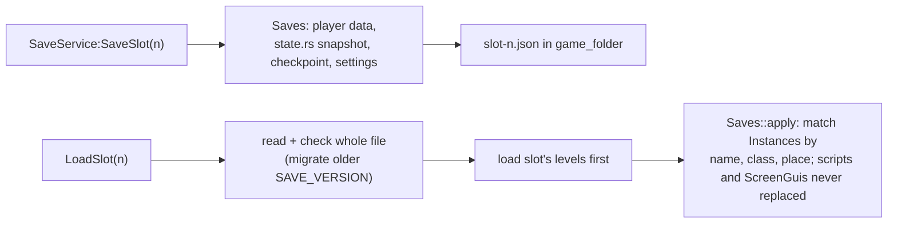

# Saves

> [!summary]
> `save` writes and reads game saves: numbered **slots** (`slot-<n>.json`) holding player data, a world-state snapshot, the active **Checkpoint** and settings; per-player data by `UserId` in multiplayer. Files live in the **player's data folder for the game** (`save::game_folder`), never the project. A load reads and checks the whole file before touching the world, and restores by matching Instances by name, class and place so scripts' references stay valid. Slot files are versioned (`SAVE_VERSION`) with migrations. Scripts use `SaveService` (`script/src/save.rs`), shared by both sides. **Implemented.**

## Flow

## Integration

Hosts call `ScriptRuntime::set_save_folder`; editor Play writes to the same folder as the built game, and Stop drops the Play world, so a save during Play never changes the edit world. `UserGameSettings` rebinds and the `UI/…` settings ride in slots.

## Development guidance

- Changing a slot file's shape: raise `SAVE_VERSION`, add a step in `migrate.rs`, keep an old slot under `src/fixtures/` that a test loads ([Change a file format](../Guides/Recipes/Change-a-File-Format.md)).
- Depends on `core` only; never reads or writes the project folder.

## Related documentation

`docs/architecture/saves.md`; [Scripting](Scripting.md); [File formats](../Reference/File-Formats.md)
