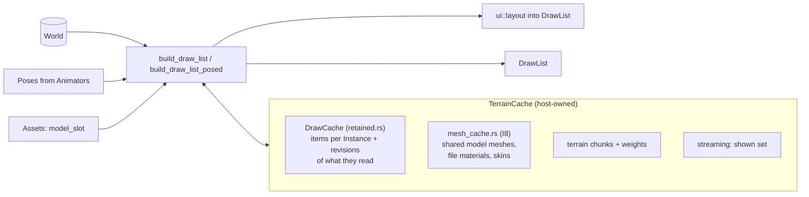

# Scene bridge

> [!summary]
> `scene` is the only place the World becomes something the renderer can draw. `build_draw_list` turns Instances, terrain, painted foliage, particles and laid-out UI into a `render::DrawList`, and keeps **each Instance's draw items between frames**, rebuilding only what changed (M4). It also owns the shared `FlyCamera`, viewport picking, streaming's camera side, the procedural surfaces for preset materials, and the Lighting-to-draw-data translations. **Implemented.**

## Architecture

### What invalidates a retained item (M4)

- The Instance's own `revision`.
- What it reads from **other** Instances (its SurfaceAppearance and light children, a Decal's part, the Inventory that equips a Tool), recorded as `dependencies` with their revisions.
- Tree moves (`World::child_order_version`): entries re-listed in tree order.
- Everything: another World (`World::identity`), changed `Assets` (`Assets::generation`), a different bloom boost.
- Still per frame: lights, probes, ProjectedDecals, joints, animated MeshParts, streaming's hidden set. Terrain, UI and particles are drawn as before.

`AXCENITY_RETAINED_DRAW_LIST=off` builds from scratch, for comparison; `scene/src/retained_tests.rs` checks over randomized worlds that retained equals from-scratch, item by item.

## Integration

- **Particle collisions** (R17.4): `scene` can't depend on `physics`, so colliding particles land on what a host's `Surfaces` closure finds: `Particles::update_against` with `physics::surface_hits` (one Workspace walk per emitter for all its paths, at most `MAX_SURFACE_RAYS` a frame). Sub-emitters are child ParticleEmitters with `EmitOn`; they keep their emitters on the CPU, as GPU particles aren't read back (`particles/collisions.rs`). A big colliding emitter moves on the GPU and lands on the depth prepass there (R17.4b), so only what the camera sees stops it.
- **Player**: the `draw.scene` and `draw.ui` steps. **Editor**: the viewport, each egui frame; Play's particles and streaming belong to the `Session` and the viewport borrows them (`Session::swap_effects`).
- `model_slot` never waits once background loading is on: a model not loaded yet draws **nothing** (M5 follow-up), then appears.
- `preload.rs` lists the asset files a world needs (`scene::asset_files`), which the player's preload and the editor's loading screen read ahead.
- Picking (`pick.rs`) must match drawn placement; MeshParts pick by their box.

## Performance

**Measured** (details in the [Optimization log](../Performance/Optimization-Log.md)):

| Change | Result |
|---|---|
| I8 shared MeshPart meshes | `bench_build_2000_mesh_parts` faster; LOD cache no longer thrown away per frame |
| M4 retained items | `bench_build_10000_parts` all still 6.4–8.0 → 1.2–1.5 ms; S10k player Draw list 12.9 → 4.3–4.4 ms (cloud container) |
| What's left | Copying every kept item each frame (~1.2 ms per 10,000 parts) |

Next step (report section 5.2, **not done**): spatial `ItemChunk`s for still, anchored parts so whole cells skip the copy, then remove the from-scratch path.

## Development guidance

- Anything a drawn item reads from another Instance **must** be added to `dependencies`, or edits to it will draw stale.
- `scene` may depend only on `core`, `assets`, `render`, `terrain` and `ui`; input and window handling belong to hosts.
- Keep the orientation convention (degrees, YXZ) shared with picking.

## Related documentation

`crates/scene/CLAUDE.md`, `docs/rendering/pipeline.md`, `docs/rendering/performance.md` (Retained draw items); [Rendering](Rendering.md), [World streaming](World-Streaming.md), [ADR-0003](../Architecture/Architecture-Decisions/ADR-0003-Renderer-Consumes-Only-Draw-Data.md)
