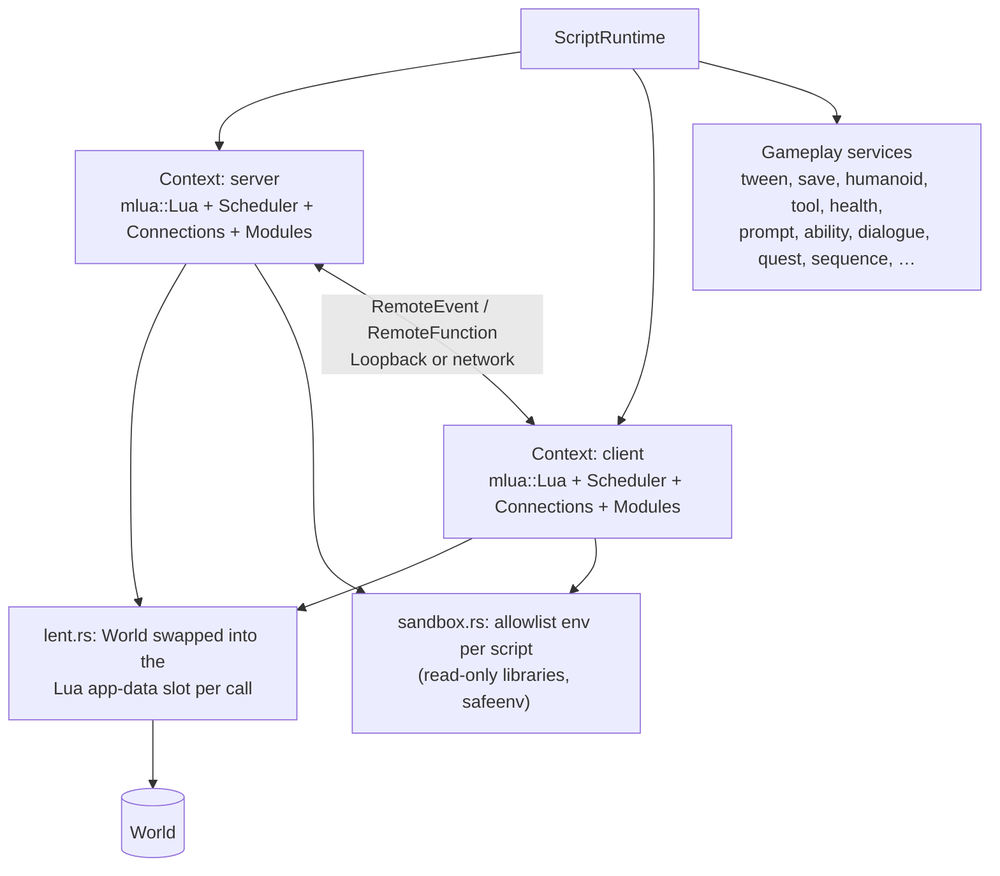

# Scripting

> [!summary]
> `script` runs **Luau** (`mlua` 0.12, `luau0-src` pinned `=0.22.0`) in a per-script allowlist sandbox, with a Roblox-familiar engine API. `ScriptRuntime` owns **two VMs**, a server side and a client side, even in single-player. Every script body and handler is a coroutine owned by a scheduler; change events are deferred; a watchdog stops a script that runs 3 s without pausing. The crate still hosts TweenService, SaveService, Prompts, Sequences, Players, chat and levels; Debris, Abilities, Tools, Health, Humanoids, dialogues and quests moved to the `gameplay` crate behind `script::GameSystem` (L7, [Gameplay systems](Gameplay-Systems.md)). **Implemented.** Native `vector` for Vector3 is **not chosen** ([ADR-0015](../Architecture/Architecture-Decisions/ADR-0015-Native-Vector-On-Hold.md)).

## Architecture

- **Two interpreters** (Phase 14): each `Context` has its own `mlua::Lua`, so the sides share no globals, libraries or string metatable. On one device both use the one `World`, lent to whichever side runs (`lent.rs`, I4). A joined device runs only LocalScripts on a replica (`become_client`); a dedicated server only Scripts (`set_dedicated`).
- **Lua Instances are IDs.** A Lua Instance is userdata holding an `InstanceId`; a per-VM weak-valued cache makes the same Instance the same userdata, so Instances work as table keys (I2).
- **The API** is written by hand in Rust (`instance.rs` property access, `tree.rs`, `collection.rs`, `types.rs` for Vector3, CFrame, Color3, UDim2, …). `definitions.rs` generates `definitions/axcenity.d.luau` for luau-lsp and the editor's API Reference from the same tables.

## Execution flow

1. **Load.** `project` reads `*.server.lua`, `*.client.lua`, `*.module.lua` and block scripts (translated to Lua at load), plus **scripts inside objects** (G2): Script, LocalScript and ModuleScript nodes anywhere in `world.json`, a level or a prefab whose `SourceFile` names a `.lua` file (usually in `objects/`), shared by every copy of the object. Hosts call `start_script` for ModuleScripts first (they only register), then Scripts, then LocalScripts. Sources compile once per thread and later copies reuse the bytecode (`chunks.rs`, M6); only source text is ever loaded, never external bytecode.
2. **Run.** Each script body runs as a coroutine in its own sandboxed environment. `task.wait`, `task.delay`, `task.defer` yield to the **scheduler**, a binary heap of (due, order) in game time (M6). `ScriptRuntime::step` resumes due coroutines in frame step 2 after delivering RemoteEvent messages (server first, then client).
3. **Events.** Handlers run immediately when an event fires, each in its own coroutine; a coroutine whose handler finished without pausing is reset and reused (M6, `handler_threads.rs`).
4. **Changes.** World changes are logged and fired by `fire_changes` before and after every entry point that runs scripts, at most 10 rounds per call ([ADR-0005](../Architecture/Architecture-Decisions/ADR-0005-Deferred-Change-Events.md)). Destroyed scripts stop and cloned scripts start there.
5. **Safety nets.** The watchdog interrupt counts in a `Cell` and checks the clock every 1,000 interrupts; past 3 s it yields the coroutine forever and reports `path:line: this script ran for 3 seconds without pausing`. Errors in one script never stop another.
6. **Debugger** (editor only): Luau's step hook pauses at breakpoints and steps (Over, Into, Out), and holds the scheduler; a failed coroutine can pause Play too, and watches run in a paused frame (`debugger.rs`, the workspace's only `unsafe`; roadmap G6).

## Dependencies

`anim` (tween easing), `assets`, `character`, `core`, `mesh_edit` (feature `csg`, `UnionAsync`), `nav` (Humanoid `MoveTo`), `physics` (raycasts, queries, mass), `procedural` (SplineMesh/Scatter generation in `step`), `render-types` (graphics settings), `save`. **Never `render` or `audio`** (the server links `script`; M8).

## Integration

- Hosts call `step`, `stepped`, `heartbeat`, `fire_touched`, `fire_touch_ended`, `fire_breaks`, `step_health`, `step_humanoids`, `step_players`, `step_prompts`, `step_tools`, `step_abilities`, `render_step`, `input_events`, `take_camera_move`, `step_camera` from [Frame schedule](Frame-Schedule.md) steps.
- Out-queues the hosts drain: `SoundAction`s (to `audio`), `NetworkRequest`s and remote messages (to `net`), shatters (to physics), level loads, test requests, chat sends, kicks.
- Blocks, node graphs, UI Event Graphs, behavior-tree and dialogue nodes all compile to Lua for this runtime ([Blocks and graphs](Blocks-and-Graphs.md)).

## Performance

All **Measured** (cloud container unless noted; details in the [Optimization log](../Performance/Optimization-Log.md)):

| Change | Result |
|---|---|
| Watchdog interrupt counts in a `Cell` (M6) | Empty Lua call 112 → 25 ns; every Luau call faster |
| Per-class method tables (M6) | `part.Position` read 512 → 397 ns (6,580 → 5,417 instructions) |
| Binary-heap scheduler, prune handlers on destroy (M6) | 10,000 waiting tasks, none due: 95,457 → 35 ns per step |
| Compiled-chunk cache (M6) | Starting 200 copies of a 31 KB script: 2.4 → 0.2 ms each |
| Handler coroutine reuse (M6) | About 1,250 fewer instructions per handler call (−18%) |
| `safeenv` + read-only libraries (L3) | Numeric code 3.1× faster interpreted, 6.2× with `--!native` |
| What's left | ~4,000 instructions per Instance property read, mostly mlua's `__index` wrapper and reference thread; a `Vector3` result allocates a userdata (L3 native `vector`, on hold) |

S10k's 200 scripts cost about 0.02 ms in Scripts and ~1.4 ms in Heartbeat; script cost on S10k shows up mostly through the writes it causes (physics, draw list).

## Configuration

- `--!native` at the top of a script compiles it with Luau's code generator (x86-64, AArch64). Not used while the debugger is on.
- `ScriptRuntime::set_watchdog_limit` (tests).

## Testing

`cargo nextest run -p axcenity-script` (393 tests: sandbox escapes in `sandbox_tests.rs`, `instance_identity_tests.rs` for I2, `luau_pin_tests.rs` for the version pin, `native_tests.rs`, `scheduler_tests.rs`, …). Micro-benchmarks: `cargo test -p axcenity-script --release --lib -- --ignored bench_member_access bench_scheduler bench_connections bench_script_start bench_handler_fire bench_native --nocapture`.

## Limitations

- No per-script memory limit; long-running C functions (a huge `string.rep`) aren't interrupted by the watchdog (`docs/scripting/sandbox.md`).
- `task.defer` runs at the next step (Roblox: later in the same frame); a message with no handler is dropped (Roblox queues it); `ContextActionResult.Pass` and touch buttons not implemented.
- `script` is still large; L7 moved the self-contained gameplay systems out ([Gameplay systems](Gameplay-Systems.md)). Hosts must build runtimes with `axcenity_sim::script_runtime()` to get them.

## Development guidance

- Build every environment from the allowlist; never expose `lua.globals()`. Release World borrows before re-entering Lua; route every resume through `scheduler::resume_as` so the debugger and script ownership work.
- New API: core declaration, Rust binding, side check in `sides.rs` if side-only, descriptions, regenerate definitions, a matching block. See [Add a script API](../Guides/Recipes/Add-a-Script-API.md).
- Raise `luau0-src` only together with `mlua`.

## Related documentation

- Topic docs: `docs/scripting.md` (map), `execution.md`, `sandbox.md`, `language.md`, `client-server.md`, `modules.md`; `docs/research/native-vector-check.md`
- [ADR-0004](../Architecture/Architecture-Decisions/ADR-0004-Luau-As-The-Only-Script-Runtime.md), [ADR-0005](../Architecture/Architecture-Decisions/ADR-0005-Deferred-Change-Events.md), [ADR-0015](../Architecture/Architecture-Decisions/ADR-0015-Native-Vector-On-Hold.md)
