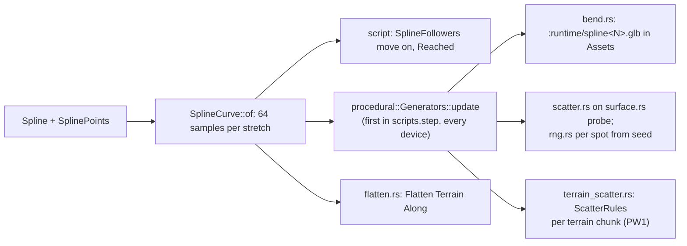

# Splines and procedural

> [!summary]
> A **Spline** is a curve of cubic Bézier stretches through its **SplinePoint** children (Auto, Linear or Free tangents), measured into an even-speed length table (`core::spline`, shared by `script`, `nav`, `anim` and `net`). **SplineFollowers** carry parts along it (server-side), NavigationAgents patrol it, Sequence cameras ride it. `procedural` makes what **SplineMeshes** (a model bent along the curve) and **SplineScatters** (models along or inside it, standing on the surface below) generate, keeps it up to date (`Generators::update`) and flattens terrain along a spline. Generated children are never saved, sent or kept in slots: every device makes them from the same settings and seed. **Implemented.**

## Flow

## Development guidance

- Deterministic: the same spline, settings and seed give the same layout; use `rng.rs`, never `rand`; never iterate a `HashMap` into output.
- Anything that saves, sends or snapshots the tree must leave generated children out (`core::spline::is_generator`).
- Terrain scatter rules (PW1) keep their results in `TerrainData`'s generated chunks, not as children; see [Terrain](Terrain.md).
- `procedural` depends on `core`, `assets`, `terrain` only, so the server and player share it.

## Related documentation

`docs/architecture/splines.md`; `examples/hello-splines`, `examples/hello-roads`; [Terrain](Terrain.md), [Networking](Networking.md); the procedural worlds plan (scatter rules, biomes, presets, roads, buildings, mesh terrain proposal): `docs/research/procedural-worlds.md`
