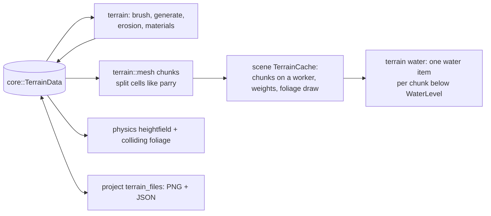
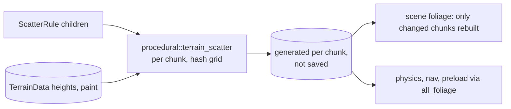

# Terrain

> [!summary]
> A `Terrain` Instance holds `TerrainData` (`core`): a height grid, paint (material layers blended by height, slope and painted weights) and **painted foliage** (scattered props or models, not Instances, visual or solid). `terrain` only computes on that data: brushes with undo records, deterministic generation and erosion, material rules, chunk meshes at several LODs, raycasts, file codecs and background jobs. `scene` meshes and draws it (chunks on a worker), `physics` collides with a heightfield, `project` reads and writes `heights.png`, paint maps and `foliage.json`. **Implemented.**

## Architecture

Since LE4 (the 2026-11-13 lighting audit) a Terrain can flood its hollows: `scene/src/terrain_water.rs` draws the renderer's water over every chunk whose lowest ground is below `WaterLevel`. It is drawn only; physics doesn't see it.

Since PW1 (procedural worlds, 2026-11-14) a Terrain can hold `ScatterRule`s that place foliage by height, slope, material layer, clumping and distance from other rules' spots. `procedural::terrain_scatter` places them per 32-sample chunk on a hash grid (one spot per `Spacing` cell from the seed and the cell's number), so chunks are made independently on every device and only those whose ground or rules changed are made again. The result lives in `TerrainData::generated_chunks` beside painted foliage; it is never saved or sent, and changing it bumps `generated_version` (which scene, physics, nav and preload keys include), not `revision`. Bake turns it into painted foliage.

Since PW2, `Biome`s inside a Terrain split it into areas, each with a ground layer and its own ScatterRules. `terrain::biomes` weighs them by height, slope and shared moisture noise with soft edges; a biome's hand paint is its ground layer's paint, so nothing new is stored. `MaterialRules` carries the biomes, laying each ground layer under the layers' own rules, and a rule inside a Biome is scaled by that biome's weight.

## Performance

**Measured** (scatter rules, cloud container, release): a 2,048-stud forest of 348,428 plants in 1,024 chunks places in 122 ms, costs 0.06 ms a frame idle, and a sculpt stroke remakes 16 chunks in 2.4 ms (`bench_forest_on_a_2048_stud_terrain`). **Measured** (rendering baseline, RX 9070 XT): a 2,048-stud terrain with 20,000 plants was CPU-bound (5,135 draw calls, `ScenePipeline::draw` 12 ms) before culling and foliage cull distances; foliage cull distances by kind (grass 120 studs, flowers 150, bushes 300, trees 800) and shadow reach (35%) followed. **Measured** (owner's biome patches): two scanned oaks are about half the triangles (project memory).

## Testing

42 tests in `terrain`; `bench_terrain_with_foliage` (player, ignored). Biomes: 6 tests in `terrain/src/biomes_tests.rs`, one in `procedural`, editor `app/terrain/biome_tests.rs` and a Terrain Studio drawing test. Scatter rules: 8 tests in `procedural/src/terrain_scatter_tests.rs`, `bench_forest_on_a_2048_stud_terrain` (ignored), scene foliage and editor `app/terrain/scatter_tests.rs`.

## Development guidance

- Generators are deterministic for a seed and `GENERATOR_VERSION`; bump the version when output changes.
- Render triangles must split cells like parry's heightfield (`mesh.rs`) so collision matches what's drawn.
- `terrain` depends only on `core`: no UI, GPU or file access.

## Related documentation

`docs/terrain.md`; [Specialized editors](../Editor/Specialized-Editors.md#terrain-studio); [Splines and procedural](Splines-and-Procedural.md) (Flatten Terrain Along); the procedural worlds plan (scatter rules, biomes, presets, roads, buildings, mesh terrain proposal): `docs/research/procedural-worlds.md`
