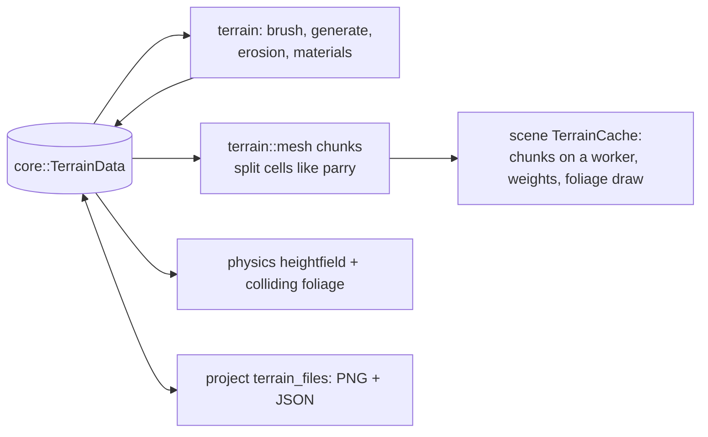

# Terrain

> [!summary]
> A `Terrain` Instance holds `TerrainData` (`core`): a height grid, paint (material layers blended by height, slope and painted weights) and **painted foliage** (scattered props or models, not Instances, visual or solid). `terrain` only computes on that data: brushes with undo records, deterministic generation and erosion, material rules, chunk meshes at several LODs, raycasts, file codecs and background jobs. `scene` meshes and draws it (chunks on a worker), `physics` collides with a heightfield, `project` reads and writes `heights.png`, paint maps and `foliage.json`. **Implemented.**

## Architecture

## Performance

**Measured** (rendering baseline, RX 9070 XT): a 2,048-stud terrain with 20,000 plants was CPU-bound (5,135 draw calls, `ScenePipeline::draw` 12 ms) before culling and foliage cull distances; foliage cull distances by kind (grass 120 studs, flowers 150, bushes 300, trees 800) and shadow reach (35%) followed. **Measured** (owner's biome patches): two scanned oaks are about half the triangles (project memory).

## Testing

42 tests in `terrain`; `bench_terrain_with_foliage` (player, ignored).

## Development guidance

- Generators are deterministic for a seed and `GENERATOR_VERSION`; bump the version when output changes.
- Render triangles must split cells like parry's heightfield (`mesh.rs`) so collision matches what's drawn.
- `terrain` depends only on `core`: no UI, GPU or file access.

## Related documentation

`docs/terrain.md`; [Specialized editors](../Editor/Specialized-Editors.md#terrain-studio); [Splines and procedural](Splines-and-Procedural.md) (Flatten Terrain Along)
