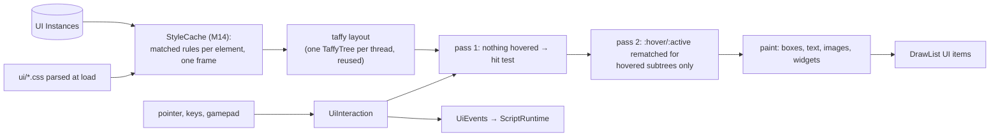

# UI

> [!summary]
> Game UI is **Instances** (`ScreenGui`, `Frame`, `TextLabel`, `TextButton`, `ImageLabel`, `TextBox`, `PageLayout`, `Table`, `ScrollingFrame`, `Slider`, `Toggle`, `Dropdown`, `ProgressBar`, `BillboardGui`) styled by **CSS** stylesheets and laid out with **taffy** (flex and absolute; `UDim2` scale plus offset). `ui` turns them into screen-space draw items in the `DrawList` (text shaped by glyphon in `render`), handles hover, press, focus (keyboard and controller via `gilrs`), scrolling, widgets, transitions, rich text, rotation, safe areas, localization and accessibility settings, and draws the built-in hotbar, prompts, ability bar, dialogue box, leaderboard and chat. **Implemented.** The editor's own UI is egui, not this.

## Execution flow

- Hosts keep one `UiInteraction`. Layout happens in the player's `draw.ui` / draw-list build and in the editor viewport; editor Play reuses the hit-test layout as `layout`'s first pass (`hit_layout`).
- Siblings lay out in tree order and draw in `z_order`; `Rotation` turns after layout; `ScrollingFrame` and `overflow` clip.

## Dependencies

`core`, `anim` (transition easing), `render` (draw types), `taffy`, `gilrs`.

## Performance

**Measured** (M14, cloud container, 500-element inventory, `bench_inventory_ui`): one layout pass 12.8–13.5 → 1.88–1.90 ms; a player frame's `UiInteraction::layout` 27.3–28.2 → 3.58–3.66 ms; editor Play 53.4–55.8 → 3.60–3.69 ms. The cascade had been 88% of the frame; editor Play laid UI out four times. What's left: painting (CSS values resolved from strings each read), taffy, transitions. Nothing is kept between frames; a retained layout is the next step if a game needs it.

## Testing

106 tests; `cargo test -p axcenity-ui --release --test bench_inventory_ui -- --ignored --nocapture` for the benchmark; `examples/hello-css`, `hello-ui`, `hello-rich-text`, `hello-accessibility` render in `every_example_renders`.

## Development guidance

- Resolve styles through `resolve_styles` / `shared_styles` with the pass's `PseudoClasses`; never walk ancestors yourself.
- Keep `render` free of Instances: `ui` produces draw data.

## Related documentation

`docs/ui.md`, `docs/scripting/ui-graphs.md`; [Blocks and graphs](Blocks-and-Graphs.md); [Specialized editors](../Editor/Specialized-Editors.md#ui-designer)
