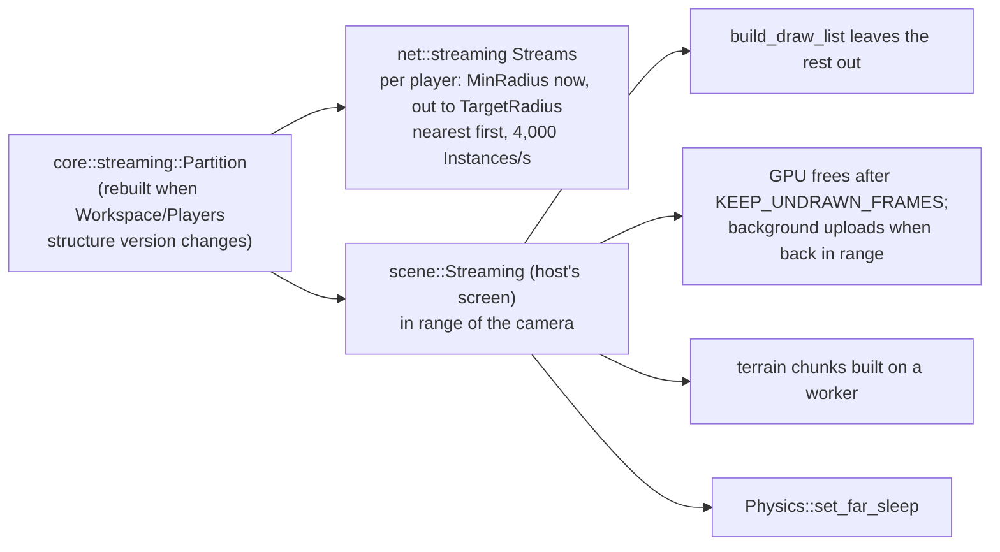

# World streaming

> [!summary]
> Phase 80: on a world too big to keep whole, each device has only what's near it. **Off by default** (`Workspace.StreamingEnabled`); with it off nothing here runs and projects play exactly as before. `core::streaming::Partition` splits the Workspace into **units** that load together (a loose part, a Model without nested Models, an `Atomic` Model); the server sends each joined player their share; a host's own screen leaves out of range content, frees its GPU copies, builds terrain chunks on a thread and lets far physics sleep. **Partial**: built and tested, one plan criterion still open, not on by default.

## Architecture

## Settings

`StreamingMinRadius` (64), `StreamingTargetRadius` (1024), unload 25% past the target; `Model.ModelStreamingMode` `Default`/`Atomic`/`Persistent`. Characters, LocalScript holders and Persistent Models always stay.

## Performance

**Measured** (`bench_50000_parts_streaming`, RX 9070 XT, release): 50,000 parts over 4 km: 6.2 ms physics, 0.7 ms streaming, against a 16.7 ms budget (`docs/architecture/streaming.md`).

## Limitations

- A flat Model with thousands of loose parts is one unit; big maps must be nested in Models or Folders to stream.
- A texture draws white until its background upload finishes.
- Editing always shows everything; Play streams around the camera.

## Related documentation

`docs/architecture/streaming.md`; [Networking](Networking.md), [Scene bridge](Scene-Bridge.md); `examples/hello-streaming`
