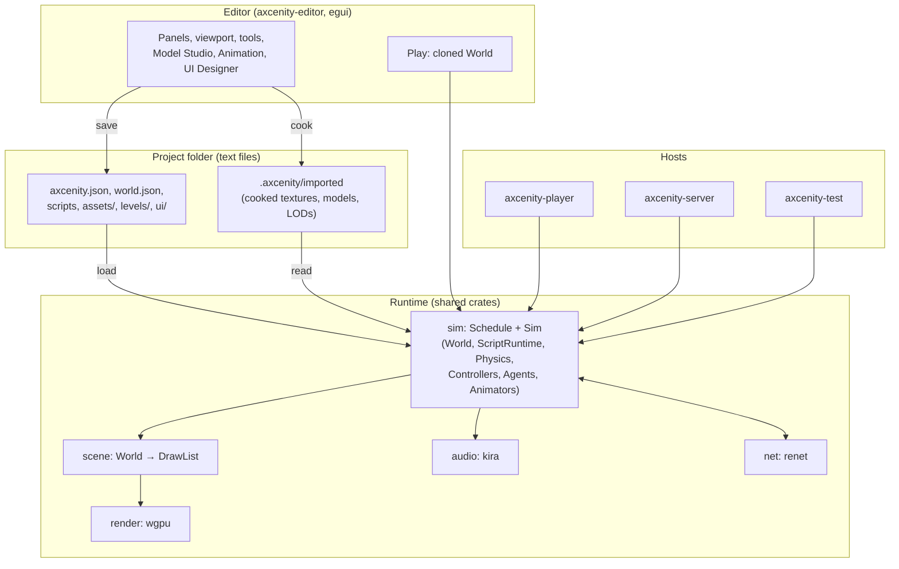

# Engine overview

Axcenity is a 3D game engine and editor written in Rust, with games scripted in Luau through a Roblox-familiar API (Instances, `workspace`, `Touched:Connect`, `task.wait`) under Axcenity's own names. Creators build in the editor and ship a small player program with a packed game file. A headless server and a test runner run the same game code.

## In one picture

## The shape, in seven facts

1. **One tree of Instances** (`core`), stored in a generational arena and referenced by IDs, not pointers. Everything in a game is an Instance with a class, a name, typed properties, attributes, tags and events. There is no ECS. [Core and data model](../Engine-Systems/Core-and-Data-Model.md)
2. **One frame order for every host.** The player, editor Play, the dedicated server and the test runner run the same table of steps (`crates/sim/src/steps.rs`), each skipping what it doesn't have. [Frame schedule](../Engine-Systems/Frame-Schedule.md)
3. **One scripting runtime.** Luau scripts, block scripts, node graphs, UI Event Graphs and behavior-tree nodes all become Lua and run in `ScriptRuntime`, two VMs per game (server side and client side). [Scripting](../Engine-Systems/Scripting.md)
4. **The renderer sees only draw data.** `scene` turns the World into a `DrawList`; `render` draws it with wgpu and never sees an Instance. [Rendering](../Engine-Systems/Rendering.md)
5. **Everything is local and text-first.** Projects are folders of deterministic JSON, Lua and CSS that diff cleanly. Cooked data lives in a per-machine `.axcenity/` folder that is never shipped as source. [Project and serialization](../Engine-Systems/Project-and-Serialization.md)
6. **The editor is a game host too.** Play runs the game in-process on a deep copy of the edit world, with crashes caught at the Play boundary. [Editor architecture](../Editor/Editor-Architecture.md)
7. **Desktop first, verified locally.** Windows and Linux are primary; GitHub Actions runs only for release tags, and every significant change carries local tests ([ADR-0011](../Architecture/Architecture-Decisions/ADR-0011-Desktop-First-Local-Verification.md), [ADR-0018](../Architecture/Architecture-Decisions/ADR-0018-Actions-For-Release-Tags-Only.md)).

## What state the engine is in (2026-11-11)

- **Feature-complete through plan Phase 80** of the unified roadmap (characters, animation, UI, navigation, saves, physics, gameplay kit, levels, Model Studio, networking, splines, decals, abilities, dialogue, world streaming) and the graphics plan's 38 phases (86 of 87 acceptance criteria ticked). Some phases keep hand checks open; `plans/axcenity-engine-unified.md` lists them under "Open checks".
- **Modernization roadmap**: I1–I11 done; M1–M9, M13, M14 done; L2 and L7 done; L3 and L4 first parts done; L1 measured and parked; M10, M11 deferred by policy; M12 in progress; L5, L6, L8 open. The gap analysis's G1–G3 (Toolbox, scripts inside objects, physics interpolation) are done. [Current roadmap](../Roadmap/Current-Roadmap.md)
- **Not built**: lag compensation and replays (Phase 81), mobile (Phases 82–88, deferred), the "trim and tighten" milestone (Phases 89–93).

## Where to go next

| You want to… | Read |
|---|---|
| Understand the layers and rules | [Architecture overview](../Architecture/Architecture-Overview.md) |
| Build, run and test | [Build and run](Build-and-Run.md) |
| Change a system | Its page under [Engine systems](../Home.md#engine-systems), then the ADRs it lists |
| Make something faster | [Performance overview](../Performance/Performance-Overview.md), then [Optimize safely](../Guides/Optimize-Safely.md) |
