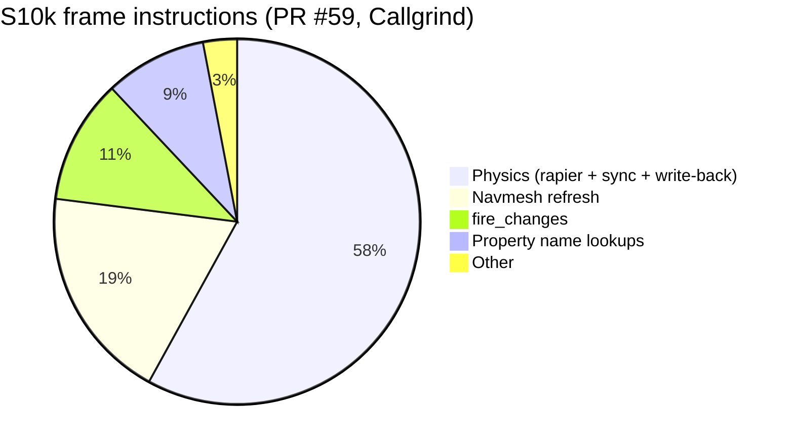

# Performance overview

Where frame time goes today, what has been done about it, and what's open. Everything here is **Measured** unless marked.

## The shape of a frame (S10k, Desktop)

After the 2026-11-09/10 roadmap work (`39dd258` baselines): the test runner and server spend about 3.7 ms a frame on S10k, editor Play 3.2 ms, the player 7.0 ms including drawing. Before (`300bbb5`): 10.0, 5.4, 8.7 and 21.5 ms.

Where S10k's simulation instructions go now (Callgrind, Container, PR #59): **physics 58%**, navmesh refresh 19%, `fire_changes` 11%, property name lookups ~9%.

## By subsystem

| Subsystem | Status | Main levers already pulled | What's left |
|---|---|---|---|
| Physics | Biggest simulation cost | M3 sync overhaul, rapier `parallel`, kept hulls, query bounds | rapier itself; `set_property` in write-back for moving parts |
| Navigation | Small median, occasional spikes | I7 anchored ground, M13 worker | `MeshBuilder::look` on the game thread when anchored parts move (2.9–3.9 ms) |
| Scripting | Cheap at S10k's load | M6, I4, L3 `safeenv`/native | mlua `__index` wrapper; Vector3 allocates a userdata per result (L3 native `vector` on hold) |
| Change events | 11% of S10k | — | `fire_changes` cost with many physics writes |
| Draw list (`scene`) | Was the player's largest step | I8, M4 retained items | Copying kept items (~1.2 ms per 10k parts); spatial chunks next |
| Renderer CPU | Threaded above 4,096 items | Culling, LOD, threaded planning, per-thing work | Shadow views copy 176-byte instances (88 needed) |
| Renderer GPU | Heavy at Ultra in dense foliage | Cut-out depth fill, alternating cascades, LOD, cull distances | Shadow vertices and lighting fill at 1440p Ultra; L5 GPU-driven path |
| UI | Fine after M14 | Style cache | No retained layout |
| Networking | Fine after M7 | postcard, motion revisions | — |
| Startup | Mostly solved by L2 | I11 preload, M5, L2, #65 | Terrain layer maps decoded on the main thread (~1.2 s on Farmhouse) |
| Loading `world.json` | Slow for huge worlds | — | S10k's 10 MB world takes ~5.5 s in release |

## Principles

- **Measure first**, in release, pinned, alternating ([Benchmarking](Benchmarking.md)). The policy says a guess doesn't justify an optimization.
- **Prefer fixing a scan to parallelizing it** (L4's lesson: Characters 2.05 → 0.31 ms by keeping bounds, not threads).
- **Simpler wins until a measurement says otherwise** (policy rule 2). L1 was measured and parked for that reason.
- **Keep output order fixed** when work is shared across threads ([Threading model](../Architecture/Threading-Model.md)).

## Pages

[Benchmarking](Benchmarking.md) · [Profiling](Profiling.md) · [Optimization log](Optimization-Log.md) · [Benchmark history](Benchmark-History.md) · [Known bottlenecks](Known-Bottlenecks.md) · [Hardware notes](Hardware-Notes.md) · [Optimize safely](../Guides/Optimize-Safely.md)
