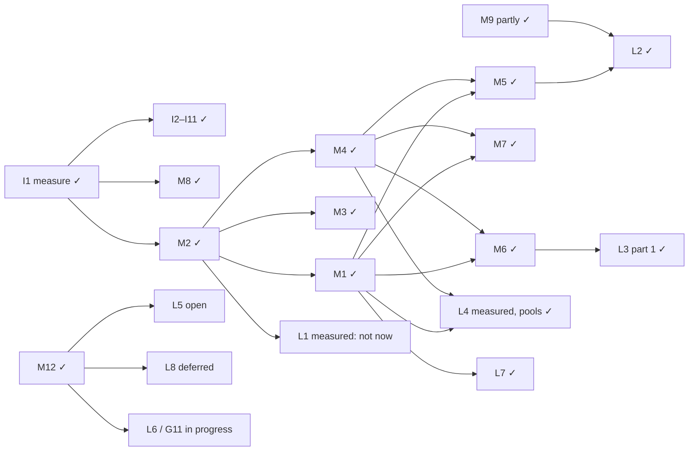

# Current roadmap

What's done, open, deferred and planned, as of `36bcf356` (2026-11-11). Sources of truth: the modernization report's section 6 (I/M/L items), the engine gap analysis's section 4 (G items, PR #89), `plans/axcenity-engine-unified.md` (Phases 1–93), `plans/axcenity-engine-graphics.md` (Phases 1–38), and the usability, design-system and release-system research. **Planned** means not built; never describe it as existing.

## Engine modernization (report of 2026-11-10)

| Item | What | Status | PR / evidence |
|---|---|---|---|
| I1–I11 | Measure first; Instance table keys; pins; cheap `with_world`; navmesh; shared meshes; `descendants_iter`; watcher; preload | **Done** | #4–#12 |
| M1 | Shared frame schedule (`sim`) | **Done** | #15, #16, #20, #24 |
| M2 | Class and tag index | **Done** | #17 |
| M3 | Physics sync overhaul + rapier `parallel` | **Done**; physics step part 1 and own pool followed | #25, #84, #86, #93 |
| M4 | Retained draw items | **Done**; next: spatial `ItemChunk`s | #23 |
| M5 | Assets off the lock | **Done** | #18, #19 |
| M6 | Script hot paths | **Done** | #22, #26, #27, #29 |
| M7 | postcard wire, motion revisions | **Done** | #34 |
| M8 | Server without GPU or audio | **Done** | #13 |
| M9 | `.axgame` zstd, times, threaded unpack | **Partly done** (read-in-place and cooked-only are G12) | #61 |
| M10 | CI half | **Deferred** (Actions runs for release tags only, CI by hand; [ADR-0018](../Architecture/Architecture-Decisions/ADR-0018-Actions-For-Release-Tags-Only.md)) | policy |
| M11 | renet secure mode | **Deferred** with internet hosting | policy |
| M12 | wgpu 30, egui 0.36, egui_dock 0.21, glyphon 0.12 | **Done** | #104 |
| M13 | Navmesh worker, shared mesh | **Done** | #32 |
| M14 | UI layout cache | **Done** | #37 |
| L1 | Per-class property slots | **Measured: not now** (name lookups ~9% of S10k; a Part ~3.3 KB; `World::clone` of 10k Parts 11.5 ms). Revisit above ~20% of a frame | #59, #87 |
| L2 | Import pipeline | **Done**, including embedded images (#65) and **references by asset ID** (#78) | #45–#57, #65, #78 |
| L3 | Faster Vector3, opt-in native code | **Part 1 done**; native `vector` **on hold** ([ADR-0015](../Architecture/Architecture-Decisions/ADR-0015-Native-Vector-On-Hold.md)) | #58 |
| L4 | Parallel read / serial write | Query bounds instead of threads (#59); 16-core measurement gave physics and rendering **own pools of ≤12 threads** (#86, #88). Stage-level parallelism still open | #59, #86, #88 |
| L5 | GPU-driven path | **Open**, after M12; the gap analysis puts it in "future, with triggers" | — |
| L6 | Split `editor` (now G11) | **In progress**: `editor-kit`, `editor-toolbox`, `editor-benchmark`, `editor-tools`, `editor-model-studio`, `editor-node-graph`, `editor-ui-designer` | G11 PRs |
| L7 | `gameplay` crate behind `GameSystem` | **Done** (Debris, Abilities, Tools, Health and Humanoids, dialogues and quests); Players stays in `script` ([ADR-0019](../Architecture/Architecture-Decisions/ADR-0019-Gameplay-Systems-Through-GameSystem.md)) | #68, #72, #77, #82, #85 |
| L8 | Render graph | **Deferred** ([ADR-0009](../Architecture/Architecture-Decisions/ADR-0009-No-Render-Graph-Yet.md)) | — |

## Next-stage roadmap (gap analysis of 2026-11, PR #89)

Built after comparing Axcenity with Unity, Unreal, Roblox Studio, Godot and s&box (`docs/research/engine-comparison.md`) and timing XB10k across engines.

| Item | What | Status |
|---|---|---|
| G1 | Toolbox: one provider layer for asset discovery | **Done** ([Toolbox](../Editor/Toolbox.md); #90, #92, #96, #107) |
| G2 | Scripts inside objects (`SourceFile` references, `objects/` folder) | **Done** (#91 design, #111, #114, #115, #117 on players' devices, in levels and characters, #120) |
| G3 | Physics render interpolation | **Done** (#110) |
| G4 | Script completion and diagnostics in the editor | Stage 1 (completion and signature hints) and stage 2 (luau-lsp errors and lints in code tabs) in review |
| G5 | UI prefabs (ScreenGuis and elements with their scripts) | **Done** (#122) |
| G6 | Debugger stepping and watches | Planned |
| G7 | Memory breakdown (Profiler Memory tab and F9 Stats) | **Done** (#125, #126) |
| G8 | `RollOffMode` curves and audio occlusion | **Done** (#128) |
| G9 | Upscaling (FSR 1-class) | Stage 1 done (#155; EASU + RCAS below 100% render scale, about 0.13 to 0.25 ms on an RX 9070 XT); stage 2 (upscale inside TAA) not started |
| G10 | Plugin API additions | Planned, as needed |
| G11 | Split the editor (L6) | In progress: `editor-kit` (#162), the Toolbox tab in `editor-toolbox` (#164), Graphics Benchmark in `editor-benchmark` (#166), the viewport tools in `editor-tools` and the Model Studio in `editor-model-studio` (#189; editor rebuild after an edit 35.5 → 32.5 s in the cloud), the node-graph editor in `editor-node-graph` and the UI Designer in `editor-ui-designer` (editor rebuild after an edit 30.7 s) |
| G12 | Cooked-only games, read the pack in place | Planned |
| G13 | 16–32 client LAN test | Planned, when the PC is free |
| G14–G16 | Run without a player; physics debug views; humanoid retargeting | Planned |
| TC1–TC8 | Team Create (live collaboration; brief of 2026-11-11 §8): design approved ([ADR-0020](../Architecture/Architecture-Decisions/ADR-0020-Team-Create-Session-Authority-And-Operations.md), #134); TC1 sync core in `collab` (#140); TC2 editor sync (edit journal, capture, two-editor tests, #150); TC3 network and identity (device keys, invites, TLS WebSocket, `--team-host`/`--team-join`, #154); TC4 interface (roster and presence #156, panel, title bar chip, others' selections #160); TC5 files (content-addressed saves with compare-and-swap, document locks, members' mirror folders, conflict copies; sync core #168, editor #169, every document tab and start-screen Join #170); TC6 reliability (host journal and crash recovery, size and rate limits #175; host epochs, members' recovery files, Recovered Changes, read-only when the host leaves, camera follow, Settings > Team Create, #180); TC7 the self-hosted `axcenity-collab` server (persistence, crash recovery, admin command line); tested on two machines over a LAN with a 5-minute cut, both ending identical (2026-11-12, results in `docs/research/team-create.md` §12; PR #195) | Done except TC8, which C12 replaces |
| C1–C12 | Collaborate (Team Create renamed; Paul's brief of 2026-11-12): audit and plan in `docs/research/collaborate.md`, [ADR-0021](../Architecture/Architecture-Decisions/ADR-0021-Collaborate-Tailscale-Live-Scripts-And-Identity-Seam.md); C1–C6 merged (audit, protocol and rename, Tailscale, setup wizard, recovery, scene presence; two-machine tests passed), C7 live scripts (`yrs`) merged; C8 chat and cursors merged; C9 host checkpoints and restores merged; C10 permissions and hardening built (identity seam, budgets per message kind, audit log, security review); next C11 performance, C12 Django account integration (document only) | In progress |
| P0–P7 | Collaborate 2.0 (Paul's brief of 2026-11-12, persistent collaboration and automatic host handoff): design in `docs/research/collaborate-persistent.md`, [ADR-0022](../Architecture/Architecture-Decisions/ADR-0022-Persistent-Collaborate-Projects-Git-Sync-And-Host-Handoff.md); P0 design done (#208); P1 repository integration (#209), P2 automatic sync and checkpoints (#212) P3 persistent projects (#213), P4 host election and handoff (#214), P5 conflicts and recovery (#217) and P6 interface built; next P7 integration tests and the guide | In progress |
| Priority 4 | GPU-driven drawing, occlusion culling, dynamic GI, ray tracing, AI assistant in the editor, Parallel Luau, … | Future, each with a trigger in the gap analysis |

## Feature plan (unified plan, Phases 1–93)

| Range | Status |
|---|---|
| Phases 1–80 | **Built**; six hand checks need the developer's PC, Mac or two computers, and Phase 80's 4 × 4 km benchmark scene isn't built yet (the plan's "Audit of 2026-11-12") |
| Phase 81: lag compensation and replays | **Planned**, after Phase 93 |
| Phases 82–88: Android and iOS | **Deferred** by policy; every criterion marked so |
| Phases 89–93: trim and tighten (engine hot-patching out and scripts hot reload with their state kept, like s&box (changed 2026-11-12); narrower Model Studio, one graph canvas, legacy paths, a multithreaded frame) | **Planned**, in that order (thread "Finish unchecked items in unified plan", 2026-11-12). Phase 93 is about half done already: parallel physics (M3), the renderer's planning pool, the nav worker (M13). Phase 92 bumps the format to 6, since 5 is the release system's engine record |

Graphics plan: Phases 1–38 built.

## Editor usability and design system

| Work | Status |
|---|---|
| Usability items U1–U20 | **Done** (#31–#56) |
| Design system V1–V26 in six phases | Phases 1–5 **done** (#66 tokens; #71 feedback: errors stay until seen, one way to open and close windows; #73 scale: Explorer and Console draw only what's visible; #74 editing: Properties edits every selected item, Explorer arrow keys; #79 shortcut table, layout presets, Increase contrast); Phase 6 (optional polish) **planned** |
| Universal search (Ctrl+K) with indexed providers | **Done** (#76) |

## Tooling for AI clients and releases

| Work | Status |
|---|---|
| MCP toolkit: `axcenity-editor --mcp` | **Done** ([MCP server](../Editor/MCP-Server.md); #97 design, #102–#109, #116, #119, #123, #127, #130 incl. `--mcp --check` and a user guide) |
| Release system: one version source, release history, tag-only signed draft releases, Version Explorer and update checks, the updater, project format 5 | Phases 3–7 **done** ([Release process](../Development/Release-Process.md); #98, #105, #113, #118, #124, #129). Next release `0.2.0-alpha.1` |

## Deferred by policy (revisit points)

| Capability | Revisit when |
|---|---|
| CI on pushes and pull requests | Architecture and core systems are stable |
| Cross-machine determinism | Lockstep or deterministic replay is actually planned |
| Mobile and web | The desktop engine is reliable |
| Internet-hosted servers, secure netcode (M11) | Local multiplayer and server/client fundamentals are mature |
| Native `vector` as Vector3's representation | Its type-identity and interop checks pass |
