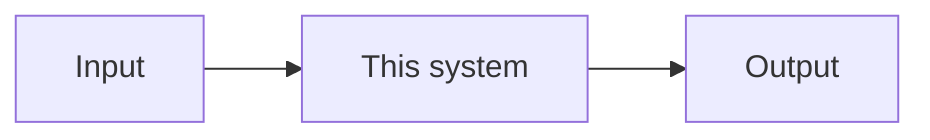

# {{title}}

> [!summary] In one paragraph
> What the system does, why it exists, and its state (Implemented, Partial, Experimental, Planned, Deferred, Deprecated).

## Overview

## Architecture

## Source code

| Where | What |
|---|---|
| `crates/<crate>/src/lib.rs` | |

## Execution flow

## Dependencies

May depend on: … Must never depend on: … (from `docs/architecture/crates.md`).

## Integration

Who calls it, in which frame step, through which API.

## Performance

Mark every figure: **Measured** (with the machine and link), **Expected**, **Theoretical** or **Unverified**.

## Configuration

## Testing

| Test or command | What it proves |
|---|---|

## Limitations

## Development guidance

## Related documentation

- Topic docs: `docs/…`
- Crate rules: `crates/<crate>/CLAUDE.md`
- Decisions: [ADR-…](../Architecture/Architecture-Decisions/…)
